# Anti-cheat

**New here?** Start with [Add anti-cheat to your game in 5 minutes](anticheat_quickstart.md): presets, a checklist and no hand-written files.

OkaySpace's anti-cheat runs on the **server** and is **opt-in**. With it off,
nothing is checked and nothing is sent differently from before.

- **P1 (authority):** the server refuses what a client may not do.
  - moving or despawning another player's networked object;
  - spawning a prefab that isn't on the game's list;
  - writing another object's SyncVars, or flooding SyncVars;
  - moving a NetworkSync object faster than `maxSyncSpeed`.
  - moving, or writing the variables of, a scene object nobody owns (a door,
    a pickup): it's the server's. Tick **Players can claim it** on its
    Network Sync (`clientClaimable`) for one any player may grab, like a
    ball: the first to move it owns it. The server can hand any object to a
    player with `anticheat.SetOwner(netId, peer)`. Writing one that merely
    isn't claimable is still refused and named once in the log. It does not
    count toward the kick, so an older scene with a shared ball doesn't kick
    the players pushing it.

  Every other refusal is reported; repeat offenders are kicked. A kicked account
  can't join again for a minute, doubling with each repeat up to an hour, and
  neither can anonymous players from its address (other signed-in players
  there still can). A player who leaves or is kicked keeps its refusal count and its
  Net Validator budgets and cooldowns for five minutes (by account, else by
  address), so reconnecting resets nothing.
- **P2 (identity and transport):** clients must encrypt, every packet is
  numbered and replays are refused, and a joining player can be required to
  hold a **session ticket** signed by your ticket service.
- **Detection engine (opt-in, server side):** behavioural detectors for movement,
  combat, economy and the network feed a per-player risk score with graduated
  responses and exportable evidence. See
  [Detection engine](#detection-engine-opt-in-server-side) below.
- **P3 (client integrity, opt-in):** a signed manifest of the shipped files,
  checked by the launcher and player before a game starts, plus Windows
  debugger / loaded-module / clock-drift checks. See
  [P3: client integrity](#p3-client-integrity-opt-in) below.

## Turning it on

The quick way: on the Network Manager, pick a preset and press **Add Anti-Cheat** (or Add Component > *Anti-Cheat (one click, safe preset)*), then
work through the **Anti-cheat checklist** in the Anti-Cheat Config or in Build Settings. See [anticheat_quickstart.md](anticheat_quickstart.md).
The presets are in `editor/AntiCheatSetup.hpp`.

By hand: add an **Anti-Cheat Config** component to the scene (with a Network Manager), or
set `NetworkManager::anticheat.settings` in code. Its rules can also come from a
`.okayac` file (one `key value` per line, `#` comments):

```
enabled true
spawn prefabs/crate.okayprefab      # repeat for each prefab clients may spawn
maxSyncSpeed 8                      # u/s; 0 = no check
maxSyncVarsPerSecond 30             # 0 = unlimited
kickAfterViolations 5               # refusals within a minute; 0 = never kick
ownerOnlySyncVars true              # "<netId>.<name>" keys are the owner's
detect.enabled true                 # the detection engine (see "Detection engine" below); off without it
# P2
requireEncryption true              # only encrypted clients; numbered packets
ticketKey <base64url ed25519 public key>
ticketAudience arena-1              # this server's id in tickets (required with a ticketKey)
ticketAnyAudience false             # also accept tickets for any server (aud "*")
# Network hardening
maxClockDrift 0.05                  # a client's game clock may run 5% off; 0 = no check
# Gameplay
serverVar score                     # SyncVar key prefixes only the server may write (repeatable)
clientVar player.                   # if any is set, the only SyncVar key prefixes clients may write (repeatable)
maxSpawnsPerSecond 5                # spawns a client may make per second (0 = unlimited)
maxLiveSpawnsPerPeer 50             # SpawnOwned objects a client may have at once (0 = unlimited)
spawnRadius 0                       # how far from the sender a spawn may land (0 = anywhere)
maxHitRange 60                      # hit claims: the longest shot (0 = any; the component's default is 300)
weapon rifle                        # a weapon clients may claim hits with, besides Net Validator ones (repeatable)
hitDamage 10                        # what a hit does, unless the game says otherwise
maxRewindRtt 0.3                    # hit claims: the most round trip (s) lag compensation allows for
```

A game hosted through a relay (`HostViaRelay` / `net_host_relay`) runs the same
checks as a directly hosted one. The relay only forwards between the host and
its clients, so every player's traffic reaches the host's checks; see
[relay.md](relay.md#what-the-relay-enforces).

React in a visual script with **On Cheat Detected**:
- Event Name is what was caught;
- Event Value is the player's peer id;
- the `cheat_detail` variable names the object involved.

Check RPCs with **Net Validator** components (size, rate, host-only), or with an
**On Validate Rpc** graph plus **Reject Rpc**.

A new Anti-Cheat Config starts safe:
- `requireEncryption` on (in builds with libsodium);
- `maxSyncSpeed 20`, `maxRpcsPerSecond 30`, `maxHitRange 300`;
- a Network Manager with no message limit gets `maxMessagesPerSecond 120`.

Scenes saved before these defaults keep `requireEncryption` off.

It also fails closed:
- If its rules file doesn't load, the server refuses every join (*"server
  misconfigured"*) and logs why, the same way `--anticheat` refuses to start.
- Disabling or removing the component while the server runs leaves the rules
  in force, unless **Allow Runtime Toggle** is on.

On its first tick a server logs one line naming the protections that are off
(anti-cheat, encryption, move check, message rate limit).

## Exporting a game with anti-cheat

Build Game and the dedicated server export carry what you chose in the editor:

- The rules (inline in the Anti-Cheat Config) are saved in the scene file. That includes the spawn list,
  the server-only and client-writable SyncVar prefixes, the spawn limits and the ticket key and audience.
  An exported server loads the scene, so it has them.
- A **Rules file** (`.okayac`) you set is shipped with the build, together with every prefab it names on a
  `spawn` line. A relative path is looked for in the game's data folder (`<Name>_Data/` or `Data/`) and, in
  the editor, in the project's `Assets/` folder. If it cannot be found, the server refuses every join.
- Every prefab on the spawn list is shipped, even with *Strip unused assets* on.
- Build Settings > **Anti-cheat** (Off / Report / Enforce) is saved in the build profile. A build that has it on
  writes the signed `Data/manifest.json` and tells the player which mode to use.
- Nothing turns on by itself: a project with no Anti-Cheat Config and Anti-cheat Off exports exactly as before.

## P2: encryption required and replay protection

With `requireEncryption true`:

- The server turns its `encryption` on. A client that doesn't offer a key is
  refused with *"encryption required"*. A client from this version with
  libsodium then turns its own `encryption` on and joins again, sealed; older
  clients need `encryption = true` set. Both ends need libsodium; a server
  built without it refuses every join and says so.
- Every sealed packet carries an 8-byte sequence number inside the ciphertext.
  A packet already seen, or more than 64 behind the newest, is dropped. The
  server switches this on through a flag at the end of its Welcome, so an older
  client can't play on such a server; update the game.
- Plaintext game packets from a joined client's address are dropped, because
  they can only be someone else's. Join and server-browser queries stay
  plaintext.

## P2: session tickets

A ticket is a short-lived pass that says *this account may join this server*.

```
okt1.<payload>.<signature>                 (base64url, no padding)
payload   = sub=<user id>&aud=<server id or *>&iat=<unix seconds>&exp=<unix seconds>[&cnf=<key binding>]
signature = ed25519 over the ASCII text "okt1.<payload part>"
```

The server checks it with the service's **public** key (`ticketKey`):
- the signature must match;
- `iat` and `exp` must hold, with ±60 s of clock skew, and the lifetime can be
  at most 1 h;
- `aud` must be this server (`ticketAudience`). A server with a `ticketKey`
  but no `ticketAudience` refuses every join and logs why; a dedicated server
  won't start. A `*` ticket is accepted only with `ticketAnyAudience true`;
- when the ticket has `cnf`, it must be the key binding of the connection
  using it (see below), so a ticket can't be replayed from another client.

An account is connected once: a second join with the same account replaces
the first, which is kicked with the reason "signed in elsewhere".

When the check passes, the player is bound to `sub`: `PeerUserId()` on the
server, and `LocalUserId()` on the client. The client passes the ticket as its
auth token (`NetworkManager::SetAuthToken(ticket)`) before joining. A ticket
check takes the place of `SetTokenVerifier` / `SetJoinCheck`.

The format is implemented in `engine/include/okay/Net/SessionTicket.hpp`.
`SessionTicket::Sign` exists for tests and tools only.

### The ticket service (not deployed; you run these steps)

The source is in `supabase/functions/session-ticket/`:

- **`index.ts`** is the Edge function. It takes
  `POST {"aud": "<game server id>", "cnf": "<key binding, optional>"}` with
  `Authorization: Bearer <player's Supabase access token>`.
  1. It checks the login with Supabase Auth (`/auth/v1/user`).
  2. It checks anti-cheat bans: `public.ac_is_banned(account, hw_hash)` from
     `docs/sql/anticheat.sql`, called with the function's own service key. A
     banned account gets `403 {"error": "banned"}` and no ticket. The body may
     also carry `"hw_hash"` (the machine hash from `shared/AntiCheatHardware.hpp`);
     it comes from the player, so it can only find a machine ban, never hide an
     account ban. Without `anticheat.sql` nobody is banned; if the lookup fails
     for any other reason the function answers `503` and issues nothing.
  3. It returns `{"ticket": "okt1…", "exp": …}`, signed for that account and
     server, and to the connection when `cnf` was sent. The ticket lives
     `OKAY_TICKET_TTL` seconds: 600 by default, at most 3600.
- **`ticket.ts`** does the signing, using Web Crypto only. It must match the
  engine's `SessionTicket::Verify`. `tests/test_net_anticheat_p2.cpp` verifies
  tickets this code signed, so a change on either side that breaks the other
  fails CI.
- **`ticket_test.ts`** is its self-test. Run `deno run ticket_test.ts`, or
  `node --experimental-strip-types ticket_test.ts`.
- **`make_key.ts`** makes the key pair. It's for you to run.

Nothing is deployed. To go live:

1. **Make the key pair on your own machine**, never in CI or in the repo:
   `deno run supabase/functions/session-ticket/make_key.ts`. It prints
   `OKAY_TICKET_SEED=…` (the **private** key) and `OKAY_TICKET_PUBLIC_KEY=…`.
2. **Store both as function secrets:**
   `supabase secrets set OKAY_TICKET_SEED=<seed> OKAY_TICKET_PUBLIC_KEY=<public>`.
   The seed never goes in a game build, a `.okayac` file, chat or git.
3. **Deploy the function:** `supabase functions deploy session-ticket`.
   `SUPABASE_URL`, `SUPABASE_ANON_KEY` and `SUPABASE_SERVICE_ROLE_KEY` come
   from the Edge runtime. The service key stays inside the function.
4. **Point each game server at the public key** in its rules:
   `ticketKey <public>` and `ticketAudience <that server's id>`. The id is the
   same `aud` that clients ask for.
5. **Tell the game to ask for tickets** (built into the player and the launcher; see
   [Joining a server that needs a ticket](#joining-a-server-that-needs-a-ticket)):
   put an `okay_tickets.cfg` next to the game with `mode required` and the
   server's id.

#### Joining a server that needs a ticket

The player installs a join gate (`NetworkManager::SetJoinGate`, `shared/TicketJoin.hpp`) when
`okay_tickets.cfg` is next to the game (one `key value` per line, `#` comments):

```
mode required              # off (the default: nothing changes) | optional | required
audience arena-1           # the server id to ask for (the server's ticketAudience)
server 203.0.113.7:45000 arena-2   # a server of its own id; "off" = this one needs no ticket
```

Every client join (a launcher `--join`, a reconnect, a script's `net_join` or a relay join) then
goes through the gate **before any socket is opened**:

1. The gate asks `NetworkManager::TicketBinding()` for the connection's key binding (`cnf`) and
   POSTs `{"aud", "cnf", "hw_hash"}` to the ticket service with the player's access token
   (`okayac::backend::SessionTicket` builds it, `ParseTicket` reads the answer; each request has an
   8 s limit).
2. A ticket is presented as the auth token instead of the account's own token, so a game server
   never sees the Supabase token. A reconnect asks again: a bound ticket works for one connection.
3. Answers (`shared/TicketClient.hpp`, `tests/test_ticket_client.cpp`):

   | Answer | What happens |
   |---|---|
   | ticket | joins with it; the service's clock (`iat`) is compared with the player's, so a wrong player clock doesn't make a good ticket "expired" (the player is told to fix the clock past 2 minutes); a ticket with under 10 s left is not used |
   | `403 banned` | final, never retried or cached. No join is sent. The launcher refreshes `ac_my_bans` so the ban banner shows the reason and the appeal button |
   | `401` | the saved session is re-read once (the launcher renews it) and the request repeated; still 401 = "sign in again" |
   | 5xx, 429, timeout, no answer | up to 3 tries with growing waits inside 12 s |
   | `404` (function not deployed), `400` | no retry; the reason is shown |

4. **`mode required`: no ticket, no join.** Any answer but a ticket, including "service down",
   returns `false` from `StartClient` with the reason in `NetworkManager::LastJoinRefusal()` and
   sends nothing. `optional` tries, and joins with the account token when the service is down
   (the server still refuses it if it requires tickets); a ban is never optional. A typo in the
   `mode` line is treated as `required`, not `off`.
5. The **launcher** also checks before it starts a game to join (off the UI thread): a ban already
   known, or a banned answer, stops the start, refreshes `ac_my_bans` and shows the toast and the
   banner. The launcher reads `okay_tickets.cfg` beside the launcher or beside the game's scene.

Without an `okay_tickets.cfg` nothing changes. What is **not** done: the join waits for the ticket
request (up to about 12 s if the service is slow; the window doesn't repaint meanwhile), and a
server doesn't tell the client that it needs tickets, so the client goes by its own config.

To rotate the key, run step 1 again, update the secrets and every server's
`ticketKey` together, and redeploy. Tickets signed with the old key stop working
when the servers switch.

## Network hardening

These hold whether or not the anti-cheat is on, unless a setting is named:

- **A client listens only to its server.** A packet from any other address is
  dropped before it's read (a stranger's `Kicked`, say).
- **Once a session is keyed, plaintext is someone else's.** Each end drops
  unsealed packets from a peer it shares keys with. The only exceptions are a
  client's Join and key hello, which can be retries sent before it got the keys,
  and server-browser queries.
- **The Join is sealed.** With `encryption` on, the client first sends a key
  hello: the protocol version (2) and its public key, padded to at least the
  size of the answer, so a spoofed hello can't make the server send more than
  it got. The server answers with its key (`JoinKey`), and the Join, with the
  name, password and token or ticket, goes encrypted.
  - Sealed-join sessions number every packet (replay window) and authenticate
    the envelope byte and protocol version as AEAD associated data.
  - An older server never answers the hello. After 4 tries (2 s) the client
    joins in the clear as before.
  - A server with `encryption` off answers "no encryption", and the client
    joins in the clear at once.
  - With `requireEncryption`, the server refuses the plaintext Join, so a
    ticket never travels in the clear.
- **Pinned host keys.** A server can have an ed25519 identity:
  `SetHostIdentity(seed)`, or `--host-key FILE` / `host_key = FILE` on the
  dedicated server, which prints the public key at startup. It signs every key
  exchange. A client that pins that key (`pinnedHostKey`, or
  `net_pin_host(key)` in OkayScript) joins only a server that signs with it. A
  pinned client never falls back to the plaintext Join, and won't join with
  encryption off.
  - Without a pin, the sealed join stops anyone listening, but not a
    man-in-the-middle.
  - The seed is the private key: keep it on the server, never in a game build
    or a `.okayac` file.
- **Pings only from players.** The server answers `Ping` only from joined
  clients and joins in progress, so a stranger can't use it to bounce traffic.
- **Reliable messages over the rate aren't acknowledged.** A message past
  `maxMessagesPerSecond` is dropped without an ack, so the client sends it again
  later instead of losing it, and a flood doesn't get its acks.
- **Press limits** (`NetworkManager::minPressInterval`, seconds, default 0 =
  off; authoritative movement). Two presses of Jump, Dash or Fire in a player's
  inputs closer together than this: the second is dropped, so a client can't
  press every tick.
- **A session cookie without encryption.** With `encryption` off, a player is
  known only by its address. The Welcome then carries a random 64-bit cookie (a
  trailing field older clients skip). The client puts it at the end of every
  Leave, State, Message and SyncVar, so a spoofed Leave can't disconnect a player.
  - Once a client has sent the cookie, the server drops those packets without
    it. An older client never sends it and plays as before.
  - Reliable messages, inputs and pings don't carry it. Encryption is the real
    protection for those.
- **Encryption that isn't built in is refused.** A host with `encryption` on in
  a build without libsodium doesn't start: `StartServer` and `HostViaRelay`
  fail with an error, and the dedicated server exits (`--no-encryption` runs it
  unencrypted). A client with `encryption` on still falls back to plaintext.
- **Reliable de-dup is a window.** Each peer remembers the newest reliable
  sequence number and the 4096 before it, instead of every number ever seen. A
  message older than that is acked but not run.
- **The clock heartbeat** (`maxClockDrift`, needs `enabled`). The server asks
  each client for its game clock about once a second, using #269's
  `ClockHeartbeat` (an HMAC challenge and response), and compares it with its
  own. A client running more than `maxClockDrift` fast or slow for three
  2-second windows in a row is reported as **clock drift** ("+50%"), at most
  once per window. So is a client that gives no good answer for 10 s ("no clock
  answer"); otherwise skipping the answer would get around the check.
  - Clients without this update never answer, so turn it on only once every
    player has it.
  - The key travels with each challenge, so the HMAC only adds anything over an
    encrypted session. That's by design: the heartbeat catches a clock that runs
    fast, not a client that forges its answers.

#302 (P2) already covers:
- `requireEncryption`: only encrypted clients;
- packet sequence numbers and the 64-packet replay window, behind the Welcome flag;
- dropping plaintext from joined clients when encryption is required;
- session tickets, and binding a player to their account id.

This section adds the rest: every mode, and the Join itself.

## Gameplay validation

The engine doesn't network gameplay: games do damage, ammo and scores through
RPCs and SyncVars, which the server used to take on trust. These let the server
check them.

- **Server-only SyncVars.** `serverVar <prefix>` lines (or the inspector's
  "SyncVars only the server may write") list key prefixes such as `score`,
  `money` or `match.`. Keys that start with `srv.` always count.
  - A client writing one is refused as a **forged syncvar** and gets the
    server's value back, since it already changed its own copy.
  - This needs `enabled`. With the anti-cheat off, plain keys are anyone's to
    write, as before.
- **Fire rate and ammo on Net Validator.** Three settings:
  - `cooldown`: the minimum seconds between one player's calls to the RPC;
  - `budget`: calls a player can bank, each call spends one;
  - `refillPerSecond`: budget regained per second, or 0 for ammo that only a
    reload refills.

  A refused call is reported as **rpc rejected**. The game tops a budget up
  (a reload, a pickup) with the **Server Budget** node, with
  `net_budget(id, "fire", 5)` in OkayScript, or with
  `NetValidator::TopUp(peer, n)`. A budget isn't refilled by going quiet:
  coming back after a pause isn't a reload, and neither is reconnecting.
- **Hit claims.** A client calls `NetworkManager::ClaimHit(target, weapon,
  origin, direction)` (`net_hit(...)` in OkayScript). It sends
  `"__hit" = "<target sync id>|<weapon>|<tick>|ox oy oz|dx dy dz"`, which only
  the server reads and is never relayed. The server checks the claim against
  its own view. With the anti-cheat on, a claim must name a known weapon (one
  a Net Validator for `hit/<weapon>` covers, or a `weapon` in the rules; any
  other does nothing and is logged once per name), and each claim counts
  against `maxRpcsPerSecond` unless that validator sets its own rate. With the
  anti-cheat off, a client gets 20 claims a second. Then, with or without the
  anti-cheat on:
  1. the shooter isn't dead (if its avatar on the server, or the pawn the server
     moves for it, has a Health);
  2. the weapon's fire rate and ammo, from a Net Validator for `hit/<weapon>`
     (cooldown and budget, as above);
  3. the shot starts within `hitOriginTolerance` (2) of where the server has
     the shooter, not where the shooter says it is: its pawn when the server
     moves it (authoritative movement; where it was at the moment the shooter
     saw, under lag compensation), else the position it last reported, which
     a max move speed (`net_max_speed`, `--max-speed`) checks. A report may
     move it at most a quarter second at that speed, however long the client
     was quiet. With neither, client claims are refused, and the server says
     so when it starts, unless `hitsNeedMoveCheck false` is in the rules;
  4. the target is in front, within `maxHitRange` (0 = any), and within
     `hitTolerance` (1) of the shot's line, plus its top speed (`maxSyncSpeed`,
     else 8 u/s) times the shooter's ping, which the anti-cheat's heartbeat
     measures (the quickest of its last 8 pings; 0.25 s until it has one),
     at most `maxRewindRtt` (0.3 s);
  5. a server raycast (3D and 2D) reaches the target, unless `hitLineOfSight
     false`: no shooting through walls;
  6. the game's own rules (the **On Validate Hit** graph event with **Reject
     Hit**, `on_validate_hit(shooter, target, weapon, damage)` in OkayScript,
     or `NetworkManager::ValidateHit(...)` in C++).

  A claim that fails is reported as **hit rejected**, with the reason. One
  that passes does `hitDamage` (10, or what the game's rules say) to the
  target's **Health**, on the server only. The new health then goes to every
  client (`"__dmg"`, which clients can't send). The host's own `ClaimHit` is
  applied at once.
  - Don't apply damage on the client.
  - Respawns aren't replicated yet: the server's Health respawns on its own,
    and the clients' copies follow the next hit.
- **Kicks filed for review** (the dedicated server's `--report-kicks`, or
  `report_kicks = true` in server.cfg).
  - When the anti-cheat kicks a player who joined with a verified account, the
    server files an `ac_reports` row for an admin to review. It's a
    `server_kick` report from the account the server's machine is signed in
    to, about the kicked account, with what was caught.
  - The server prints which account that is at startup, and refuses to start
    with the flag if it isn't signed in.
  - Reports are limited to one per account per hour and 20 an hour in all,
    which is the backend's own limit. **Nothing is banned automatically.**
  - That account must be listed in `ac_report_servers`. An admin adds it once
    per server operator: `insert into public.ac_report_servers (user_id, note)
    values ('<account id>', 'EU 1');`. No one else may file `server_kick`
    reports or reasons that start with `[server check]`, so a player can't
    forge one.
  - In C++, `NetworkManager::SetAntiCheatKickHandler` gets every anti-cheat
    kick with the player's account and last refusals.

## Detection engine (opt-in, server side)

The checks above refuse a message that is **impossible** (not yours, not allowed, too fast). The detection engine
is for the cheats that send **possible-looking** messages: a client that moves 30% faster than it should, never
misses, fires a bit faster than the weapon, or claims a bit of currency it never earned. It watches what each
player *claims* over time, compares it with what the server knows, and keeps a **risk score** per player. It is
off unless `detect.enabled true`, and every game-specific detector (speed, flight, weapons, abilities, economy)
stays off until you give it the number it needs.

> **What it can and cannot do.** Anything running on the player's machine can be patched out, so none of this
> trusts the client. Every detector uses only what the server saw, measured with the server's clock and the
> server's own physics. That makes cheating *expensive and slow to hide*, not impossible: a cheat tuned to stay
> inside the tolerances (see [Limits](#detection-limits)) is not caught. The engine also cannot see anything the
> server never receives (a read-only wall-hack that only shows the player enemies is invisible to a server).

### How it works

1. **Detectors** turn what clients send into *evidence*: a record with the kind of cheat, the measured value, the
   threshold it broke, the server tick, a short ring of the player's recent states (position, view, ping) and a
   one-line explanation.
2. Evidence adds to the player's **risk**: the kind's weight x how far past the threshold it was (capped at
   `severityCap`). Risk **decays** with a half-life (`riskHalfLife`, 90 s), so one odd moment fades and steady
   cheating adds up. One detector scores at most once per `evidenceInterval` (0.5 s), and the *soft* detectors
   (the ones that can be tripped by a honest glitch: burst speed, through-wall shot, fire rate, no-clip, jump rate,
   cooldown, message rate, ...) need `confirmations` hits (2) within `confirmWindow` (3 s) before they score.
3. Risk crosses **rungs** of a response ladder. Each rung is announced once, in order (`onDetectResponse`):

   | rung | default risk | what the server does |
   |---|---|---|
   | `log` | 10 | the evidence is kept and logged |
   | `flag` | 25 | flagged for review (use `onDetectResponse` / the kick handler to file it) |
   | `rate_limit` | 40 | the player's message budget is halved (`rateLimitFactor`); the excess is dropped |
   | `shadow_restrict` | 60 | its hit claims do no damage and the player is not told |
   | `kick` | 90 | kicked (`"anti-cheat"`), with the evidence bundle attached to the kick |
   | `ban_request` | 140 | the kick handler gets `banRequested = true`; **nothing is banned automatically** |

   Rungs below `kick` are released when risk falls below `releaseRatio` (0.6) of their threshold; `kick` and
   `ban_request` are latched. A rung set to 0 is off. A player who leaves and rejoins as the same account keeps
   its risk for five minutes (like violation counts).
4. **Evidence export**: `detector.Bundle(peer, options, account, address)` builds an `EvidenceBundle`
   ([below](#evidence-bundles)). The kick handler's `AntiCheatKick` already carries `risk`, `banRequested` and the
   bundle as JSON in `evidence`.

Everything takes the time as an argument (`double`, seconds), so the same input always gives the same result and
tests run in fake time. In a running server the time is the anti-cheat's own clock (`anticheat.Clock()`).

### What each detector checks

| detector (`detect.weight.<name>`) | checks | needs |
|---|---|---|
| `speed_window` | horizontal path length over 0.5 s / 2 s / 6 s windows against `maxSpeed` x a tolerance that shrinks with the window (1.25 / 1.15 / 1.08), plus ping slack | `maxSpeed` (or `maxSyncSpeed`) |
| `speed_burst` | a travel budget that refills at `maxSpeed x burstTolerance` and holds `burstBankSeconds` of travel, so packets bunched by a lag spike are paid for by the silence before them | `maxSpeed` |
| `teleport` | a jump further than the budget plus `teleportDistance` | `maxSpeed` |
| `fly` | higher above the ground than a jump (+ step height), rising longer than a jump lasts, or hovering past the apex without falling (gravity violation) | `gravity`, `maxJumpHeight`, a ground query for the hover / height tests |
| `wall_climb` | the same height test with almost no sideways movement; without a ground query, a sustained climb steeper than `slopeLimit` | as `fly` |
| `noclip` | the step between two samples crosses a static solid (a server linecast against colliders that are not dynamic bodies or networked objects) | scene colliders (wired automatically) |
| `input_mismatch` | moving above `ghostSpeedFraction` x `maxSpeed` for `ghostWindow` seconds while the player's input has been idle (needs fresh input: `staleInputSeconds`) | input commands (authoritative movement) or `OnInput` |
| `jump_rate` | more than `maxJumpsPerSecond` jump presses in a second | jump events |
| `fire_rate` | a token bucket per weapon: refills at `shotsPerSecond x fireRateTolerance`, holds `fireBankSeconds` | `detect.weapon` |
| `accuracy`, `headshot` | hit ratio over the last `accuracyWindow` shots (at least `accuracyMinShots`) above `maxAccuracy`; headshot ratio over the hits (at least `headshotMinHits`) above `maxHeadshotRatio` | shot events (headshot flag comes from game code) |
| `aim_snap` | a view change of `aimSnapDegrees` at more than `aimSnapSpeed` deg/s in one sample, followed within `aimSnapShotWindow` by a hit, `aimSnapConfirm` times within `aimSnapWithin` s | aim samples (input commands or `OnAim`) |
| `through_wall` | the server's own raycast found a solid between shooter and target | hit claims (automatic) |
| `damage_exceeds` | damage above the weapon's `maxDamage` (x its head multiplier on a headshot) | `detect.weapon`, shot events |
| `hit_out_of_reach` | the target was further off the shot's ray than lag compensation allows, shot origin not where the shooter is, or beyond the weapon's range | hit claims (automatic) |
| `economy_delta` | a counter the client claims above what the server's grants explain (+ `economyTolerance`, + `maxGainPerSecond` x time if the key allows a rate) | `detect.economy`, `SetBalance` / `OnGrant` from game code; client SyncVar writes of those keys are checked automatically |
| `duplicate_item` | one unique item id held twice (by two players, or twice by one), or the same item gained faster than `maxItemsPerSecond` | `OnItemAcquire` / `OnItemRelease` from game code |
| `cooldown_bypass` | an ability used again before `cooldown x (1 - cooldownTolerance)` minus ping slack | `detect.ability`, `OnAbility` from game code |
| `message_burst` | messages per second above `maxMessagesPerSecond` (with `messageBurstSeconds` of bank) | automatic |
| `replay` | a sequence number seen before or older than `replayWindow`; the secure channel's replay refusals are fed in automatically | automatic (encrypted sessions) |
| `malformed` | more than `maxMalformedPerMinute` unreadable messages, hit claims, positions or values | automatic |
| `desync_force` | more than `maxCorrectionsPerMinute` position corrections for one player, or its tick going backwards | automatic (corrections) |
| `time_manipulation` | its game clock off the server's by more than `clockDrift` for three `clockWindow`s in a row (ping jitter is allowed for) | `OnClock` (the existing `maxClockDrift` heartbeat still works as before) |
| `violation` | every refusal the checks above make (forged transform / despawn / sync var / spawn id weigh double) | automatic |

### False-positive protection

- **Grace** for `graceTeleport` (1 s), `graceRespawn` (2 s, also clears the shot window and aim state), `graceMigration` (6 s, everyone) and `graceJoin` (3 s warm-up): positions are re-anchored and nothing is judged. Tell the engine from game code:
  `NoteTeleport`, `NoteRespawn`, `NoteHostMigration`. The engine calls the first two itself for `ServerTeleport` and `NoteRespawn`.
- **Lag spikes**: a silence longer than `lagSpikeGap` (0.35 s) followed by traffic grants `graceLag` (1 s) during which the speed windows, jump rate, fire rate, aim snaps, cooldowns and message rate are not judged, and the stale windows are cleared. The travel budget still applies (bunched packets are paid for by the silence). A player who needs more than `maxLagGracesPerMinute` (6) graces a minute stops getting them, so faking lag is not a free pass.
- **High ping**: every window, bucket and clock check loosens by `pingTolerance` x the player's round trip (at most `maxToleratedRtt`, 0.4 s) plus 0.1 s. The anti-cheat feeds each peer's measured ping in.
- **Stale input**: the ghost-movement check ignores input older than `staleInputSeconds`.
- **Legitimate boosts**: `NoteSpeedBoost(peer, multiplier, until)`, `NoteExternalForce(peer, until)` (knockback, vehicles, moving platforms), `NoteFlightAllowed(peer, until)` (jetpack, glide, an admin's noclip).
- **Confirmations**: soft detectors need several hits (above). A single flick shot, a single odd packet or one bumped wall does not score.
- **Parameter-gated**: a detector whose threshold is 0 / unset does nothing, so a game never gets a check it did not configure.

### Config keys

All are `.okayac` lines starting `detect.` (and live in `AntiCheatSettings::detect`, so the Anti-Cheat Config
component's inline rules and its `.okayac` file both carry them). Unknown keys and bad numbers fail the whole file
(the server then refuses joins, as for every other bad key). Only values that differ from the default are written
back by `ToText()`.

```
detect.enabled true                 # master switch; everything else is off without it
# movement
detect.maxSpeed 8                   # u/s; 0 = use maxSyncSpeed
detect.speedTolerance 1.25          # also speedToleranceMid 1.15, speedToleranceLong 1.08
detect.speedWindowShort 0.5         # also speedWindowMid 2, speedWindowLong 6 (seconds)
detect.burstTolerance 1.5           # travel budget refill, x maxSpeed
detect.burstBankSeconds 1.5         # how much lag-burst travel is allowed
detect.teleportDistance 12
detect.gravity 20                   # 0 = the vertical checks are off
detect.maxJumpHeight 1.2            # 0 = the vertical checks are off
detect.stepHeight 0.6               # also slopeLimit, groundEpsilon, hoverWindow
detect.noclipMinStep 0.25           # also noclipMaxGap
detect.ghostSpeedFraction 0.4       # also ghostWindow, staleInputSeconds
detect.maxJumpsPerSecond 4
# combat
detect.weapon rifle 10 30 2 300     # name  shots/s  max damage  [head multiplier [max range]]
detect.fireRateTolerance 1.2        # also fireBankSeconds
detect.accuracyWindow 40            # also accuracyMinShots 30, maxAccuracy 0.95, headshotMinHits 20, maxHeadshotRatio 0.8
detect.aimSnapDegrees 25            # also aimSnapSpeed, aimSnapShotWindow, aimSnapConfirm, aimSnapWithin
# economy / state
detect.economy coins 0              # counter key  [max gain per second]
detect.ability dash 5               # name  cooldown seconds
detect.cooldownTolerance 0.1        # also economyTolerance, maxItemsPerSecond
# network
detect.maxMessagesPerSecond 90      # also messageBurstSeconds, maxMalformedPerMinute, maxCorrectionsPerMinute, clockDrift, clockWindow, replayWindow
# suspicion model
detect.riskHalfLife 90              # also riskCap, evidenceInterval, severityCap, confirmations, confirmWindow
detect.flagAt 25                    # also logAt, rateLimitAt, shadowAt, kickAt, banAt, releaseRatio, rateLimitFactor (0 = rung off)
detect.weight.teleport 30           # risk per record, any detector name from the table
detect.evidenceCap 48               # also snapshotSeconds, snapshotCap, evidenceSnapshots
# false-positive protection
detect.graceTeleport 1              # also graceRespawn, graceMigration, graceJoin, lagSpikeGap, graceLag, maxLagGracesPerMinute, pingTolerance, maxToleratedRtt
```

### The editor inspector

Anti-Cheat Config > **Detection engine** (editor) shows the `detect.*` settings of the component's inline rules: the master switch, an
**Observe mode** checkbox, about thirty numbers grouped as Movement, Combat, Economy, Network, Risk, Responses and False positives (each with
a tooltip taken from this page), and a text box with every `detect.*` line (so weapons, abilities, economy counters and weights, which are
lists, can be edited too; **Apply text** checks the whole text and changes nothing on an error, naming the line). The scene file stores the same
lines (`anticheatdetect`), so nothing is lost on save and load.

- **Observe mode** sets `kickAt`, `banAt`, `shadowAt` and `rateLimitAt` to 0 (log and flag stay on): the detectors score and keep their evidence,
  nothing is done to a player. Unticking brings back the values that were there (the defaults if a file had them at 0). This is the "start in
  observe mode" advice of [Tuning](#tuning) as one click.
- The logic (field table, tooltips, observe mode, text round trip) is `okay/Net/DetectInspector.hpp`, unit tested in `anticheat_wiring`.
  A rules file (`file`) replaces the inline settings when it loads, so edit the file instead when one is set.

### Tuning

- **Start in observe mode**: set `kickAt 0` and `banAt 0` (and `shadowAt 0`, `rateLimitAt 0`), run real matches, and read the evidence
  (`onDetectResponse`, the kick handler, or `detector.Bundle`). Raise a threshold, or lower a weight, for any detector that scored an honest player.
- **Set `maxSpeed` to your fastest legitimate speed** (sprint + slope + any permanent buff), not the walking speed. Use `NoteSpeedBoost` for
  temporary ones. Too low gives false positives in every window; the tolerances are for network noise, not for game design.
- **Weapons**: give each weapon its real `shots/s` (the fastest mode) and its `max damage`. An unlisted weapon is not rate- or damage-checked.
- **Accuracy and headshot ratios are a statistic**: a skilled honest player reaches 75% and 35% in the simulation; the defaults (95% / 80%) leave
  a wide margin. Lower them only for games with aim assist off and high skill ceilings, and never below what your best players do.
- **Weights**: a rung's distance is `threshold / weight`. A weight of 30 (teleport, duplicate item) flags on the first record; a weight of 6
  needs about four records. Impossible-by-construction facts (damage above the weapon max, a duplicated unique item, a clock at 1.5x) are heavy;
  statistics (accuracy) are lighter and decay away.
- **The older `maxSyncSpeed` check is stricter about lag than the engine**: it banks about half a second of travel per object. If your players see
  one-second stalls, set `maxSyncSpeed 0` and give `detect.maxSpeed` instead (its budget holds `burstBankSeconds`, 1.5 s, and is paid for by
  the silence before a burst). Hit-claim checks keep using 8 u/s as a target's top speed when `maxSyncSpeed` is 0.
- **Server-authoritative movement** (`authoritativeMovement`): the server moves players itself, so the movement detectors have nothing to check; the
  input commands still feed the input, aim and jump detectors, and the combat, economy and network detectors run as usual.
- **Ground and static queries** are wired from the scene's Physics3D when the server starts. Games without 3D colliders can set
  `anticheat.detector.hooks.groundAt` / `staticBlocked` themselves, or leave them empty (then only the steep-climb and speed checks run).
- **Games that do not use +Y as up** or have no gravity (top-down): leave `gravity` / `maxJumpHeight` at 0 and the vertical checks stay off; the
  speed checks use X and Z.

### Evidence bundles

`EvidenceBundle` (okay/Net/CheatDetect.hpp) is what a server attaches to a report. It is a single compact JSON object:

```
{"v":1,"peer":4,"risk":62.5,"action":"shadow_restrict","t":812.4,"trunc":false,"game":"demo","server":"arena-3",
 "counts":{"speed_window":4,"teleport":1},"thr":{"maxSpeed":8,...},
 "ev":[{"k":"teleport","t":801.2,"tick":2210,"val":91.4,"thr":24.5,"w":30,"d":"moved 91 units in 50 ms","s":[[t,x,y,z,yaw,pitch,rtt],...]}],
 "snap":[[t,x,y,z,yaw,pitch,rtt],...]}
```

- **Size**: `ToJson(maxBytes)` drops snapshots first, then each record's snapshots, then the oldest records, until it fits, and sets `"trunc":true`.
  The default for a kick is 12 KB.
- **No secrets, no addresses**: the account id and network address are only copied when the game sets `includeAccount` / `includeAddress`
  in `BundleOptions` (off by default; `AntiCheatKick.evidence` never has them, add them from the handler if your report policy allows).
  Free text is ASCII-only, capped, and any run of 32+ token-like characters (a ticket, key, or id) is replaced by `[redacted]`.
- **Parsing**: `EvidenceBundle::Parse` is built for hostile input: at most 256 KB, depth 8, 512 array items, 64 keys per object, strings of 512
  characters, finite numbers only, a known version and known detector names; unknown keys are ignored and a failed parse leaves the output untouched.
  It is fuzzed in `cheat_detect`.
- **Sending it**: `KickReporter` (the dedicated server's `--report-kicks`) attaches the kick's bundle to the `ac_reports` row it files
  (`kind = 'server_kick'`, in the `evidence` column), for a kick and for a ban request alike (the reason then reads "ban requested by the
  server's anti-cheat"; nothing is banned automatically, an admin decides). Before it goes out the bundle is parsed again and re-written with
  its account and address cleared (`KickReporter::includeIdentifiers` is the opt-in, off by default), cut to 16 KiB, and checked to be a JSON
  object (`okayac::backend::ValidEvidence`). A bundle that doesn't parse, or an engine that is off, leaves it out and the report is still filed.
  The report throttle (one per account an hour, 20 an hour) is unchanged. On the backend an `ac_reports.evidence jsonb` column holds it:
  a JSON object of at most 16 KiB (a check constraint), kept only when a `ac_report_servers` account files the row (anyone else's is dropped, not
  refused), unchangeable by a review, and readable through the existing "admins read reports" policy only (no other policy on the table lets
  anyone select). The launcher's Reports list does not fetch it; "Evidence" on a selected `server_kick` report loads that one bundle.

### Simulation harness: what was measured

**Part 1 - scripted players against the detection engine** (`anticheat_sim`; 20 Hz position samples over a modelled network of latency, jitter, loss and lag spikes, fake time, 40 seeded trials per profile; the numbers are produced by the test and are the same on every run). "Flagged" means risk reached the `flag` rung (25); "time" is seconds from the cheat starting to the flag, median and worst.

| cheat | flagged | time to flag (median / worst) |
|---|---|---|
| speedhack 1.5x-3x | 40/40 | 3.88 s / 21.88 s |
| speedhack: runs at 1.30x the top speed, all the time | 40/40 | 5.62 s / 6.33 s |
| speedhack: runs at 1.15x the top speed, all the time | 40/40 | 6.98 s / 7.52 s |
| teleport 40-250 units | 40/40 | 0.02 s / 0.03 s |
| fly (climb + hover) | 40/40 | 1.08 s / 1.58 s |
| fly (low hover, never falls) | 40/40 | 1.58 s / 1.63 s |
| wall climb | 40/40 | 1.22 s / 1.63 s |
| no-clip through walls | 40/40 | 4.92 s / 4.93 s |
| ghost movement (no input) | 40/40 | 2.17 s / 2.23 s |
| jump spam | 40/40 | 4.40 s / 4.57 s |
| aimbot (100% hits, 95% headshots) | 40/40 | 13.50 s / 16.75 s |
| aimbot snap-and-shoot | 40/40 | 6.13 s / 10.21 s |
| rapid fire 15-40/s | 40/40 | 4.22 s / 6.11 s |
| hits through walls | 40/40 | 1.37 s / 3.40 s |
| damage hack (x6) | 40/40 | 0.19 s / 0.20 s |
| packet replay | 40/40 | 2.59 s / 3.40 s |
| forged ownership claims | 40/40 | 1.71 s / 2.09 s |
| inventory duplication | 40/40 | 1.03 s / 1.03 s |
| cooldown bypass | 40/40 | 9.09 s / 12.26 s |
| message flood | 40/40 | 1.72 s / 1.73 s |
| malformed packet fuzz | 40/40 | 4.77 s / 5.99 s |
| time manipulation 1.3x-2x | 40/40 | 5.03 s / 7.53 s |

| honest profile (150 s per run; the shooter 300 s, the last row 600 s over 10 runs) | wrongly flagged | scored anything | highest risk |
|---|---|---|---|
| typical mover | 0/40 | 0/40 | 0.0 |
| 300 ms ping, 60 ms jitter | 0/40 | 0/40 | 0.0 |
| 8% packet loss | 0/40 | 0/40 | 0.0 |
| lag spikes 0.5-1.8 s | 0/40 | 0/40 | 0.0 |
| respawns / teleports | 0/40 | 0/40 | 0.0 |
| ramps, ledges, falls | 0/40 | 0/40 | 0.0 |
| skilled shooter (75% acc, 35% head, flicks) | 0/40 | 1/40 | 16.5 |
| trader (grants, items, cooldowns) | 0/40 | 0/40 | 0.0 |
| chatty lobby (60 msg/s, bursts to 150/s) | 0/40 | 0/40 | 0.0 |
| clock drift 3% + jitter | 0/40 | 0/40 | 0.0 |

Overall in this run: 880/880 cheating runs flagged, 0/410 honest runs flagged. The one honest run that scored at all was a
75%-accuracy shooter who landed 39 of 40 shots in one window (accuracy alone adds 14 risk and the flag rung is 25).

**Part 2 - scripted clients against a real `NetworkManager` server** (in-process, loopback UDP; the server runs the real receive path, the
physics queries use real colliders in its scene, and the clients are real `NetworkManager`s):

| script | result |
|---|---|
| speed hack, 3x | detected: speed windows, burst budget, then kicked at risk 90; the kick carried a parseable evidence bundle |
| teleport, +120 units four times | detected: teleport + speed evidence, flagged |
| fly: climbs to 12 m and hovers | detected: fly / wall-climb evidence |
| no-clip through a static collider (both faces) | detected: no-clip evidence from the server's linecast |
| rapid fire, 50 claims/s against a 10/s rifle | detected: fire-rate evidence |
| shots through a wall (server raycast) | detected: through-wall evidence, no damage applied |
| forged transform / despawn of another player's object | detected: refused and scored (violations weigh double) |
| ticket forgery (3 bad tokens) | refused at the join gate; the cheater never gets a peer |
| inventory duplication: currency claimed from nowhere, one unique item held by two players | detected: economy and duplicate-item evidence |
| malformed packet fuzz (400 random messages on 8 channels, plus bad hit claims) | the server survives, the honest client is untouched, the fuzzer is scored |
| packet replay (sealed datagrams captured by a relay and re-sent) | detected: replay evidence from the secure channel's window |
| honest: walks at 6 u/s, a half-second lag stall, a teleport | clean (no evidence, no violation) |
| honest: 300 ms ping, 40 ms jitter, 4% loss, 1% duplicates (real-time network simulator) | clean |

Not covered by Part 2 (engine-level only, Part 1): aim snaps, accuracy / headshot ratios, jump spam, ghost movement, cooldowns, message floods
and time manipulation, because those need input commands, headshot flags or a game's own events that the in-process clients here do not produce.


### Detection limits

- A cheat that stays inside the tolerances is invisible: a 1.2x speed hack at `maxSpeed 8` walks at 9.6 u/s, which is inside the 6 s window's
  tolerance plus slack. A perfect-looking triggerbot with human accuracy is not a number the server can separate from a good player.
- Anything the server never receives cannot be seen: read-only wall-hacks, radar, ESP. A server that does not send hidden players (interest
  culling, occlusion) is the only fix, and the engine's interest culling already does part of it.
- The ground, no-clip and wall queries use the server's colliders. A level whose collision differs from what clients see gives false positives
  and false negatives; test in your level.
- Economy and cooldown checks only know what game code reports. If the server does not call `OnGrant` for a legitimate source, every gain from it
  looks like duplication; if the rules do not name a counter, it is not watched.
- Network-model limits: all the loss, jitter and spike numbers here are from a model and from loopback tests, not from real networks. Tune
  with your players' real traffic (observe mode first).
- A banned player can make a new account. Risk follows an account (or, for anonymous players, an address) for five minutes after it leaves; the
  backend's ban list is what persists.

## P3: client integrity (opt-in)

OkaySpace has a small, opt-in anti-cheat layer. **It is off by default**: with it
off, builds and launches behave exactly as without it (the one visible change is
that File > Build Game also writes `Data/manifest.json`, which nothing reads
until anti-cheat is turned on).

Read [Limits](#limits) before relying on it. In short, every check here runs on
the player's own machine, so a determined cheater can bypass it. It is there to
catch off-the-shelf tools, to stop casual file edits, and to give you reports to
act on. What actually stops cheating in multiplayer is a server that doesn't
trust the client.

### What it does

| Piece | Where | Platforms |
|---|---|---|
| **Integrity manifest**: every shipped file's size and SHA-256, optionally signed with ed25519 | written by File > Build Game (`Data/manifest.json`) | all |
| **Launch check**: the install is compared with the manifest before the game starts | launcher (Play, library games, joins) and the player itself | all |
| **Debugger detection** | player, while the game runs | Windows |
| **Loaded-module allowlist**: DLLs that aren't Windows', the game's own or a known overlay | player, while the game runs | Windows |
| **Clock-drift heartbeat**: the game's clock against a trusted clock, through a challenge-response, flagged past 5% | player, while the game runs | Windows |
| **Reports, bans, appeals** (Supabase, `docs/sql/anticheat.sql`) | launcher: Admin > Anti-cheat, the ban banner, Report cheating | all |

Windows-only checks are compiled out on other platforms; the logic behind them
(what counts as drift, which modules are allowed) is plain code that is unit
tested everywhere.

#### Modes

Each place that runs checks has one setting:

- **Off** (default): nothing is checked.
- **Report**: checks run; problems are logged and shown, and nothing is refused.
- **Enforce**: a failed launch check refuses the launch; a runtime finding closes the game.

Where it's set:

- **A game**: Build Settings > Output > **Anti-cheat**. This writes
  `anticheat=report` or `anticheat=enforce` into the game's `game.okayconfig`
  (nothing is written for Off). The environment variable `OKAY_ANTICHEAT`
  (`report` / `enforce`) can make a game stricter on one machine, never looser.
- **The launcher**: Settings > Behavior > **Anti-cheat** (`anticheat=` in
  `launcher.cfg`). The launcher checks the official game, library games that are
  built games (they have a `game.okayconfig`), and games it starts to join a
  session. Project scenes opened from the launcher are never checked.

The player logs what it finds to its log and to `anticheat.log` in the game's
save folder. In report mode the player shows nothing on screen. The launcher
shows report-mode problems as a warning and still starts the game.

A library game that the launcher runs through its own player (a scene, not the
game's exe) is checked by the launcher only. That player reads its settings from
its own folder, not the game's.

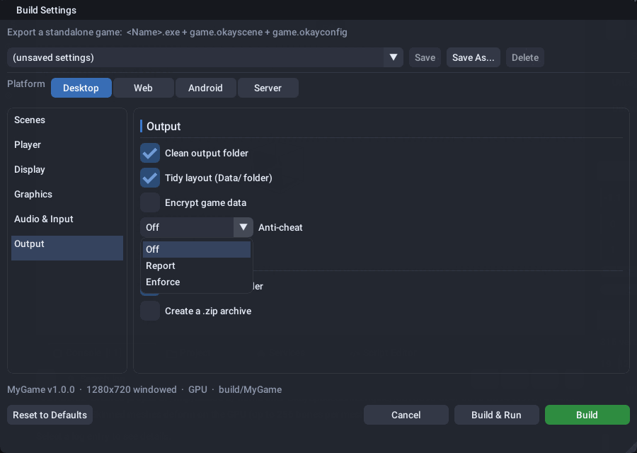

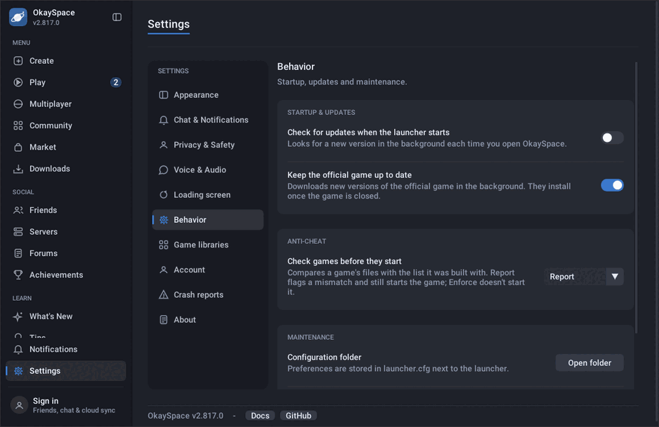

What a player sees when a game is set to **Enforce** and one of its files was
changed:

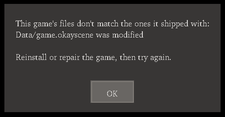

The launcher in **Enforce** mode refuses to start the game. In **Report** mode it
starts the game and shows the problem:

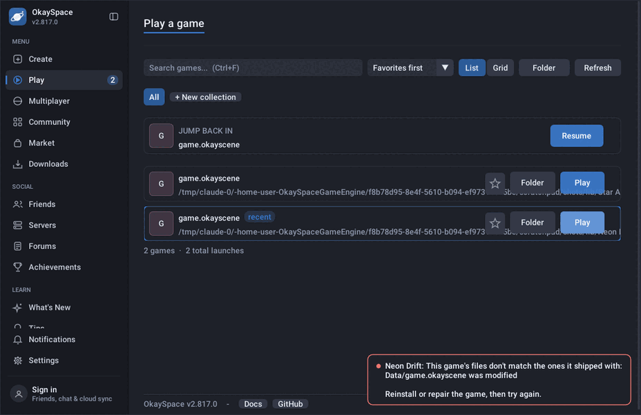

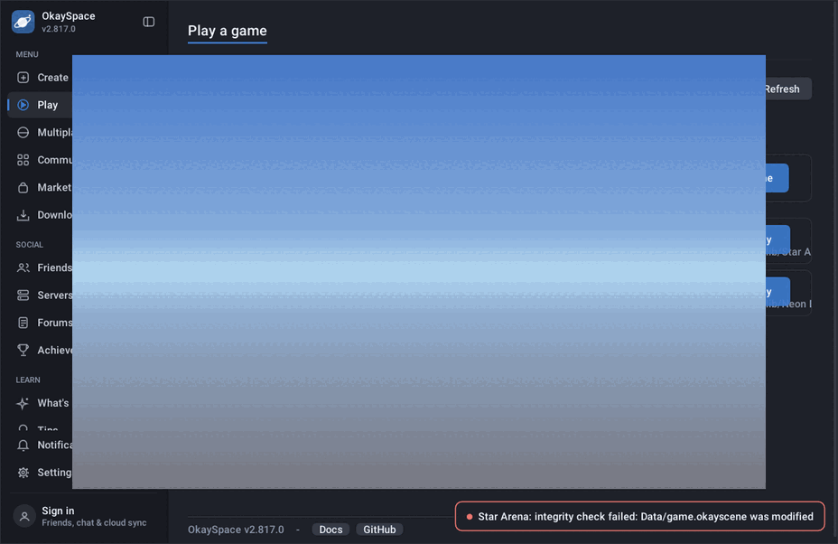

### The manifest

```json
{
  "format": "okayspace-integrity/1",
  "game": "My Game",
  "version": "1.0.0",
  "anticheat": "enforce",
  "files": [
    {"path": "Data/game.okayscene", "size": 1234, "sha256": "..."},
    {"path": "My Game.exe", "size": 5678, "sha256": "..."}
  ],
  "signature": {"alg": "ed25519", "key": "<public key, hex>", "sig": "<signature, hex>"}
}
```

- It lists every file in the build folder except hidden ones and the manifest itself.
- `anticheat` is the game's mode from Build Settings (left out for Off). It's
  part of the signed text, so in a build with trusted keys it can't be lowered
  (see below).
- `signature` is there only when a signing key is set up (see below). It covers
  the manifest's text up to `signature`, exactly as the editor writes it.
- Files are checked with the same size + SHA-256 check (`okayofficial::Verify`)
  that the launcher's official-game updater uses, and paths go through the same
  path-safety rules, so a crafted manifest can't point outside the game folder.

A launch check fails when:

- `Data/manifest.json` is missing or malformed;
- a listed file is missing or changed;
- a program file (`.exe`, `.dll`, `.asi`, ...) that the manifest doesn't list sits in the game folder (for example, a proxy `version.dll` beside the exe), including hidden-named ones (`.hook.dll`) and ones inside hidden folders;
- a program file is a link, or a folder is a link (its contents couldn't be checked);
- the signature doesn't match, which means the manifest was edited;
- the build trusts at least one key, and the manifest is unsigned or signed by a key it doesn't trust.

Extra files that aren't programs, such as saves and logs, are ignored.

### Keys: setup for the owner

Signing proves a manifest came from you, so nobody can edit a file and then
"fix" the manifest. **No key is in this repository and none is made by the
build.** You create the keys and keep the private halves out of git.

You need two ed25519 keypairs:

- **dev**: for your own test builds;
- **release**: for what you ship. Keep it offline or in a CI secret.

1. Make each keypair with OpenSSL (any machine; on Windows, Git Bash has
   everything used here):

   ```bash
   openssl genpkey -algorithm ed25519 -out okay-ac-release.pem
   # the private key, as the editor reads it (64 hex digits):
   openssl pkey -in okay-ac-release.pem -outform DER | tail -c 32 | od -An -tx1 | tr -d ' \n' > okay-ac-release.key
   # the public key (64 hex digits):
   openssl pkey -in okay-ac-release.pem -pubout -outform DER | tail -c 32 | od -An -tx1 | tr -d ' \n'; echo
   ```

   The `.pem` and `.key` files are secrets. Store them outside the repo and
   restrict who can read them (`chmod 600`). A libsodium secret key (128 hex
   digits, the seed followed by the public key) works as the `.key` file too.

2. **Signing (the editor)**: before you start the editor (or the launcher that
   starts it), set one of these:

   | Variable | Value |
   |---|---|
   | `OKAY_AC_SIGNING_KEY_FILE` | path to the `.key` file (preferred) |
   | `OKAY_AC_SIGNING_KEY` | the 64 hex digits themselves (for CI secrets) |

   File > Build Game then signs `Data/manifest.json`, and the build message says
   `integrity manifest signed (key <first 16 hex digits>)`. If the key can't be
   read, the manifest is written unsigned and the message says why. Key material
   never appears in that message.

3. **Trusting (the launcher, and optionally a player)**: build them with your
   public keys:

   ```bash
   cmake ... -DOKAY_AC_TRUSTED_KEYS=<release public hex>,<dev public hex>          # the launcher
   cmake ... -DOKAY_AC_PLAYER_TRUSTED_KEYS=<release public hex>                    # a player of your own games only
   ```

   `OKAY_AC_TRUSTED_KEYS` goes to the launcher only, which applies it to the
   official game. The player gets keys only from `OKAY_AC_PLAYER_TRUSTED_KEYS`
   (see below for why the general player has none). The release workflow takes
   the launcher's keys from the `OKAY_AC_TRUSTED_KEYS` repository variable, and
   warns in the job summary when it's empty.

   Each key must be exactly 64 hex digits, separated by commas with no spaces;
   anything else fails the CMake configure. Keys that no signature should verify
   under (small-order points such as the identity) are refused too.

   A build with trusted keys rejects unsigned manifests and manifests signed by
   any other key. If the built-in list somehow doesn't parse, the program trusts
   no key at all and every check fails (it never falls back to anything else).
   In a build without any (the default), a signature is still checked against
   the key it names, but that only proves the manifest wasn't edited after
   signing, not who signed it. For local testing only, such a build also accepts
   `OKAY_AC_TRUSTED_KEY=<public hex>` from the environment. A build with keys
   built in ignores that variable, so a player can't point a release at their
   own key.

   **A player built with trusted keys is for your own signed games.** It refuses
   to start any game without a valid manifest signed by one of those keys, takes
   the anti-cheat mode from that signed manifest (`game.okayconfig` and
   `OKAY_ANTICHEAT` can only make it stricter), and only runs scenes that are
   among the signed files. Don't ship that player as the general runtime other
   creators build their games with: their unsigned games wouldn't start. The
   launcher applies its trusted keys to the official game only; other library
   games are checked by hash and against the key they name.

4. Turn anti-cheat on for the game (Build Settings > Output > Anti-cheat) and,
   if you want the launcher to check too, in Settings > Behavior. Start with
   **Report** and read `anticheat.log` before you switch to **Enforce**.

If you rotate a key, ship a player and launcher that trust both the old and the
new key, re-sign your builds with the new one, and then drop the old one.

### The backend: reports, bans, appeals

`docs/sql/anticheat.sql` adds three tables to your Supabase project.

| Table | What's in it | Who can see / change it |
|---|---|---|
| `ac_reports` | a player reporting another player, a player's own game reporting what its anti-cheat found (`kind = 'client_check'`), or a game server reporting an anti-cheat kick (`kind = 'server_kick'`) | anyone signed in can file a player report (20 an hour); only `ac_report_servers` accounts file `server_kick` ones; admins read and review |
| `ac_report_servers` | the accounts game servers file their kick reports with | admins only |
| `ac_devices` | which machines (salted hardware hashes) an account used, written when a session ticket is issued | admins only |
| `ac_bans` | an anti-cheat ban of an account and/or a machine (hardware hash), with a reason and an optional end | players see their own; admins ban, edit and lift, but never a ban on their own account |
| `ac_appeals` | a player's appeal against one of their bans | players file through `ac_file_appeal` (one waiting at a time, 3 per ban) and see their own; admins decide |

"Admins" means `public.is_admin` from `admin.sql`, the same check the other
admin tools use. Every admin action is written to `admin_log` by triggers, so
it's logged however it's made (launcher, SQL, PostgREST): a ban, an unban, a
change to a ban's end, reason or lift reason (`ac_ban_edit`), a report review,
an appeal decision, and deleting a report, ban or appeal (`ac_report_delete`,
`ac_ban_delete`, `ac_appeal_delete`). `ac_purge_old()` logs one summary line
(`ac_purge`) instead of a line per row.

#### Admin views: linked accounts and ban with devices

Launcher > Admin > Anti-cheat uses the two device helpers of `anticheat.sql`:

- **Linked accounts** (button on a selected report): calls `ac_linked_accounts(p_user)` for the reported account (for a client check, the
  reporter's own) and lists the other accounts that used a machine this one used: how many machines they share, when one was last seen, and
  whether the other account is already banned. It is a lead, not proof: machines are shared (family PCs, internet cafes). Admins only.
- **Also ban every machine this account used** (checkbox in the Ban dialog): calls `ac_ban_with_devices` instead of a plain ban. It makes
  the account's ban plus one machine ban per machine not already banned, in one step under the admin's own rights (the ban policy and guard apply
  to every row, so an admin still can't ban themselves), and the launcher reports how many ban rows it made.

The requests and the row parsing are plain functions in `shared/AntiCheatAdminTools.hpp` (`LinkedAccounts`, `ParseLinkedAccounts`,
`BanWithDevices`, `ParseBanCount`, `ReportEvidence`, `ParseReportEvidence`), unit tested in `anticheat_wiring`; the launcher only sends them.

Anti-cheat bans are separate from site bans (`site_bans`). They're enforced
when a ticket is issued: the ticket service asks
`public.ac_is_banned(user_id, hw_hash)` and signs nothing for a banned account
or machine, so a server that requires tickets (`ticketKey`) keeps banned
players out without ever talking to Supabase. **Never give a game server the
`service_role` key**: it can read and change the whole database, and anyone
running the server could take it. A server needs only the ticket service's
public key. Besides the ticket service, only admins may call `ac_is_banned`;
any other signed-in player is refused, and players see their own bans with
`ac_my_bans`. A ban takes effect at the player's next ticket, so within
`OKAY_TICKET_TTL` (10 minutes by default).

**Abuse limits** (all in the database, `docs/sql/anticheat.sql`): 20 reports an hour and 60 a day per
player; the same player can't be reported again within 10 minutes, or more than 3 times a day, by one
reporter; a reporter whose last 10 reports in 30 days were all dismissed (none actioned) is paused;
one appeal an hour and 5 a day per player (3 per ban, one open per ban); `ac_my_bans` 120 lookups an hour.

**Ban evasion.** A ban belongs to an account and, optionally, a machine hash. The ticket service
records which machine hashes an account used (`ac_note_device`, `ac_devices`, admins read it only,
newest 20 per account, 90 days). Admins get `ac_linked_accounts(user)` (other accounts that used the same
machines) and `ac_ban_with_devices(user, reason, until)` (the account and every machine it used, in one
step, through the ordinary ban rules). A new account on a banned machine gets no ticket, and the attempt
is written to the audit log. Shared machines exist, so a link is a lead for an admin, never an automatic
ban. This only works for players who send the hash (anyone can hide it by modifying their client), and a
fresh install on new hardware is a new machine.

**Audit.** `ac_audit` is an append-only record of every change to bans, appeals, report reviews and the
list of server accounts, with who (or "no signed-in user": the SQL editor, the service key, a cascade),
and the old and new row. `admin_log` only sees signed-in admins; this sees everything. The API cannot
edit or delete its rows, a trigger stops the table owner too, and only `ac_purge_audit()` trims entries
over a year old (and logs that it did). A database superuser can still drop the trigger: it records
what happened through the product, it is not protection from whoever runs the database. It holds account
ids (never names or emails), and because it is append-only it keeps the ids of deleted accounts until
the year is up; the device links (`ac_devices`) are deleted with the account.

Deleting an account deletes its account-only bans. A ban that also names a
machine is kept, with `user_id` set to null, so deleting the account and
signing up again doesn't clear a machine ban: the new account still sees it
(and can appeal it) through `ac_my_bans`, and admins still see it under Bans.

#### In the launcher

- **Admin > Anti-cheat** (admins only):
  - **Reports**: filter by status, open a report to see its details and machine hash, then mark it reviewing, dismiss it, or **Ban...** (prefilled from the report).
  - **Bans**: active, or every ban; **Unban...** asks for a reason and keeps the record. **Ban a player...** bans by username.
  - **Appeals**: read each appeal next to its ban, then **Accept...** (lifts the ban) or **Reject...**, with a note the player sees.
- **For players**: a banner at the top of every page shows an active
  anti-cheat ban, its reason and its end. **Appeal...** opens a box to explain;
  the banner then shows that the appeal is waiting, or the decision and its note.
- **Report cheating...** in a chat's menu files a player report.
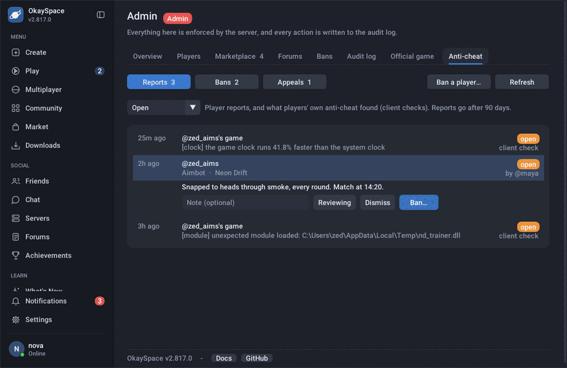

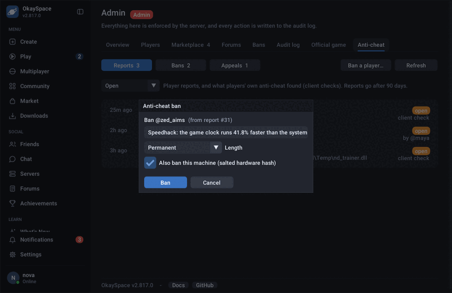

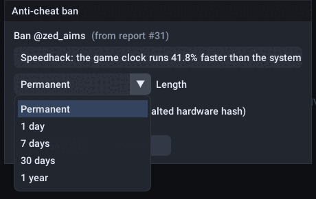

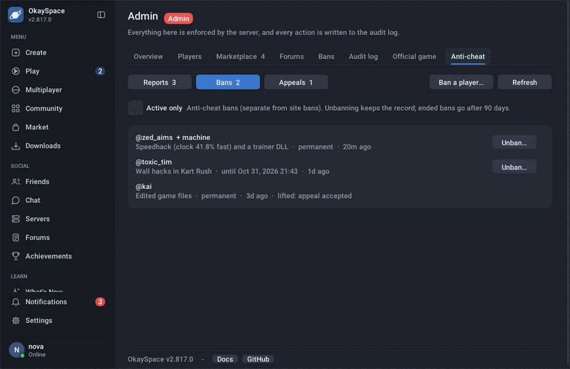

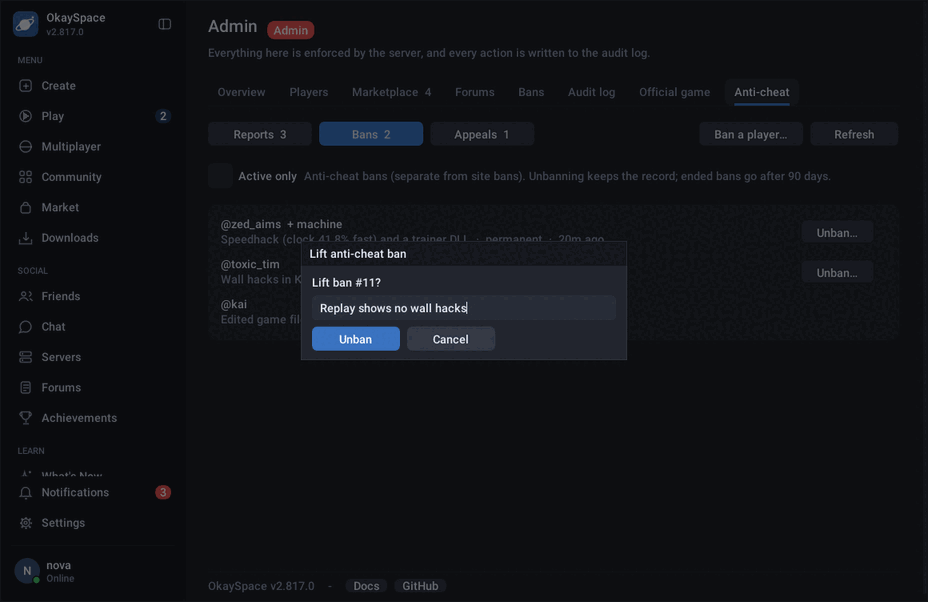

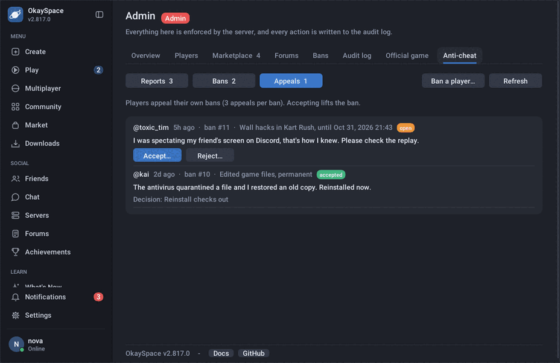

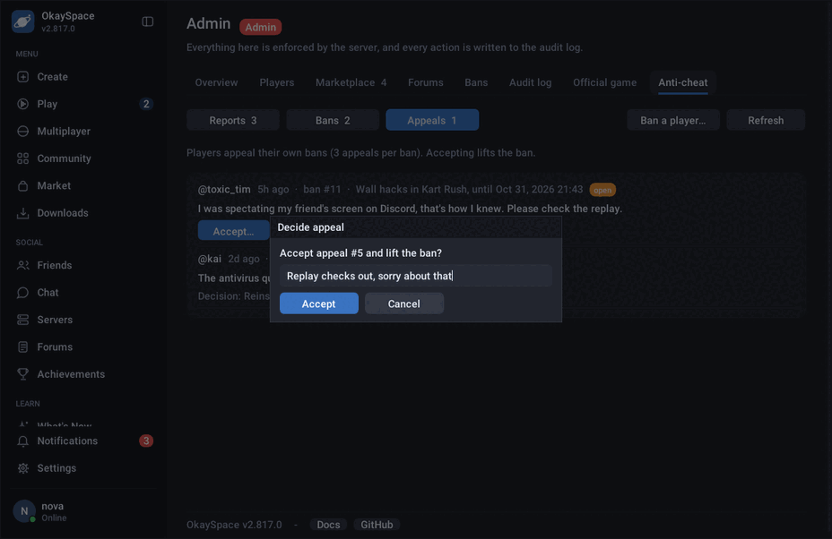

What a banned player sees, and the appeal flow:

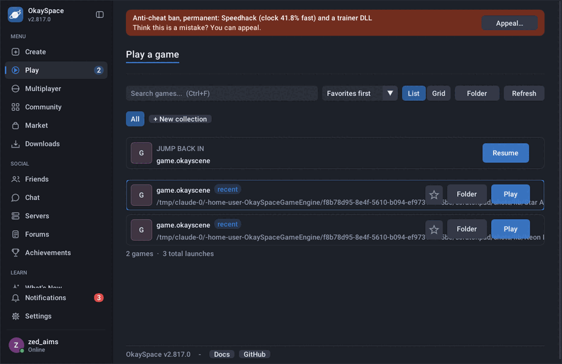

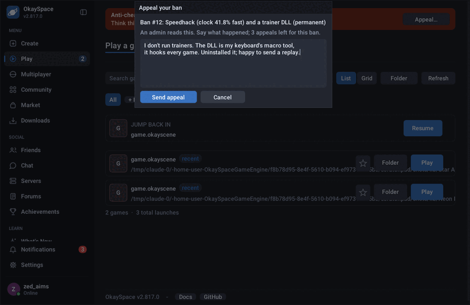

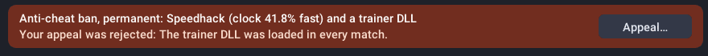

Reporting a cheater from a chat:

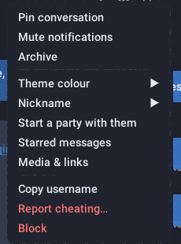

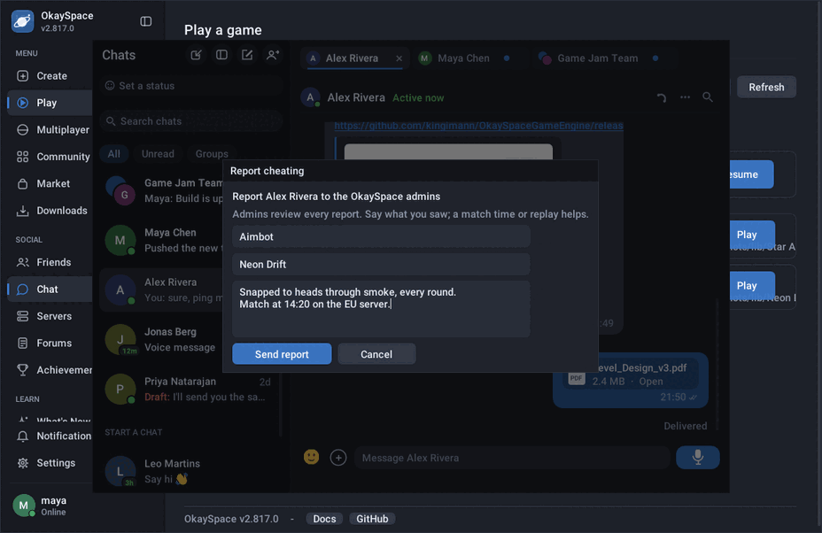

These screenshots use the launcher's built-in sample data (`OKAY_UI_DEMO_USER`,
plus `OKAY_UI_DEMO_ACVIEW` / `OKAY_UI_DEMO_ACPOPUP` / `OKAY_UI_DEMO_ACBAN` /
`OKAY_UI_DEMO_ACAPPEAL`), not a server.

- A game with anti-cheat on files a `client_check` report when its checks find
  something and the player is signed in: one report per run, sent when the game
  closes (or before it refuses to start), with this machine's hardware hash.
  Paths in it are cut down to file names (`hook.dll`, not
  `C:\Users\<name>\...\hook.dll`), so the report doesn't carry the player's OS
  user name. The local `anticheat.log` keeps the full paths.

#### Hardware hash

`shared/AntiCheatHardware.hpp`. A ban can name a machine, so a cheater can't
come back on a new account. Only this leaves the machine:

```
HMAC-SHA256(key = "okayac-hw|" + salt, canonical text)   -> 64 hex digits
```

The canonical text is these parts, each lower-cased and trimmed, sorted by name,
one `name=value` line each (any part the machine doesn't have is left out):

| Part | Windows | Linux |
|---|---|---|
| `machine_guid` | `HKLM\SOFTWARE\Microsoft\Cryptography\MachineGuid` | `/etc/machine-id` |
| `volume_serial` | serial number of the volume Windows is on | (none) |
| `cpu` | CPUID vendor + brand string (x86) | same |

- **No machine id, no hash.** Without a real `machine_guid` (macOS, Linux
  without a machine-id, or a blanked-out id) the hash is empty and nothing is
  sent: the CPU brand alone is shared by many machines, and a ban on its hash
  would hit all of them. Such a player can be banned by account only. The
  database never matches an empty or malformed hash either.
- The raw values are never stored or sent.
- The salt is `-DOKAY_AC_HW_SALT=...` (default `okayspace-ac-hw/1`). Give your
  deployment its own so its hashes can't be matched against anyone else's. It
  doesn't have to be secret: the machine GUID alone has 122 random bits.
- The hash changes when Windows is reinstalled, the system drive is reformatted,
  or the CPU is swapped. Machines cloned from one image can share a GUID. Treat
  a hash match as a lead, not proof.

#### Retention

`public.ac_purge_old()` deletes:

- reports older than 90 days;
- decided appeals older than 90 days;
- bans that ended (lifted or expired) more than 90 days ago.

Active bans are kept. If the `pg_cron` extension is enabled, the SQL file
schedules it nightly (job `okay-ac-retention`). Otherwise run
`select public.ac_purge_old();` yourself, or from a scheduled Edge Function.

#### Setting it up

1. Run `docs/sql/admin.sql` first if you haven't already.
2. Then run `docs/sql/anticheat.sql` once in the Supabase SQL editor. It is
   idempotent, so you can re-run it after updating. (Optional: enable `pg_cron`
   under Database > Extensions first, so the 90-day clean-up schedules itself.)
3. Optionally set `-DOKAY_AC_HW_SALT=<something unique to you>` when building
   the launcher and player.
4. Admins (the `admin` badge) see **Admin > Anti-cheat** in the launcher.

`tests/scripts/test_anticheat_sql.sh` runs `anticheat.sql` and
`tests/sql/test_anticheat.sql` against a local, throwaway Postgres (with
`tests/sql/supabase_stub.sql` standing in for Supabase's `auth` schema and
roles). Point it at one with `OKAY_SQL_TEST_PGHOST` (a socket directory or
localhost); ctest skips it otherwise. Never point it at a live database.

### Crypto

- ed25519 comes from libsodium when the build has it (`OKAY_USE_SODIUM`, which
  the engine finds through pkg-config or `OKAY_SODIUM_PREFIX` for MinGW).
  Otherwise (and with `-DOKAY_OWN_CRYPTO=ON`) `shared/AntiCheatCrypto.hpp` uses
  `okay::crypto`, our own Ed25519 (`engine/src/Crypto/`, written from RFC 8032).
  `shared/AntiCheatCrypto.hpp` itself holds no crypto code: the TweetNaCl-derived
  port that used to be the fallback is deleted. `okay::crypto` makes the checks
  libsodium 1.0.18 makes before verifying: S must be canonical, R must not be a
  small-order point, and the public key must be canonical and not small-order
  (so the identity-key forgery plain TweetNaCl accepts is refused). The launcher
  links `okay_crypto` directly. **`okay::crypto` has not had its outside review
  yet** (`CLAUDE.md` rule 18, `docs/crypto_review_package.md`), so a build
  without libsodium relies on unreviewed code for this; libsodium stays the
  preferred path where it is built. Both paths are tested against the RFC 8032
  vectors and the small-order encodings on every build, and
  `tests/test_anticheat_golden.cpp` pins what the old port answered.
- SHA-256 is the engine's bundled implementation, the same one the official-game
  updater uses.

### The runtime checks (Windows)

`shared/AntiCheatChecks.hpp`, run from the player's frame loop. Each check runs
every few seconds:

- **Debugger**: `IsDebuggerPresent` and `CheckRemoteDebuggerPresent`, every 5 s.
- **Modules**: the process's module list, every 10 s. Allowed modules are:
  - anything under the Windows folder;
  - the game's own `.exe` / `.dll` files as its verified manifest lists them;
  - the Steam and Discord overlays, matched by file name.

  Anything else is reported once (for example a cheat DLL in `%TEMP%`). GPU
  tools, recorders and other overlays will show up here too, which is why
  Report is the place to start.
- **Clock heartbeat**: every second, a challenge (random nonce + sequence)
  is answered with the game's clock reading (the performance counter that game
  time runs on) and tagged with HMAC-SHA256 under a per-run key. The reference
  is a monotonic clock that NTP and the user can't step
  (`QueryUnbiasedInterruptTime`, falling back to `GetTickCount64`), not the
  wall clock. Every 5 s window gives one rate; a window more than 5% off, after
  allowing for round-trip time, is suspicious, and only three such windows in a
  row (15 s of sustained drift, all the same way) are flagged. A one-off jump of
  either clock (a time sync, a resume from sleep) lands in a single window and
  is never flagged. Common speedhacks scale the performance counter but not the
  interrupt-time clock.

  `ClockHeartbeat` / `AnswerChallenge` are transport-agnostic. A multiplayer
  server can act as the verifier and carry the challenge and response in its
  own messages, which is the stronger setup because the server's clock is out
  of the cheater's reach. Wiring that into the network layer is not part of
  this change.

### Limits

Be clear-eyed about what this is.

- **Without trusted keys it's telemetry.** A launcher built without
  `OKAY_AC_TRUSTED_KEYS` can't tell who signed a game, so what its checks find is
  something to report and look at, not proof. The same goes for every player
  without keys.
- **It's client-side.** Every check runs in a process the player controls. A
  cheater can patch the checks out of the exe or hook the APIs they call. In a
  player without trusted keys they can also delete the `anticheat=` line from
  `game.okayconfig` to switch it off; a player built with trusted keys takes the
  mode from the signed manifest instead and refuses to run without one. Signing
  raises the bar for edited game files; it doesn't make the client trustworthy.
- **It's report-first.** Debugger and module checks produce false positives
  (antivirus, OBS, RTSS / MSI Afterburner, IME and input-method DLLs, other
  overlays and accessibility tools, developers debugging their own game). The
  Build Settings tooltip says so too. Use Report, look at what turns up, and enforce only what you're sure of.
- **The clock check is local.** In the player it compares two clocks of the same
  machine. A tool that slows or speeds up both, or that hooks the reference
  clock too, won't show up. The server-verified version is the one worth wiring in.
- **No kernel driver, no memory scanning, no obfuscation.** This won't stop a
  dedicated cheat developer.
- **Updates are signed only once you create keys.** The launcher and editor verify `versions.json`
  against `OKAY_UPDATE_TRUSTED_KEYS` ([updater.md](updater.md#signed-releases)); a build without it still
  accepts an unsigned feed, and so does anyone who runs an older build.
- **The ticket flow is only as good as its config.** A game without `okay_tickets.cfg`, or with
  `mode optional`, joins a ticket-requiring server without a ticket (the server then refuses it); the
  server does not announce that it needs tickets.
- **Integrity costs a hash of every file at each launch**, done by the launcher
  and again by the player. That's fine for small games and noticeable for very
  large ones.

The real defence for multiplayer is server authority: the server owns positions,
hits and inventory, and rejects what isn't possible. Anti-cheat reports are a
signal to review, not a verdict.
