# Anti-cheat

OkaySpace's anti-cheat runs on the **server** and is **opt-in**. With it off,
nothing is checked and nothing is sent differently from before.

- **P1 (authority):** the server refuses what a client may not do.
  - moving or despawning another player's networked object;
  - spawning a prefab that isn't on the game's list;
  - writing another object's SyncVars, or flooding SyncVars;
  - moving a NetworkSync object faster than `maxSyncSpeed`.
  - moving, or writing the variables of, a scene object nobody owns (a door,
    a pickup): it's the server's. Tick **Players can claim it** on its
    Network Sync (`clientClaimable`) for one any player may grab, like a
    ball: the first to move it owns it. The server can hand any object to a
    player with `anticheat.SetOwner(netId, peer)`.

  Every refusal is reported; repeat offenders are kicked. A kicked account
  can't join again for a minute, doubling with each repeat up to an hour, and
  neither can anonymous players from its address (other signed-in players
  there still can). A player who leaves or is kicked keeps its refusal count and its
  Net Validator budgets and cooldowns for five minutes (by account, else by
  address), so reconnecting resets nothing.
- **P2 (identity and transport):** clients must encrypt, every packet is
  numbered and replays are refused, and a joining player can be required to
  hold a **session ticket** signed by your ticket service.
- **P3 (client integrity, opt-in):** a signed manifest of the shipped files,
  checked by the launcher and player before a game starts, plus Windows
  debugger / loaded-module / clock-drift checks. See
  [P3: client integrity](#p3-client-integrity-opt-in) below.

## Turning it on

Add an **Anti-Cheat Config** component to the scene (with a Network Manager), or
set `NetworkManager::anticheat.settings` in code. Its rules can also come from a
`.okayac` file (one `key value` per line, `#` comments):

```
enabled true
spawn prefabs/crate.okayprefab      # repeat for each prefab clients may spawn
maxSyncSpeed 8                      # u/s; 0 = no check
maxSyncVarsPerSecond 30             # 0 = unlimited
kickAfterViolations 5               # refusals within a minute; 0 = never kick
ownerOnlySyncVars true              # "<netId>.<name>" keys are the owner's
# P2
requireEncryption true              # only encrypted clients; numbered packets
ticketKey <base64url ed25519 public key>
ticketAudience arena-1              # this server's id in tickets ("" = any)
# Network hardening
maxClockDrift 0.05                  # a client's game clock may run 5% off; 0 = no check
# Gameplay
serverVar score                     # SyncVar key prefixes only the server may write (repeatable)
clientVar player.                   # if any is set, the only SyncVar key prefixes clients may write (repeatable)
maxSpawnsPerSecond 5                # spawns a client may make per second (0 = unlimited)
maxLiveSpawnsPerPeer 50             # SpawnOwned objects a client may have at once (0 = unlimited)
spawnRadius 0                       # how far from the sender a spawn may land (0 = anywhere)
maxHitRange 60                      # hit claims: the longest shot (0 = any; the component's default is 300)
weapon rifle                        # a weapon clients may claim hits with, besides Net Validator ones (repeatable)
hitDamage 10                        # what a hit does, unless the game says otherwise
```

A game hosted through a relay (`HostViaRelay` / `net_host_relay`) runs the same
checks as a directly hosted one. The relay only forwards between the host and
its clients, so every player's traffic reaches the host's checks; see
[relay.md](relay.md#what-the-relay-enforces).

React in a visual script with **On Cheat Detected**:
- Event Name is what was caught;
- Event Value is the player's peer id;
- the `cheat_detail` variable names the object involved.

Check RPCs with **Net Validator** components (size, rate, host-only), or with an
**On Validate Rpc** graph plus **Reject Rpc**.

## P2: encryption required and replay protection

With `requireEncryption true`:

- The server turns its `encryption` on. A client that doesn't offer a key is
  refused with *"encryption required"*, so set `encryption = true` on the client
  too. Both ends need libsodium; a server built without it refuses every join
  and says so.
- Every sealed packet carries an 8-byte sequence number inside the ciphertext.
  A packet already seen, or more than 64 behind the newest, is dropped. The
  server switches this on through a flag at the end of its Welcome, so an older
  client can't play on such a server; update the game.
- Plaintext game packets from a joined client's address are dropped, because
  they can only be someone else's. Join and server-browser queries stay
  plaintext.

## P2: session tickets

A ticket is a short-lived pass that says *this account may join this server*.

```
okt1.<payload>.<signature>                 (base64url, no padding)
payload   = sub=<user id>&aud=<server id or *>&iat=<unix seconds>&exp=<unix seconds>
signature = ed25519 over the ASCII text "okt1.<payload part>"
```

The server checks it with the service's **public** key (`ticketKey`):
- the signature must match;
- `iat` and `exp` must hold, with ±60 s of clock skew, and the lifetime can be
  at most 24 h;
- `aud` must be this server or `*`.

When the check passes, the player is bound to `sub`: `PeerUserId()` on the
server, and `LocalUserId()` on the client. The client passes the ticket as its
auth token (`NetworkManager::SetAuthToken(ticket)`) before joining. A ticket
check takes the place of `SetTokenVerifier` / `SetJoinCheck`.

The format is implemented in `engine/include/okay/Net/SessionTicket.hpp`.
`SessionTicket::Sign` exists for tests and tools only.

### The ticket service (not deployed; you run these steps)

The source is in `supabase/functions/session-ticket/`:

- **`index.ts`** is the Edge function. It takes
  `POST {"aud": "<game server id>"}` with `Authorization: Bearer <player's
  Supabase access token>`.
  1. It checks the login with Supabase Auth (`/auth/v1/user`).
  2. It returns `{"ticket": "okt1…", "exp": …}`, signed for that account and
     server. The ticket lives `OKAY_TICKET_TTL` seconds: 600 by default, at most
     86400.
- **`ticket.ts`** does the signing, using Web Crypto only. It must match the
  engine's `SessionTicket::Verify`. `tests/test_net_anticheat_p2.cpp` verifies
  tickets this code signed, so a change on either side that breaks the other
  fails CI.
- **`ticket_test.ts`** is its self-test. Run `deno run ticket_test.ts`, or
  `node --experimental-strip-types ticket_test.ts`.
- **`make_key.ts`** makes the key pair. It's for you to run.

Nothing is deployed. To go live:

1. **Make the key pair on your own machine**, never in CI or in the repo:
   `deno run supabase/functions/session-ticket/make_key.ts`. It prints
   `OKAY_TICKET_SEED=…` (the **private** key) and `OKAY_TICKET_PUBLIC_KEY=…`.
2. **Store both as function secrets:**
   `supabase secrets set OKAY_TICKET_SEED=<seed> OKAY_TICKET_PUBLIC_KEY=<public>`.
   The seed never goes in a game build, a `.okayac` file, chat or git.
3. **Deploy the function:** `supabase functions deploy session-ticket`.
   `SUPABASE_URL` and `SUPABASE_ANON_KEY` come from the Edge runtime.
4. **Point each game server at the public key** in its rules:
   `ticketKey <public>` and `ticketAudience <that server's id>`. The id is the
   same `aud` that clients ask for.
5. **Fetch a ticket before joining** (still to do in the launcher or game):
   POST to the function with the player's access token and the server id, then
   `SetAuthToken(ticket)` on the client's NetworkManager.

To rotate the key, run step 1 again, update the secrets and every server's
`ticketKey` together, and redeploy. Tickets signed with the old key stop working
when the servers switch.

## Network hardening

These hold whether or not the anti-cheat is on, unless a setting is named:

- **A client listens only to its server.** A packet from any other address is
  dropped before it's read (a stranger's `Kicked`, say).
- **Once a session is keyed, plaintext is someone else's.** Each end drops
  unsealed packets from a peer it shares keys with. The only exceptions are a
  client's Join and key hello, which can be retries sent before it got the keys,
  and server-browser queries.
- **The Join is sealed.** With `encryption` on, the client first sends a key
  hello: the protocol version (2) and its public key, padded to at least the
  size of the answer, so a spoofed hello can't make the server send more than
  it got. The server answers with its key (`JoinKey`), and the Join, with the
  name, password and token or ticket, goes encrypted.
  - Sealed-join sessions number every packet (replay window) and authenticate
    the envelope byte and protocol version as AEAD associated data.
  - An older server never answers the hello. After 4 tries (2 s) the client
    joins in the clear as before.
  - A server with `encryption` off answers "no encryption", and the client
    joins in the clear at once.
  - With `requireEncryption`, the server refuses the plaintext Join, so a
    ticket never travels in the clear.
- **Pinned host keys.** A server can have an ed25519 identity:
  `SetHostIdentity(seed)`, or `--host-key FILE` / `host_key = FILE` on the
  dedicated server, which prints the public key at startup. It signs every key
  exchange. A client that pins that key (`pinnedHostKey`, or
  `net_pin_host(key)` in OkayScript) joins only a server that signs with it. A
  pinned client never falls back to the plaintext Join, and won't join with
  encryption off.
  - Without a pin, the sealed join stops anyone listening, but not a
    man-in-the-middle.
  - The seed is the private key: keep it on the server, never in a game build
    or a `.okayac` file.
- **Reliable de-dup is a window.** Each peer remembers the newest reliable
  sequence number and the 4096 before it, instead of every number ever seen. A
  message older than that is acked but not run.
- **The clock heartbeat** (`maxClockDrift`, needs `enabled`). The server asks
  each client for its game clock about once a second, using #269's
  `ClockHeartbeat` (an HMAC challenge and response), and compares it with its
  own. A client running more than `maxClockDrift` fast or slow for three
  2-second windows in a row is reported as **clock drift** ("+50%"), at most
  once per window. So is a client that gives no good answer for 10 s ("no clock
  answer"); otherwise skipping the answer would get around the check.
  - Clients without this update never answer, so turn it on only once every
    player has it.
  - The key travels with each challenge, so the HMAC only adds anything over an
    encrypted session.

#302 (P2) already covers:
- `requireEncryption`: only encrypted clients;
- packet sequence numbers and the 64-packet replay window, behind the Welcome flag;
- dropping plaintext from joined clients when encryption is required;
- session tickets, and binding a player to their account id.

This section adds the rest: every mode, and the Join itself.

## Gameplay validation

The engine doesn't network gameplay: games do damage, ammo and scores through
RPCs and SyncVars, which the server used to take on trust. These let the server
check them.

- **Server-only SyncVars.** `serverVar <prefix>` lines (or the inspector's
  "SyncVars only the server may write") list key prefixes such as `score`,
  `money` or `match.`. Keys that start with `srv.` always count.
  - A client writing one is refused as a **forged syncvar** and gets the
    server's value back, since it already changed its own copy.
  - This needs `enabled`. With the anti-cheat off, plain keys are anyone's to
    write, as before.
- **Fire rate and ammo on Net Validator.** Three settings:
  - `cooldown`: the minimum seconds between one player's calls to the RPC;
  - `budget`: calls a player can bank, each call spends one;
  - `refillPerSecond`: budget regained per second, or 0 for ammo that only a
    reload refills.

  A refused call is reported as **rpc rejected**. The game tops a budget up
  (a reload, a pickup) with the **Server Budget** node, with
  `net_budget(id, "fire", 5)` in OkayScript, or with
  `NetValidator::TopUp(peer, n)`. A budget isn't refilled by going quiet:
  coming back after a pause isn't a reload, and neither is reconnecting.
- **Hit claims.** A client calls `NetworkManager::ClaimHit(target, weapon,
  origin, direction)` (`net_hit(...)` in OkayScript). It sends
  `"__hit" = "<target sync id>|<weapon>|<tick>|ox oy oz|dx dy dz"`, which only
  the server reads and is never relayed. The server checks the claim against
  its own view. With the anti-cheat on, a claim must name a known weapon (one
  a Net Validator for `hit/<weapon>` covers, or a `weapon` in the rules; any
  other does nothing and is logged once per name), and each claim counts
  against `maxRpcsPerSecond` unless that validator sets its own rate. With the
  anti-cheat off, a client gets 20 claims a second. Then, with or without the
  anti-cheat on:
  1. the shooter isn't dead (if its avatar on the server has a Health);
  2. the weapon's fire rate and ammo, from a Net Validator for `hit/<weapon>`
     (cooldown and budget, as above);
  3. the shot starts within `hitOriginTolerance` (2) of where the server has
     the shooter, not where the shooter says it is: its pawn when the server
     moves it (authoritative movement; where it was at the moment the shooter
     saw, under lag compensation), else the position it last reported, which
     a max move speed (`net_max_speed`, `--max-speed`) checks. A report may
     move it at most a quarter second at that speed, however long the client
     was quiet. With neither, client claims are refused, and the server says
     so when it starts, unless `hitsNeedMoveCheck false` is in the rules;
  4. the target is in front, within `maxHitRange` (0 = any), and within
     `hitTolerance` (1) of the shot's line, plus its top speed (`maxSyncSpeed`,
     else 8 u/s) times the shooter's ping, which the anti-cheat's heartbeat
     measures (0.25 s until it does);
  5. a server raycast (3D and 2D) reaches the target, unless `hitLineOfSight
     false`: no shooting through walls;
  6. the game's own rules (the **On Validate Hit** graph event with **Reject
     Hit**, `on_validate_hit(shooter, target, weapon, damage)` in OkayScript,
     or `NetworkManager::ValidateHit(...)` in C++).

  A claim that fails is reported as **hit rejected**, with the reason. One
  that passes does `hitDamage` (10, or what the game's rules say) to the
  target's **Health**, on the server only. The new health then goes to every
  client (`"__dmg"`, which clients can't send). The host's own `ClaimHit` is
  applied at once.
  - Don't apply damage on the client.
  - Respawns aren't replicated yet: the server's Health respawns on its own,
    and the clients' copies follow the next hit.
- **Kicks filed for review** (the dedicated server's `--report-kicks`, or
  `report_kicks = true` in server.cfg).
  - When the anti-cheat kicks a player who joined with a verified account, the
    server files an `ac_reports` row for an admin to review. It's a "player"
    report from the account the server's machine is signed in to, about the
    kicked account, with what was caught.
  - The server prints which account that is at startup, and refuses to start
    with the flag if it isn't signed in.
  - Reports are limited to one per account per hour and 20 an hour in all,
    which is the backend's own limit. **Nothing is banned automatically.**
  - No new SQL is needed: `anticheat.sql` already allows these rows. They are
    marked `[server check]` in the reason.
  - In C++, `NetworkManager::SetAntiCheatKickHandler` gets every anti-cheat
    kick with the player's account and last refusals.

## P3: client integrity (opt-in)

OkaySpace has a small, opt-in anti-cheat layer. **It is off by default**: with it
off, builds and launches behave exactly as without it (the one visible change is
that File > Build Game also writes `Data/manifest.json`, which nothing reads
until anti-cheat is turned on).

Read [Limits](#limits) before relying on it. In short, every check here runs on
the player's own machine, so a determined cheater can bypass it. It is there to
catch off-the-shelf tools, to stop casual file edits, and to give you reports to
act on. What actually stops cheating in multiplayer is a server that doesn't
trust the client.

### What it does

| Piece | Where | Platforms |
|---|---|---|
| **Integrity manifest**: every shipped file's size and SHA-256, optionally signed with ed25519 | written by File > Build Game (`Data/manifest.json`) | all |
| **Launch check**: the install is compared with the manifest before the game starts | launcher (Play, library games, joins) and the player itself | all |
| **Debugger detection** | player, while the game runs | Windows |
| **Loaded-module allowlist**: DLLs that aren't Windows', the game's own or a known overlay | player, while the game runs | Windows |
| **Clock-drift heartbeat**: the game's clock against a trusted clock, through a challenge-response, flagged past 5% | player, while the game runs | Windows |
| **Reports, bans, appeals** (Supabase, `docs/sql/anticheat.sql`) | launcher: Admin > Anti-cheat, the ban banner, Report cheating | all |

Windows-only checks are compiled out on other platforms; the logic behind them
(what counts as drift, which modules are allowed) is plain code that is unit
tested everywhere.

#### Modes

Each place that runs checks has one setting:

- **Off** (default): nothing is checked.
- **Report**: checks run; problems are logged and shown, and nothing is refused.
- **Enforce**: a failed launch check refuses the launch; a runtime finding closes the game.

Where it's set:

- **A game**: Build Settings > Output > **Anti-cheat**. This writes
  `anticheat=report` or `anticheat=enforce` into the game's `game.okayconfig`
  (nothing is written for Off). The environment variable `OKAY_ANTICHEAT`
  (`report` / `enforce`) can make a game stricter on one machine, never looser.
- **The launcher**: Settings > Behavior > **Anti-cheat** (`anticheat=` in
  `launcher.cfg`). The launcher checks the official game, library games that are
  built games (they have a `game.okayconfig`), and games it starts to join a
  session. Project scenes opened from the launcher are never checked.

The player logs what it finds to its log and to `anticheat.log` in the game's
save folder. In report mode the player shows nothing on screen. The launcher
shows report-mode problems as a warning and still starts the game.

A library game that the launcher runs through its own player (a scene, not the
game's exe) is checked by the launcher only. That player reads its settings from
its own folder, not the game's.

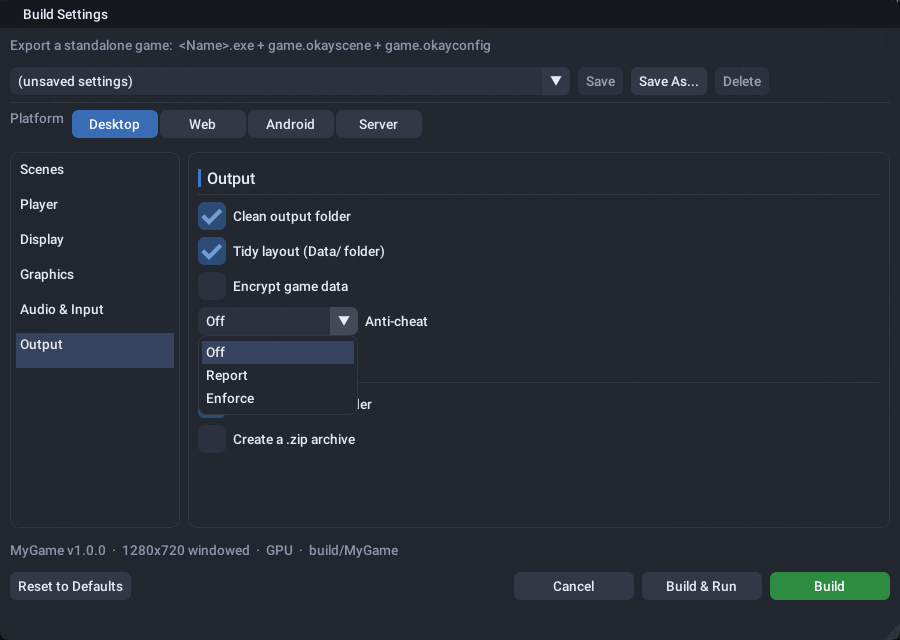

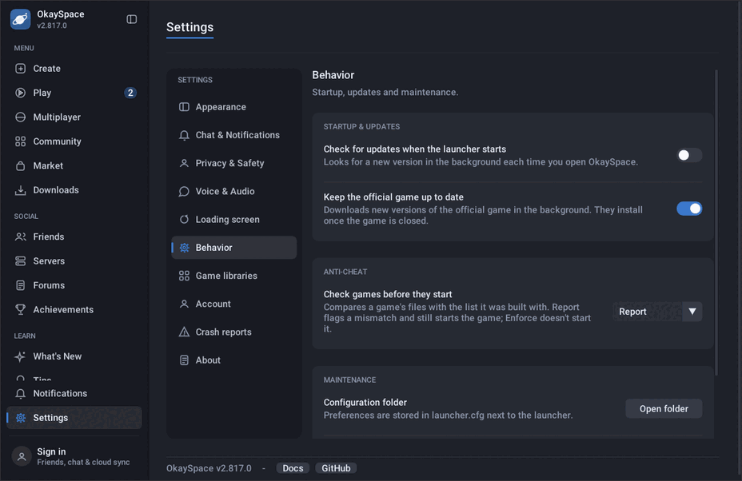

What a player sees when a game is set to **Enforce** and one of its files was
changed:

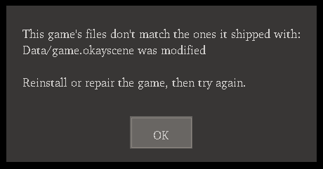

The launcher in **Enforce** mode refuses to start the game. In **Report** mode it
starts the game and shows the problem:

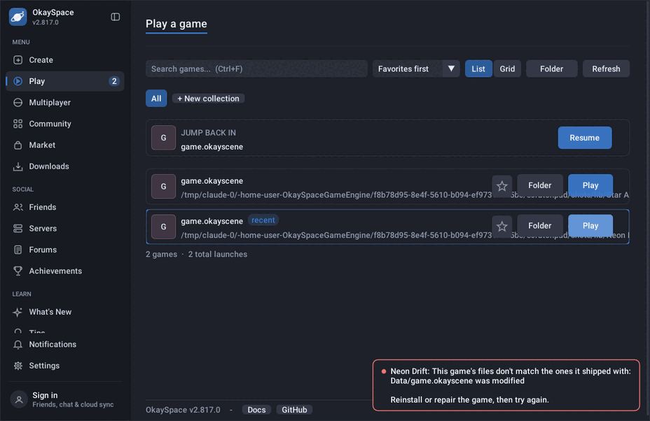

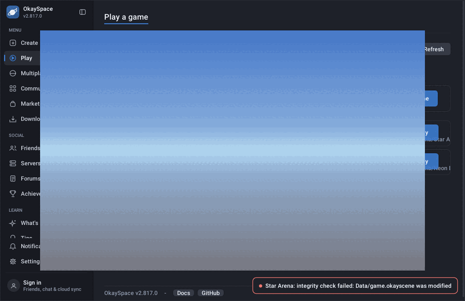

### The manifest

```json
{
  "format": "okayspace-integrity/1",
  "game": "My Game",
  "version": "1.0.0",
  "anticheat": "enforce",
  "files": [
    {"path": "Data/game.okayscene", "size": 1234, "sha256": "..."},
    {"path": "My Game.exe", "size": 5678, "sha256": "..."}
  ],
  "signature": {"alg": "ed25519", "key": "<public key, hex>", "sig": "<signature, hex>"}
}
```

- It lists every file in the build folder except hidden ones and the manifest itself.
- `anticheat` is the game's mode from Build Settings (left out for Off). It's
  part of the signed text, so in a build with trusted keys it can't be lowered
  (see below).
- `signature` is there only when a signing key is set up (see below). It covers
  the manifest's text up to `signature`, exactly as the editor writes it.
- Files are checked with the same size + SHA-256 check (`okayofficial::Verify`)
  that the launcher's official-game updater uses, and paths go through the same
  path-safety rules, so a crafted manifest can't point outside the game folder.

A launch check fails when:

- `Data/manifest.json` is missing or malformed;
- a listed file is missing or changed;
- a program file (`.exe`, `.dll`, `.asi`, ...) that the manifest doesn't list sits in the game folder (for example, a proxy `version.dll` beside the exe), including hidden-named ones (`.hook.dll`) and ones inside hidden folders;
- a program file is a link, or a folder is a link (its contents couldn't be checked);
- the signature doesn't match, which means the manifest was edited;
- the build trusts at least one key, and the manifest is unsigned or signed by a key it doesn't trust.

Extra files that aren't programs, such as saves and logs, are ignored.

### Keys: setup for the owner

Signing proves a manifest came from you, so nobody can edit a file and then
"fix" the manifest. **No key is in this repository and none is made by the
build.** You create the keys and keep the private halves out of git.

You need two ed25519 keypairs:

- **dev**: for your own test builds;
- **release**: for what you ship. Keep it offline or in a CI secret.

1. Make each keypair with OpenSSL (any machine; on Windows, Git Bash has
   everything used here):

   ```bash
   openssl genpkey -algorithm ed25519 -out okay-ac-release.pem
   # the private key, as the editor reads it (64 hex digits):
   openssl pkey -in okay-ac-release.pem -outform DER | tail -c 32 | od -An -tx1 | tr -d ' \n' > okay-ac-release.key
   # the public key (64 hex digits):
   openssl pkey -in okay-ac-release.pem -pubout -outform DER | tail -c 32 | od -An -tx1 | tr -d ' \n'; echo
   ```

   The `.pem` and `.key` files are secrets. Store them outside the repo and
   restrict who can read them (`chmod 600`). A libsodium secret key (128 hex
   digits, the seed followed by the public key) works as the `.key` file too.

2. **Signing (the editor)**: before you start the editor (or the launcher that
   starts it), set one of these:

   | Variable | Value |
   |---|---|
   | `OKAY_AC_SIGNING_KEY_FILE` | path to the `.key` file (preferred) |
   | `OKAY_AC_SIGNING_KEY` | the 64 hex digits themselves (for CI secrets) |

   File > Build Game then signs `Data/manifest.json`, and the build message says
   `integrity manifest signed (key <first 16 hex digits>)`. If the key can't be
   read, the manifest is written unsigned and the message says why. Key material
   never appears in that message.

3. **Trusting (the launcher, and optionally a player)**: build them with your
   public keys:

   ```bash
   cmake ... -DOKAY_AC_TRUSTED_KEYS=<release public hex>,<dev public hex>          # the launcher
   cmake ... -DOKAY_AC_PLAYER_TRUSTED_KEYS=<release public hex>                    # a player of your own games only
   ```

   `OKAY_AC_TRUSTED_KEYS` goes to the launcher only, which applies it to the
   official game. The player gets keys only from `OKAY_AC_PLAYER_TRUSTED_KEYS`
   (see below for why the general player has none). The release workflow takes
   the launcher's keys from the `OKAY_AC_TRUSTED_KEYS` repository variable, and
   warns in the job summary when it's empty.

   Each key must be exactly 64 hex digits, separated by commas with no spaces;
   anything else fails the CMake configure. Keys that no signature should verify
   under (small-order points such as the identity) are refused too.

   A build with trusted keys rejects unsigned manifests and manifests signed by
   any other key. If the built-in list somehow doesn't parse, the program trusts
   no key at all and every check fails (it never falls back to anything else).
   In a build without any (the default), a signature is still checked against
   the key it names, but that only proves the manifest wasn't edited after
   signing, not who signed it. For local testing only, such a build also accepts
   `OKAY_AC_TRUSTED_KEY=<public hex>` from the environment. A build with keys
   built in ignores that variable, so a player can't point a release at their
   own key.

   **A player built with trusted keys is for your own signed games.** It refuses
   to start any game without a valid manifest signed by one of those keys, takes
   the anti-cheat mode from that signed manifest (`game.okayconfig` and
   `OKAY_ANTICHEAT` can only make it stricter), and only runs scenes that are
   among the signed files. Don't ship that player as the general runtime other
   creators build their games with: their unsigned games wouldn't start. The
   launcher applies its trusted keys to the official game only; other library
   games are checked by hash and against the key they name.

4. Turn anti-cheat on for the game (Build Settings > Output > Anti-cheat) and,
   if you want the launcher to check too, in Settings > Behavior. Start with
   **Report** and read `anticheat.log` before you switch to **Enforce**.

If you rotate a key, ship a player and launcher that trust both the old and the
new key, re-sign your builds with the new one, and then drop the old one.

### The backend: reports, bans, appeals

`docs/sql/anticheat.sql` adds three tables to your Supabase project.

| Table | What's in it | Who can see / change it |
|---|---|---|
| `ac_reports` | a player reporting another player, or a player's own game reporting what its anti-cheat found (`kind = 'client_check'`) | anyone signed in can file one (20 an hour); admins read and review |
| `ac_bans` | an anti-cheat ban of an account and/or a machine (hardware hash), with a reason and an optional end | players see their own; admins ban, edit and lift |
| `ac_appeals` | a player's appeal against one of their bans | players file through `ac_file_appeal` (one waiting at a time, 3 per ban) and see their own; admins decide |

"Admins" means `public.is_admin` from `admin.sql`, the same check the other
admin tools use. Every admin action is written to `admin_log` by triggers, so
it's logged however it's made (launcher, SQL, PostgREST): a ban, an unban, a
change to a ban's end, reason or lift reason (`ac_ban_edit`), a report review,
an appeal decision, and deleting a report, ban or appeal (`ac_report_delete`,
`ac_ban_delete`, `ac_appeal_delete`). `ac_purge_old()` logs one summary line
(`ac_purge`) instead of a line per row.

Anti-cheat bans are separate from site bans (`site_bans`): this file doesn't
block anything else on its own. For a game server that wants to keep banned
players out, `public.ac_is_banned(user_id, hw_hash)` answers whether an
account or machine is banned right now. Only game servers (the `service_role`
key) and admins may call it; any other signed-in player is refused, and
players see their own bans with `ac_my_bans`. Calling it on join is the
network layer's job.

Deleting an account deletes its account-only bans. A ban that also names a
machine is kept, with `user_id` set to null, so deleting the account and
signing up again doesn't clear a machine ban: the new account still sees it
(and can appeal it) through `ac_my_bans`, and admins still see it under Bans.

#### In the launcher

- **Admin > Anti-cheat** (admins only):
  - **Reports**: filter by status, open a report to see its details and machine hash, then mark it reviewing, dismiss it, or **Ban...** (prefilled from the report).
  - **Bans**: active, or every ban; **Unban...** asks for a reason and keeps the record. **Ban a player...** bans by username.
  - **Appeals**: read each appeal next to its ban, then **Accept...** (lifts the ban) or **Reject...**, with a note the player sees.
- **For players**: a banner at the top of every page shows an active
  anti-cheat ban, its reason and its end. **Appeal...** opens a box to explain;
  the banner then shows that the appeal is waiting, or the decision and its note.
- **Report cheating...** in a chat's menu files a player report.
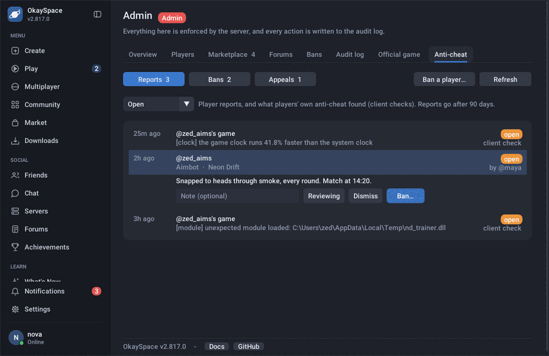

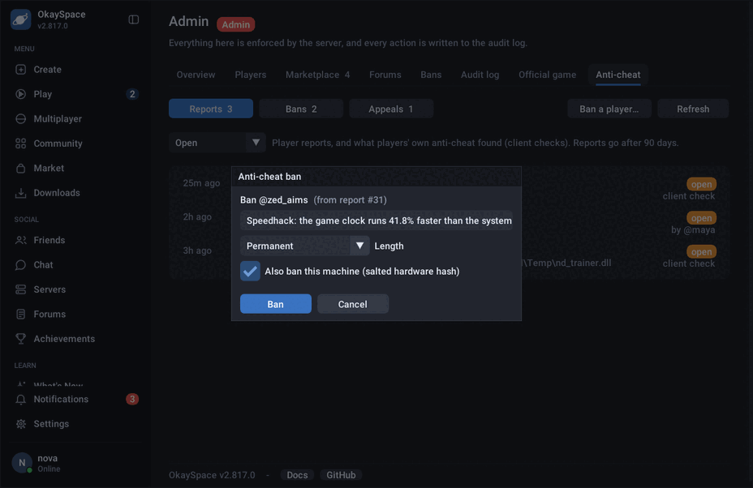

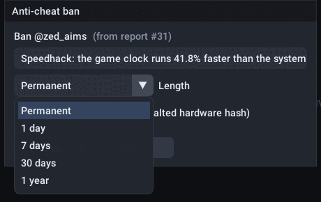

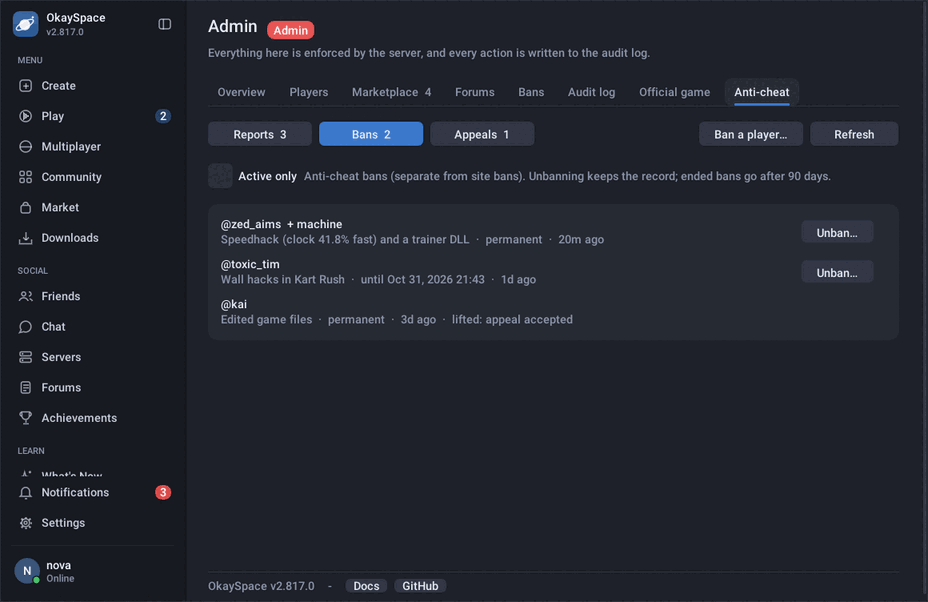

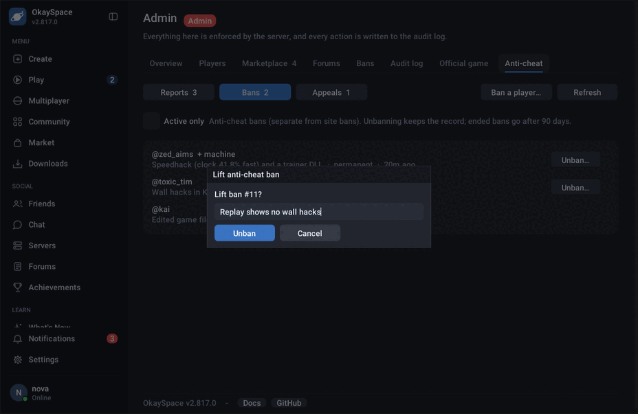

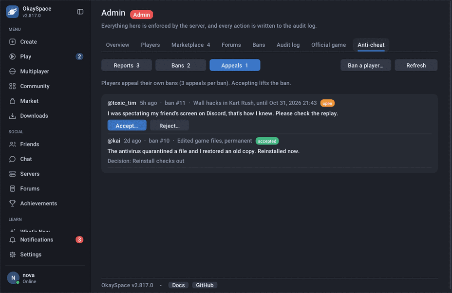

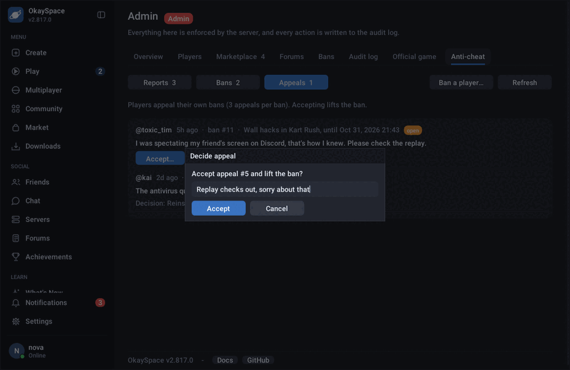

What a banned player sees, and the appeal flow:

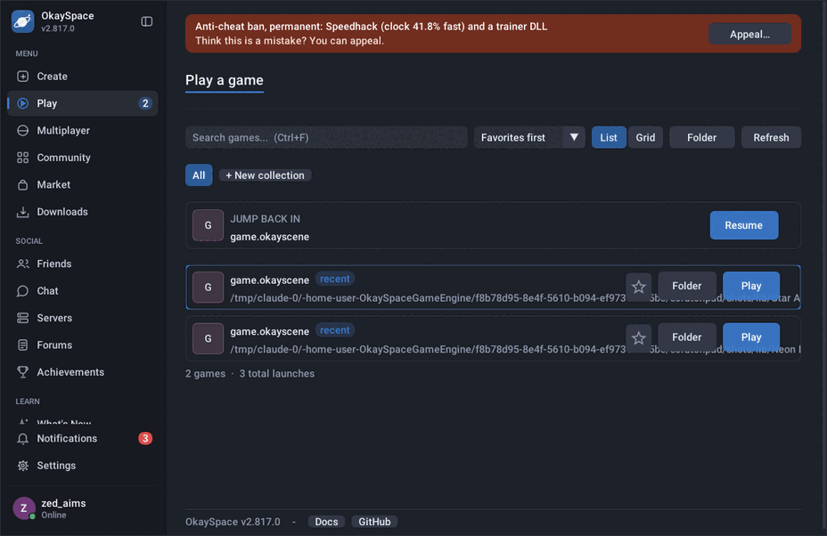

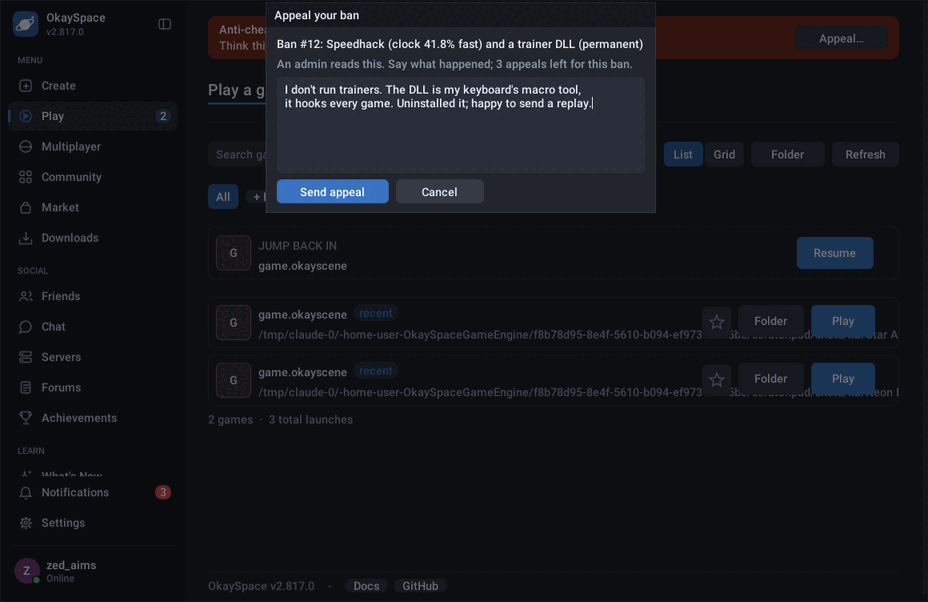

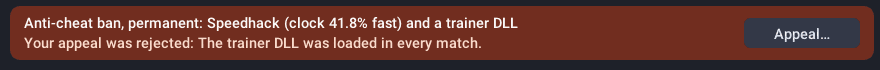

Reporting a cheater from a chat:

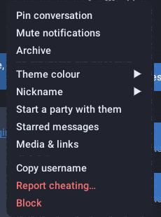

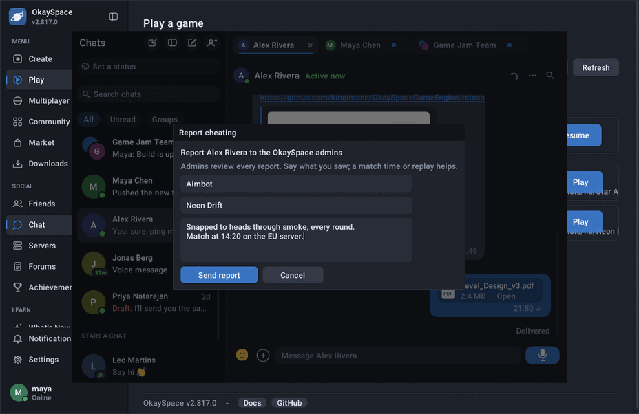

These screenshots use the launcher's built-in sample data (`OKAY_UI_DEMO_USER`,
plus `OKAY_UI_DEMO_ACVIEW` / `OKAY_UI_DEMO_ACPOPUP` / `OKAY_UI_DEMO_ACBAN` /
`OKAY_UI_DEMO_ACAPPEAL`), not a server.

- A game with anti-cheat on files a `client_check` report when its checks find
  something and the player is signed in: one report per run, sent when the game
  closes (or before it refuses to start), with this machine's hardware hash.
  Paths in it are cut down to file names (`hook.dll`, not
  `C:\Users\<name>\...\hook.dll`), so the report doesn't carry the player's OS
  user name. The local `anticheat.log` keeps the full paths.

#### Hardware hash

`shared/AntiCheatHardware.hpp`. A ban can name a machine, so a cheater can't
come back on a new account. Only this leaves the machine:

```
HMAC-SHA256(key = "okayac-hw|" + salt, canonical text)   -> 64 hex digits
```

The canonical text is these parts, each lower-cased and trimmed, sorted by name,
one `name=value` line each (any part the machine doesn't have is left out):

| Part | Windows | Linux |
|---|---|---|
| `machine_guid` | `HKLM\SOFTWARE\Microsoft\Cryptography\MachineGuid` | `/etc/machine-id` |
| `volume_serial` | serial number of the volume Windows is on | (none) |
| `cpu` | CPUID vendor + brand string (x86) | same |

- **No machine id, no hash.** Without a real `machine_guid` (macOS, Linux
  without a machine-id, or a blanked-out id) the hash is empty and nothing is
  sent: the CPU brand alone is shared by many machines, and a ban on its hash
  would hit all of them. Such a player can be banned by account only. The
  database never matches an empty or malformed hash either.
- The raw values are never stored or sent.
- The salt is `-DOKAY_AC_HW_SALT=...` (default `okayspace-ac-hw/1`). Give your
  deployment its own so its hashes can't be matched against anyone else's. It
  doesn't have to be secret: the machine GUID alone has 122 random bits.
- The hash changes when Windows is reinstalled, the system drive is reformatted,
  or the CPU is swapped. Machines cloned from one image can share a GUID. Treat
  a hash match as a lead, not proof.

#### Retention

`public.ac_purge_old()` deletes:

- reports older than 90 days;
- decided appeals older than 90 days;
- bans that ended (lifted or expired) more than 90 days ago.

Active bans are kept. If the `pg_cron` extension is enabled, the SQL file
schedules it nightly (job `okay-ac-retention`). Otherwise run
`select public.ac_purge_old();` yourself, or from a scheduled Edge Function.

#### Setting it up

1. Run `docs/sql/admin.sql` first if you haven't already.
2. Then run `docs/sql/anticheat.sql` once in the Supabase SQL editor. It is
   idempotent, so you can re-run it after updating. (Optional: enable `pg_cron`
   under Database > Extensions first, so the 90-day clean-up schedules itself.)
3. Optionally set `-DOKAY_AC_HW_SALT=<something unique to you>` when building
   the launcher and player.
4. Admins (the `admin` badge) see **Admin > Anti-cheat** in the launcher.

`tests/scripts/test_anticheat_sql.sh` runs `anticheat.sql` and
`tests/sql/test_anticheat.sql` against a local, throwaway Postgres (with
`tests/sql/supabase_stub.sql` standing in for Supabase's `auth` schema and
roles). Point it at one with `OKAY_SQL_TEST_PGHOST` (a socket directory or
localhost); ctest skips it otherwise. Never point it at a live database.

### Crypto

- ed25519 comes from libsodium when the build has it (`OKAY_USE_SODIUM`, which
  the engine finds through pkg-config or `OKAY_SODIUM_PREFIX` for MinGW).
  Otherwise a portable implementation in `shared/AntiCheatCrypto.hpp` is used:
  a port of TweetNaCl's public-domain ed25519, plus the checks libsodium 1.0.18
  makes before verifying: S must be canonical, R must not be a small-order
  point, and the public key must be canonical and not small-order (so the
  identity-key forgery TweetNaCl alone accepts is refused). The launcher always
  uses the portable code, because it doesn't link the engine. Both are tested
  against the RFC 8032 vectors and the small-order encodings on every build.
- SHA-256 is the engine's bundled implementation, the same one the official-game
  updater uses.

### The runtime checks (Windows)

`shared/AntiCheatChecks.hpp`, run from the player's frame loop. Each check runs
every few seconds:

- **Debugger**: `IsDebuggerPresent` and `CheckRemoteDebuggerPresent`, every 5 s.
- **Modules**: the process's module list, every 10 s. Allowed modules are:
  - anything under the Windows folder;
  - the game's own `.exe` / `.dll` files as its verified manifest lists them;
  - the Steam and Discord overlays, matched by file name.

  Anything else is reported once (for example a cheat DLL in `%TEMP%`). GPU
  tools, recorders and other overlays will show up here too, which is why
  Report is the place to start.
- **Clock heartbeat**: every second, a challenge (random nonce + sequence)
  is answered with the game's clock reading (the performance counter that game
  time runs on) and tagged with HMAC-SHA256 under a per-run key. The reference
  is a monotonic clock that NTP and the user can't step
  (`QueryUnbiasedInterruptTime`, falling back to `GetTickCount64`), not the
  wall clock. Every 5 s window gives one rate; a window more than 5% off, after
  allowing for round-trip time, is suspicious, and only three such windows in a
  row (15 s of sustained drift, all the same way) are flagged. A one-off jump of
  either clock (a time sync, a resume from sleep) lands in a single window and
  is never flagged. Common speedhacks scale the performance counter but not the
  interrupt-time clock.

  `ClockHeartbeat` / `AnswerChallenge` are transport-agnostic. A multiplayer
  server can act as the verifier and carry the challenge and response in its
  own messages, which is the stronger setup because the server's clock is out
  of the cheater's reach. Wiring that into the network layer is not part of
  this change.

### Limits

Be clear-eyed about what this is.

- **Without trusted keys it's telemetry.** A launcher built without
  `OKAY_AC_TRUSTED_KEYS` can't tell who signed a game, so what its checks find is
  something to report and look at, not proof. The same goes for every player
  without keys.
- **It's client-side.** Every check runs in a process the player controls. A
  cheater can patch the checks out of the exe or hook the APIs they call. In a
  player without trusted keys they can also delete the `anticheat=` line from
  `game.okayconfig` to switch it off; a player built with trusted keys takes the
  mode from the signed manifest instead and refuses to run without one. Signing
  raises the bar for edited game files; it doesn't make the client trustworthy.
- **It's report-first.** Debugger and module checks produce false positives
  (antivirus, OBS, RTSS / MSI Afterburner, IME and input-method DLLs, other
  overlays and accessibility tools, developers debugging their own game). The
  Build Settings tooltip says so too. Use Report, look at what turns up, and enforce only what you're sure of.
- **The clock check is local.** In the player it compares two clocks of the same
  machine. A tool that slows or speeds up both, or that hooks the reference
  clock too, won't show up. The server-verified version is the one worth wiring in.
- **No kernel driver, no memory scanning, no obfuscation.** This won't stop a
  dedicated cheat developer.
- **Integrity costs a hash of every file at each launch**, done by the launcher
  and again by the player. That's fine for small games and noticeable for very
  large ones.

The real defence for multiplayer is server authority: the server owns positions,
hits and inventory, and rejects what isn't possible. Anti-cheat reports are a
signal to review, not a verdict.
