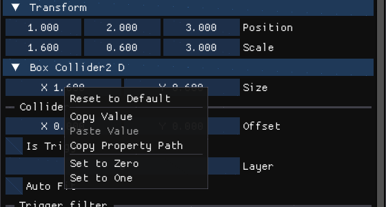
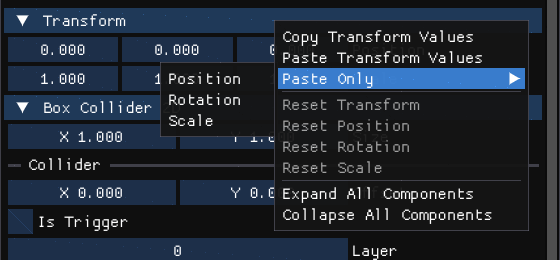

# Inspector right-click menus

Owner request (2026-11-15): "improve the context menu for inspector ... add more." This page lists every right-click menu
of the editor's **Inspector** panel, what each row does, and when it is greyed out (a greyed row always has a tooltip that
says why). The Hierarchy menus and the Project panel menus are not part of this page.

How it is built: the **rules** (which rows exist, their order, labels, plurals, what is enabled when and the reason when not)
are plain data in [`editor/InspectorContextModel.hpp`](../editor/InspectorContextModel.hpp) and are unit tested without a
window (`tests/test_inspector_context_model.cpp`). The **operations** behind the rows (move, duplicate, paste as new, copy all
values, reset one value, Transform parts, what Paste Value accepts) are in `editor/InspectorModel.*` and are tested headless too
(`tests/test_inspector_menu_actions.cpp`). `editor/InspectorPanel.cpp` only draws the list and carries out the row that was
clicked. Every value goes through the property registry (the same path Copy Values, the generated cards, Undo and the scene
file already use), so there is no second idea of "a component's values". Four small rule files keep the decisions
out of the drawing code, each with its own test:

| File | Decides | Test |
|---|---|---|
| [`editor/AddComponentRules.hpp`](../editor/AddComponentRules.hpp) | "only one per object": the one table that the Add Component browser, Duplicate and Paste As New all use | `add_component_rules` |
| [`editor/InspectorClickRules.hpp`](../editor/InspectorClickRules.hpp) | which menu a right click opens (a field's, or the empty space's, never both) and where a field's row is | `inspector_click_rules`, `inspector_imgui` |
| [`editor/InspectorClipboardRules.hpp`](../editor/InspectorClipboardRules.hpp) | what Paste Value takes from the clipboard: size cap, one line, safe preview, file paths inside the project | `inspector_clipboard_rules` |
| [`editor/ComponentIdScope.hpp`](../editor/ComponentIdScope.hpp) | every component's card gets widget ids of its own | `inspector_imgui` |

Written from the owner's request and the existing code; no code, text or tests were taken from another project.

## Where each menu opens

| Menu | Open it by |
|---|---|
| Component | the **...** button at the right of a component header, or right-click the header |
| Transform | right-click the **Transform** header |
| Field | right-click a field row: the label, the gap next to it or the box itself (a number, a box to tick, a list, a text box, a colour, a file or object field ...) |
| Object | right-click the object header bar at the top (the icon, the gaps, the Tag and Layer row), not the name box |
| Empty space | right-click empty space in the Inspector (below the components, beside the headers) |

One right click opens one menu. A field with a menu takes the click on its whole row; the empty-space menu opens only when no
field took it and no widget is under the mouse. (Earlier the empty-space menu also opened over a label or a gap and replaced the
field's menu: see "Tested".)

Every change a menu makes is one undo step with a name (**Edit > Undo Duplicate Light** and so on). With several objects
selected, a row that says "(3 objects)" does it to the same component on each selected object that has one.

## Component menu

| Row | What it does | Greyed out when |
|---|---|---|
| Disable Component / Enable Component | turns the component off or on (the same as the check box in the header) | never |
| Move Up, Move Down | one place in the list | already first / last |
| Move to Top, Move to Bottom | right below the Transform / last | already first / last |
| Duplicate Component | adds another component of the same kind with the same values and on / off state, right below this one | scripts; a kind the editor cannot copy; **a kind that is "only one per object"** (almost all: see below); a kind whose copy would not save as the same scene text (see below) |
| Copy Values | copies the values of this component that its property list holds (what scripts and Custom Actions can read and write); the tooltip says so, and names what is not copied when it knows | the kind has no registered values |
| Paste Values | writes the copied values into this component | nothing copied, or copied from another kind |
| Paste As New *Kind* | adds a new component of the copied kind (from anywhere) with the copied values to **every selected object that can take it**; the label names that number ("(2 objects)"), not the number of objects that have the right-clicked kind | nothing copied; "only one per object" and every selected object has one; the copy would not be the same (see below) |
| Reset | puts every value back to what a new component has | the kind has no registered values |
| Revert / Apply Component to Prefab | (existing) only for a component changed from its prefab | |
| Expand All Components, Collapse All Components | opens or closes every card | |
| Edit Script / Open in Node Editor | script components: opens the script in the Script Editor, or the graph in the Visual Script window | a graph stored inside the scene (it needs a file first: use **Open in node editor** in the card) |
| Reveal Script in Project | finds the script file in the Project panel | the script is stored inside the scene |
| Scripting Reference | opens Help > Scripting Reference | |
| Copy Component Type Name | copies the name scripts use ("Rigidbody2D") | never |
| Remove Component | removes it (from every selected object when several are selected) | the component is required, or another component on the object needs it (the tooltip names it). The second case only happens in a project whose code registers `RequireComponent` rules; **the shipped editor registers none, so you cannot see it there** (it is tested with a rule registered in the test) |

## One per object: Duplicate and Paste As New follow the Add Component list

The Add Component browser hides most kinds once an object has one: add a Rigidbody 2D and the row is gone. Duplicate Component and
Paste As New used to ignore that and could make a second Rigidbody 2D, Box Collider or Light that the editor otherwise refuses to
add. Now all three read **one table**, [`editor/AddComponentRules.hpp`](../editor/AddComponentRules.hpp) (208 kinds). Every row of the
browser is written `item(oked::CanAddOne<Rigidbody2D>(*go), "Rigidbody2D")`; `CanAddOne` does not compile for a kind that is not in the
table, and `tests/test_add_component_rules.cpp` reads the browser's sources and checks the table and the rows agree (a kind without a
row, a row without a kind, a row still written the old way). A kind in the table gets a **greyed** (not hidden) Duplicate Component
with the reason "Only one per object: a second *Kind* cannot be added (the Add Component list does not offer one either)", and Paste As
New of it is greyed on an object that already has one.

Of the 109 kinds the property registry can add, 100 are in that table. What can still be duplicated is the other 9, the kinds the Add
Component list offers again and again: **Volume** (the six Volume rows: Checkpoint, Kill, Force, Atmosphere, Ambience, Reverb), **UI
Dropdown, UI Input Field, UI Scroll View, UI Layout Group, Net Object, Net Transform, Sync Var** and **Player View**. (The test prints
this list; it is the list the run on 2026-11-16 found.) Scripts are attached from files (their Duplicate says so). A project's own
`DisallowMultipleComponent` rule is asked as well.

Several of these cards edit their own component: every component's card now has widget ids of its own
([`ComponentIdScope`](../editor/ComponentIdScope.hpp)), and the Rigidbody 2D / 3D cards edit the component they draw instead of the
first Rigidbody on the object. Before, two components of one kind shared the ids of their widgets ("Size##bc"), and a drag on the
copy's box moved the original's too (shown with Dear ImGui itself in `tests/test_inspector_imgui.cpp`).

## A copy is only offered when it would be the same

Copy Values, Duplicate and Paste As New work from the property registry: the values scripts and Custom Actions can read and write.
Some components save more than that to the scene file (a particle system's colour gradient and curves are not registered values). A
copy made from the registered values of such a component would be a different component, so it is not offered. The menu finds out by
trying (`CheckCopyIsExact`, nothing in your scene is touched), when a menu opens or on Copy Values: the object's saved text is loaded
into scratch scenes and

1. **Is the copy the same?** On one scratch object the original is taken out and a copy, made the way the menu would make it, put in
   its place. What the original added to the object's saved text and what the copy adds must be the same records (a record that exists
   once per object, like a UI object's layout, is there on both sides). If they differ, **Duplicate Component** is greyed ("A copy would
   not be the same as the original: its saved "..." settings are not all part of its copyable values"), and a clipboard taken from that
   component cannot be used for **Paste As New** (Paste Values, which only writes the registered values into a component that exists,
   still works). With the registered values changed and nothing else touched, every one of the 109 registered kinds comes out the same;
   what makes a copy differ is state the registry does not hold, for example a particle system with a colour gradient or a size curve.
2. **Can the file keep a second one?** A copy is put next to the original on another scratch object: the scene file has to save it
   and to load it back as a second one. Some writers keep only one component of a kind per object (12 kinds: Ranged Weapon, Virtual
   Joystick, Touch D Pad, Touch Button, UI Search Bar, UI Date Time Picker, UI File Picker, UI Accordion, UI Breadcrumbs, UI
   Pagination, UI Skeleton, UI Bottom Sheet; all of them are "only one per object" in the Add Component list too). Only **Duplicate**
   needs this; Paste As New puts the copy on an object that has none, so it is still offered for them.

`tests/test_inspector_menu_actions.cpp` runs both questions for every registered kind and compares the first with an independent
measure, the saved text of the original and of a copy made on another object; it also duplicates each kind the menu offers and compares
the saved text of the original and the copy after a reload. Its first run found that the first version of the check was wrong for
those 12 kinds and for four UI kinds (UI Panel, Text Renderer, UI Draggable, Player Controller), which share a record per object; this
is the version that agrees for all 109.

## Transform menu

Copy Transform Values, Paste Transform Values, **Paste Only > Position / Rotation / Scale**, **Reset Transform**, Reset
Position, Reset Rotation, Reset Scale, Expand / Collapse All Components. Paste and Reset go to every selected object. A camera
keeps its scale (a camera cannot be scaled): with a camera among several selected objects the scale rows still work for the others
and their tooltips say "1 selected camera keeps its scale"; only when every selected object is a camera is Reset Scale greyed. The
same holds for the **Scale** field menu (its rows name the objects they skip) and for Paste All Component Values. A reset row is
greyed out when the value is already at its default; **Reset Rotation** is only greyed when there is no rotation at all (a turn of
a fraction of a degree counts as a rotation).

## Field menu

Open it on any field of a component the property registry knows. In the generated cards (components without a hand-written
Inspector) the whole row answers, every kind of value: the label, the gap next to it and the box (numbers, text, colours, lists,
file and object fields). In the hand-written cards the field answers when its label matches a property of the component, on the
widget (Position, Rotation and Scale in the Transform answer on the whole row).

| Row | What it does |
|---|---|
| Revert Property / Apply Property to Prefab | (existing) only for a property changed from its prefab |
| Reset to Default | writes the value a new component has |
| Copy Value | copies the value as text to the system clipboard (so it can also be pasted into a text file or a chat) |
| Paste Value | reads the clipboard text as this kind of value and writes it (the tooltip shows what it would paste); greyed out, with the reason, when the text is not such a value (see below) |
| Copy Property Path | copies the path ("Light.intensity") that scripts, the visual script and Custom Actions use |
| Set to Zero, Set to One | numbers and vectors; greyed out when zero or one is outside the allowed range |
| Set to Identity | rotations (no rotation) |
| Set to White | colours (each object keeps its own alpha) |
| Clear | text, file and object fields |
| Show in Project | file fields: selects the file in the Project panel |
| Select Object | object fields: selects the referenced object |

A read-only value only offers the copy rows. When several objects are selected a row says how many it reaches ("(2 objects)"); a
camera among them is left out of a scale and the row's tooltip says so ("Skips 1 selected object: a camera cannot be scaled.").
(Dear ImGui's text boxes have no right-click menu of their own in the version the editor uses, so nothing is lost on them. A colour
box has one for its display options; in the generated cards it is switched off so the field menu answers there, and in a
hand-drawn card the field menu replaces it.)

### Paste Value and the clipboard

The clipboard is whatever you last copied in any program, so it is checked before anything is written
([`InspectorClipboardRules.hpp`](../editor/InspectorClipboardRules.hpp), [`CheckPaste`](../editor/InspectorModel.hpp)). It is read **once,
when the menu opens**, not every frame, and at most 64 KB of it is looked at. Paste Value is **greyed out, with the reason as its
tooltip,** when:

| The clipboard holds | Tooltip says |
|---|---|
| nothing, or only blank text | the clipboard holds no text / only blank text |
| more than 64 KB | more than 64 KB of text, too much for a field |
| several lines (for a one-line field) or a tab / control character | the clipboard holds several lines / control characters |
| text that is not this kind of value (a number, 3 numbers, a colour ...) | the clipboard text is not a number / 3 numbers ... |
| `nan` or `inf` | a number that is nan or infinite cannot be pasted |
| a value outside the field's allowed range, a rotation of four zeros, an enum number that is not a choice, an object id that is not one | the field's own refusal |
| a file path with `..`, a network path (`\\server\share`), or an absolute path outside the project folder | the path rule |
| the value the field already has on every selected object | the field already holds the copied value (no empty undo step) |

A file path must stay inside the project: a project-relative path ("Assets/hero.png") is accepted, and so is an absolute path
**inside the open project folder**, because that is the form the Project panel stores when a file is picked or dropped, so Copy Value on
one file field can be pasted into another. A stricter rule (project-relative paths only) is one argument away
(`CheckAssetPath(..., allowAbsoluteInProject = false)`). The number parsers also refuse a huge text without copying or splitting it (a
whole file on the clipboard cannot freeze the Inspector).

## Object menu (header bar) and empty-space menu

| Row | What it does |
|---|---|
| Copy All Component Values | copies the values of every component, the Transform's position, rotation and scale included (not the name, tag, layer or place in the Hierarchy) |
| Paste All Component Values | writes them into the components of the same kinds on the selected objects; components the object lacks are not added |
| Reset Transform | position 0, no rotation, scale 1 (a camera keeps its scale) |
| Select Parent | selects the parent object |
| Select Prefab Root, Select Prefab Asset | prefab instances: the instance root (parts only); the file in the Project panel |
| Copy Object Name, Copy Object Path | to the clipboard |
| Add Component... | opens the Add Component browser |
| Expand / Collapse All Components | |

The empty-space menu has: Add Component..., Paste As New *Kind*, Paste All Component Values, Expand / Collapse All Components.

## Pictures

These are **headless renders** (a small software rasteriser draws Dear ImGui's draw lists to a PNG) of the real menu code in
`editor/InspectorPanel.cpp`, driven by simulated mouse clicks on a small stand-in Inspector with a few components. They use Dear
ImGui's built-in font and dark style, not the editor's theme, so the real editor looks different (colours, font, spacing). They show
what rows appear, in what order, and which are greyed out. The card titles use the readable names the real hand-written cards use
("Box Collider 2D"). The render program is not part of the repository and was not run again for the review fixes: the pictures below
are of menus whose rows have not changed since they were taken (the Transform, field, object and empty-space menus; the Transform and
field menus gained tooltips only). Two pictures were **removed**: the Box Collider component menu showed Duplicate Component switched
on (a Box Collider is "only one per object", so it is greyed now), and the "Remove Component greyed because a Box Collider needs a
Rigidbody" picture showed a state the shipped editor cannot produce (it registers no `RequireComponent` rules). There are no new
pictures of the greyed Duplicate or of the label-and-gap click; the steps in [try_it.md](try_it.md) section 18 show them in the editor.

| Picture | What it shows |
|---|---|
|  | Right-click a row (here Size of the Box Collider card): Reset to Default, Copy Value, Paste Value (greyed: no such value on the clipboard), Copy Property Path, Set to Zero, Set to One |
|  | The Transform header menu; Paste and the resets that have nothing to do are greyed |
|  | **Paste Only** opens Position / Rotation / Scale |
|  | Right-click the object header bar |
|  | Right-click empty space on an object with only a Transform: Expand / Collapse are greyed (no components) |

## What was there before, and what this change added

Searched first (the feature map, the code, `scripts/find_existing.py`): no other open branch touches the Inspector menus.

| Menu | Already there (reused) | Added |
|---|---|---|
| Component | Move Up / Down (always enabled), Expand / Collapse All, Copy Values / Paste Values / Reset (hidden for kinds without registered values), Revert / Apply Component to Prefab, Remove (never checked `GameObject::RequiredBy`) | Enable / Disable, Move to Top / Bottom, greyed Move at the ends, Duplicate, Paste As New, Copy Component Type Name, script rows, Remove refused while another component needs it, "(N objects)" labels, a reason for every greyed row |
| Transform | Copy / Paste Transform Values (kept in local variables of `DrawInspector`), Reset Pos / Rot / Scale buttons | one shared clip, Paste Only, Reset Transform / Position / Rotation / Scale rows, applies to the whole selection |
| Field | prefab Revert Property / Apply Property (only on changed fields); file fields: Choose from project, Clear | Reset to Default, Copy / Paste Value, Copy Property Path, quick values, Show in Project, Select Object (one popup together with the prefab rows) |
| Object header | buttons: Select Asset, Select Instance Root (prefab banner), Reset buttons, Lock Inspector box | a right-click menu with Copy / Paste All Component Values, Reset Transform, Select Parent, Select Prefab Root / Asset, Copy Object Name / Path, Add Component... |
| Empty space | nothing | Add Component..., Paste As New, Paste All Component Values, Expand / Collapse All |

## Limits (honest)

* **Duplicate Component and Paste As New are offered for few kinds.** The Add Component list hides a kind once the object has one (208
  kinds), and these two rows follow it, so for a Rigidbody, a collider, a Light, an Audio Source, a Particle System ... they are
  greyed with the reason. What is left is what the list offers again and again, and only when the copy saves as the same scene
  text: Volume, UI Dropdown, UI Input Field, UI Scroll View, UI Layout Group, Net Object, Net Transform, Sync Var and Player View.
  `tests/test_inspector_menu_actions.cpp` prints the list it found, and every kind that is refused because a copy
  would differ, each with its reason. Script components, visual scripts and any hand-built component the registry has no entry for
  are greyed with a reason too. What a copy holds is what **Copy Values** copies: the registry's values, not run-time state.
* "Would the copy be the same" is answered by saving the object's text and loading it into scratch scenes when the component menu
  opens (or Copy Values is chosen). An object whose saved text is over 1 MB is not checked, and Duplicate is greyed for it ("its
  saved text is too big to compare here").
* A value only the hand-written card knows (not in the registry) is not copied; a kind that saves such a value is not offered for
  Duplicate or Paste As New (see above).
* **Pasted file paths.** A path inside the open project folder is accepted in the absolute form too, because the Project panel
  stores the full path of a file you drop on a file field; with the strict switch (`allowAbsoluteInProject = false`) only
  project-relative paths pass, and then Copy Value on one file field could not be pasted into another.
* **A hand-drawn field answers only where its card calls the tooltip helper** (`oked::FieldTip`, about 1,350 call sites in `main.cpp`,
  which is also what shows the field's tooltip) and its label matches a registered property. A few rows do not call it yet; for
  example the Size and Offset rows of the Box Collider 3D card. The generated cards and the Transform rows always answer. The
  fix for a missing row is one `oked::FieldTip("Size##bc3");` line after the widget.
* The Add Component browser itself is still opened by its button or by **Add Component...** in the menus; it has no menu of its own.
* No "Add Keyframe": the Animator's keyframes record a whole Transform, not single properties.
* No docs link per component: the editor has no viewer for component pages (script components get **Scripting Reference**).
* The **Uniform** scale check box stays under the Scale row (it is a setting of the card, not a value).
* **Lock Inspector** stays the check box at the top of the panel.

## Tested

Run on Linux (g++ 13, no optimisation) on 2026-11-16, in a tests-only CMake build of this branch merged with main (engine library built
from this branch). `ctest -R "inspector|add_component"`: **7 of 7 tests passed.**

* `inspector_context_model` (`tests/test_inspector_context_model.cpp`, header-only): 465,766 checks, 0 failures. Most of the checks are
  the same structural rules applied to about 8,400 generated menu states (order, nothing listed twice, every greyed row has a reason
  ...); the specific assertions about rows, labels and reasons are its 192 `CHECK` lines in 13 suites.
* `inspector_click_rules` (header-only, 31,722 checks) and `inspector_clipboard_rules` (header-only, 82 checks): which menu a right
  click opens and where a field's row is; what Paste Value takes from the clipboard.
* `inspector_imgui` (37 checks): the four core Dear ImGui sources the editor uses, a window-less context and simulated mouse input:
  one menu opens on a label, in a gap and on a box, never two; dragging the second of two same-kind cards leaves the first alone
  (with `ComponentIdScope` the first card's value stays 1 while the second goes to 7; without it both move).
* `inspector_menu_actions` (590 checks): the operations behind the rows, the copy check for all 109 registered kinds, camera scale
  lock, Reset Rotation, Paste Value checks, the bounded number parsers (allocation counting) and `SerializeObject` without children.
* `add_component_rules` (655 checks): the table (208 kinds) against the 210 rows in the browser's sources, the run-time answers, and the
  three one-line fixes in `editor/main.cpp` that no test can run (read from the source).
* `inspector_model` (existing, 192 checks): copy, paste, reset, prefab changes, one undo step per edit.
* **Each new test fails without its fix.** `python3 scripts/inspector_menus_mutation_check.py --imgui <ImGui folder> --build <build
  folder>` puts each old bug back, one at a time, in a copy of the source (the repository is not touched), builds and runs the
  matching test and reports RED (caught) or GREEN (the test is too weak). It first runs the unchanged test and skips the mutations of
  a test that is not green. 54 mutations, **all 54 caught** (20 on the header-only rules, 3 with Dear ImGui, 31 on the engine-linked tests: the model, the engine's number
  parsers and `SerializeObject`, the table and the three lines of `editor/main.cpp`). Run on 2026-11-16 in about nine minutes.
* The changed editor files give no new warning with `-Wall -Wextra -Wpedantic`; `editor/main.cpp`, `editor/InspectorPanel.cpp` and the
  tool files compile with `-fsyntax-only` after the merge. The Inspector files, the four rule headers and the tool files also pass
  `-fsyntax-only` with the MinGW win32 compiler (no `<mutex>` or `<thread>`); `main.cpp` could not be checked that way here (no Windows
  SDL headers).
* **Not run:** the real editor in a window (nobody has clicked the steps in [try_it.md](try_it.md) section 18; the drawing code in
  `editor/main.cpp` and `editor/InspectorPanel.cpp` is only compiled, the parts that decide what it does are tested without a window),
  anything on Windows, and the script rows with the real Script Editor and node editor windows. There are no new pictures.
