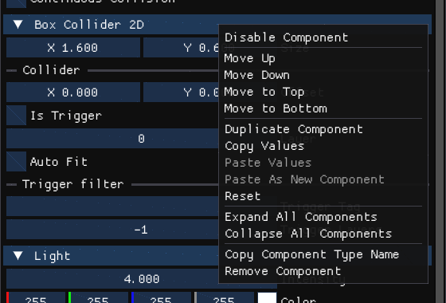
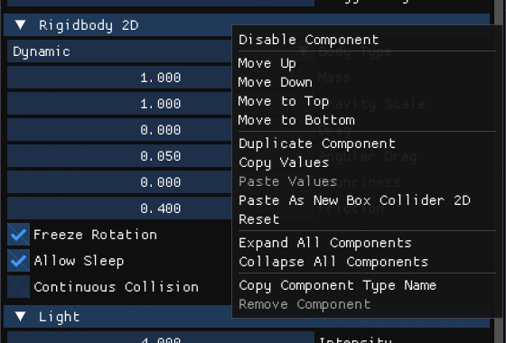
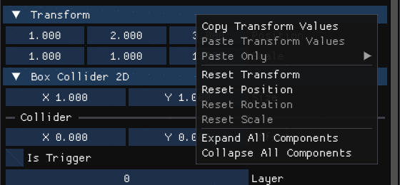
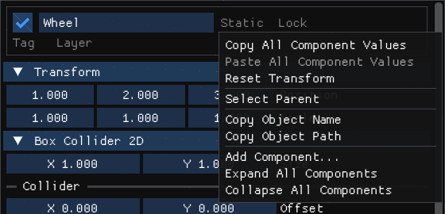
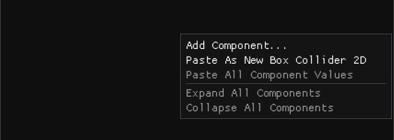

# Inspector right-click menus

Owner request (2026-11-15): "improve the context menu for inspector ... add more." This page lists every right-click menu
of the editor's **Inspector** panel, what each row does, and when it is greyed out (a greyed row always has a tooltip that
says why). The Hierarchy menus and the Project panel menus are not part of this page.

How it is built: the **rules** (which rows exist, their order, labels, plurals, what is enabled when and the reason when not)
are plain data in [`editor/InspectorContextModel.hpp`](../editor/InspectorContextModel.hpp) and are unit tested without a
window (`tests/test_inspector_context_model.cpp`). The **operations** behind the rows (move, duplicate, paste as new, copy all
values, reset one value, Transform parts) are in `editor/InspectorModel.*` and are tested headless too
(`tests/test_inspector_menu_actions.cpp`). `editor/InspectorPanel.cpp` only draws the list and carries out the row that was
clicked. Every value goes through the property registry (the same path Copy Values, the generated cards, Undo and the scene
file already use), so there is no second idea of "a component's values".

Written from the owner's request and the existing code; no code, text or tests were taken from another project.

## Where each menu opens

| Menu | Open it by |
|---|---|
| Component | the **...** button at the right of a component header, or right-click the header |
| Transform | right-click the **Transform** header |
| Field | right-click a field row (a number, a box to tick, a list, a file or object field ...) |
| Object | right-click the object header bar at the top (the icon, the gaps, the Tag and Layer row), not the name box |
| Empty space | right-click empty space in the Inspector (below the components, beside the headers) |

Every change a menu makes is one undo step with a name (**Edit > Undo Duplicate Light** and so on). With several objects
selected, a row that says "(3 objects)" does it to the same component on each selected object that has one.

## Component menu

| Row | What it does | Greyed out when |
|---|---|---|
| Disable Component / Enable Component | turns the component off or on (the same as the check box in the header) | never |
| Move Up, Move Down | one place in the list | already first / last |
| Move to Top, Move to Bottom | right below the Transform / last | already first / last |
| Duplicate Component | adds another component of the same kind with the same values and on / off state, right below this one | scripts; a kind the editor cannot copy; a kind that is "only one per object" |
| Copy Values | copies every value of this component | the kind has no registered values |
| Paste Values | writes the copied values into this component | nothing copied, or copied from another kind |
| Paste As New *Kind* | adds a new component of the copied kind (from anywhere) with the copied values | nothing copied; "only one per object" and it is already there |
| Reset | puts every value back to what a new component has | the kind has no registered values |
| Revert / Apply Component to Prefab | (existing) only for a component changed from its prefab | |
| Expand All Components, Collapse All Components | opens or closes every card | |
| Edit Script / Open in Node Editor | script components: opens the script in the Script Editor, or the graph in the Visual Script window | a graph stored inside the scene (it needs a file first: use **Open in node editor** in the card) |
| Reveal Script in Project | finds the script file in the Project panel | the script is stored inside the scene |
| Scripting Reference | opens Help > Scripting Reference | |
| Copy Component Type Name | copies the name scripts use ("Rigidbody2D") | never |
| Remove Component | removes it (from every selected object when several are selected) | the component is required, or another component on the object needs it (the tooltip names it) |

## Transform menu

Copy Transform Values, Paste Transform Values, **Paste Only > Position / Rotation / Scale**, **Reset Transform**, Reset
Position, Reset Rotation, Reset Scale, Expand / Collapse All Components. Paste and Reset go to every selected object. A camera
keeps its scale (scale is locked on cameras). A reset row is greyed out when the value is already at its default.

## Field menu

Open it on any field of a component the property registry knows. In the generated cards (components without a hand-written
Inspector) the whole row answers. In the hand-written cards the field answers when its label matches a property of the
component (Position, Rotation and Scale in the Transform answer on the whole row).

| Row | What it does |
|---|---|
| Revert Property / Apply Property to Prefab | (existing) only for a property changed from its prefab |
| Reset to Default | writes the value a new component has |
| Copy Value | copies the value as text to the system clipboard (so it can also be pasted into a text file or a chat) |
| Paste Value | reads the clipboard text as this kind of value and writes it; greyed out when the text is not such a value |
| Copy Property Path | copies the path ("Light.intensity") that scripts, the visual script and Custom Actions use |
| Set to Zero, Set to One | numbers and vectors; greyed out when zero or one is outside the allowed range |
| Set to Identity | rotations (no rotation) |
| Set to White | colours (each object keeps its own alpha) |
| Clear | text, file and object fields |
| Show in Project | file fields: selects the file in the Project panel |
| Select Object | object fields: selects the referenced object |

A read-only value only offers the copy rows. Text boxes and colour boxes keep Dear ImGui's own right-click menus (Cut, Copy,
Paste; colour options) when you right-click the box itself; the generated cards still answer on the label.

## Object menu (header bar) and empty-space menu

| Row | What it does |
|---|---|
| Copy All Component Values | copies the values of every component, the Transform's position, rotation and scale included (not the name, tag, layer or place in the Hierarchy) |
| Paste All Component Values | writes them into the components of the same kinds on the selected objects; components the object lacks are not added |
| Reset Transform | position 0, no rotation, scale 1 (a camera keeps its scale) |
| Select Parent | selects the parent object |
| Select Prefab Root, Select Prefab Asset | prefab instances: the instance root (parts only); the file in the Project panel |
| Copy Object Name, Copy Object Path | to the clipboard |
| Add Component... | opens the Add Component browser |
| Expand / Collapse All Components | |

The empty-space menu has: Add Component..., Paste As New *Kind*, Paste All Component Values, Expand / Collapse All Components.

## Pictures

These are **headless renders** (a small software rasteriser draws Dear ImGui's draw lists to a PNG) of the real menu code in
`editor/InspectorPanel.cpp`, driven by simulated mouse clicks on a small stand-in Inspector with a few components. They use Dear
ImGui's built-in font and dark style, not the editor's theme, so the real editor looks different (colours, font, spacing). They show
what rows appear, in what order, and which are greyed out. The card titles use the readable names the real hand-written cards use
("Box Collider 2D"). The render program is not part of the repository (see "Tested" below).

| Picture | What it shows |
|---|---|
|  | The menu of a **Box Collider** header: Paste Values and Paste As New are greyed because nothing is copied yet |
|  | The menu of a **Rigidbody** header after a Box Collider was copied (**Paste As New Box Collider 2D** is on), with the rule "a Box Collider needs a Rigidbody": **Remove Component** is greyed (hover it and the tooltip names the Box Collider) |
|  | Right-click a row (here Size of the Box Collider card): Reset to Default, Copy Value, Paste Value (greyed: no such value on the clipboard), Copy Property Path, Set to Zero, Set to One |
|  | The Transform header menu; Paste and the resets that have nothing to do are greyed |
|  | **Paste Only** opens Position / Rotation / Scale |
|  | Right-click the object header bar |
|  | Right-click empty space on an object with only a Transform: Expand / Collapse are greyed (no components) |

## What was there before, and what this change added

Searched first (the feature map, the code, `scripts/find_existing.py`): no other open branch touches the Inspector menus.

| Menu | Already there (reused) | Added |
|---|---|---|
| Component | Move Up / Down (always enabled), Expand / Collapse All, Copy Values / Paste Values / Reset (hidden for kinds without registered values), Revert / Apply Component to Prefab, Remove (never checked `GameObject::RequiredBy`) | Enable / Disable, Move to Top / Bottom, greyed Move at the ends, Duplicate, Paste As New, Copy Component Type Name, script rows, Remove refused while another component needs it, "(N objects)" labels, a reason for every greyed row |
| Transform | Copy / Paste Transform Values (kept in local variables of `DrawInspector`), Reset Pos / Rot / Scale buttons | one shared clip, Paste Only, Reset Transform / Position / Rotation / Scale rows, applies to the whole selection |
| Field | prefab Revert Property / Apply Property (only on changed fields); file fields: Choose from project, Clear | Reset to Default, Copy / Paste Value, Copy Property Path, quick values, Show in Project, Select Object (one popup together with the prefab rows) |
| Object header | buttons: Select Asset, Select Instance Root (prefab banner), Reset buttons, Lock Inspector box | a right-click menu with Copy / Paste All Component Values, Reset Transform, Select Parent, Select Prefab Root / Asset, Copy Object Name / Path, Add Component... |
| Empty space | nothing | Add Component..., Paste As New, Paste All Component Values, Expand / Collapse All |

## Limits (honest)

* **Duplicate Component and Paste As New work for components the property registry knows** (most built-in kinds; the
  test `duplicate every registered kind` duplicates each one). Script components, visual scripts and any hand-built component the
  registry has no entry for are greyed out with a reason. What is copied is what **Copy Values** copied before: the registry's values,
  not run-time state.
* A value only the hand-written card knows (not in the registry) is not copied.
* **A hand-drawn field answers only where its card calls the tooltip helper** (`oked::FieldTip`, about 1,350 call sites in `main.cpp`,
  which is also what shows the field's tooltip) and its label matches a registered property. A few rows do not call it yet; for
  example the Size and Offset rows of the Box Collider 3D card. The generated cards and the Transform rows always answer. The
  fix for a missing row is one `oked::FieldTip("Size##bc3");` line after the widget.
* The Add Component browser itself is still opened by its button or by **Add Component...** in the menus; it has no menu of its own.
* No "Add Keyframe": the Animator's keyframes record a whole Transform, not single properties.
* No docs link per component: the editor has no viewer for component pages (script components get **Scripting Reference**).
* The **Uniform** scale check box stays under the Scale row (it is a setting of the card, not a value).
* **Lock Inspector** stays the check box at the top of the panel.

## Tested

Run on Linux (g++ 13, Debug build without optimisation, engine library built before the last merge of main; the four newer commits
on main do not touch anything these tests use):

* `tests/test_inspector_context_model.cpp` (`inspector_context_model`): the rules, 465,583 checks over every combination of the
  state flags, 0 failures. Header-only, builds with plain `g++` (also a mutation check: breaking a rule makes it fail).
* `tests/test_inspector_menu_actions.cpp` (`inspector_menu_actions`): the operations, 173 checks, 0 failures. It duplicates every
  kind of component the registry can add (109 kinds) with changed values (106 of them had values to change) and compares the copy
  with the original in memory and, for the kinds the scene file keeps (97), after a save and load.
* The existing `inspector_model` test (copy, paste, reset, prefab changes, one undo step per edit): 192 checks, 0 failures.
* The three files and `InspectorPanel.cpp` / `InspectorModel.cpp` give no warning of their own with the project's flags
  (`-Wall -Wextra -Wpedantic`).
* Not in the repository: a throwaway program ran the real `InspectorPanel.cpp` menu code inside a Dear ImGui context with no window
  and clicked through it with simulated mouse input (97 checks, 0 failures: the rows that open, the greyed rows, duplicate, move,
  enable / disable, paste as new, copy and paste values, the field menu on a generated card and on a hand-drawn field, the Transform
  menu with its submenu, the object and empty-space menus, several selected objects, a required component, script rows, undo
  names). It found one real bug, fixed here: the right-click popup of a field was named after an item id that is 0 for a labelled
  field, so two rows shared one popup (the same fault was in the prefab "Revert Property" popup). It also drew the pictures above.
* **Not run:** the real editor (`main.cpp` was only syntax-checked with `g++ -fsyntax-only`; the editor target was not built or run),
  the Windows build, and the script rows with the real Script Editor and node editor windows (the harness gave them stand-in hooks).
