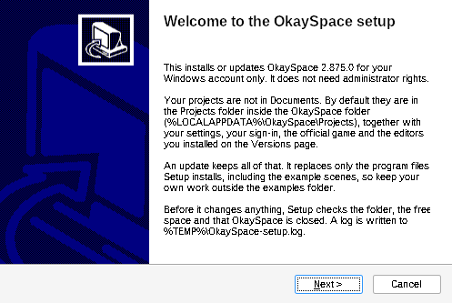
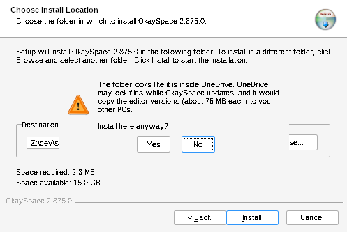
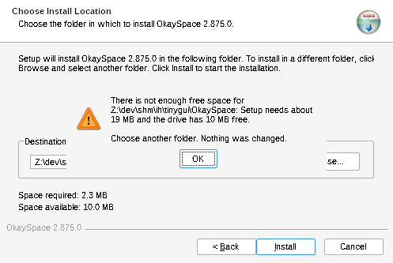
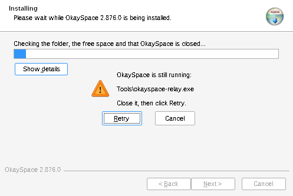
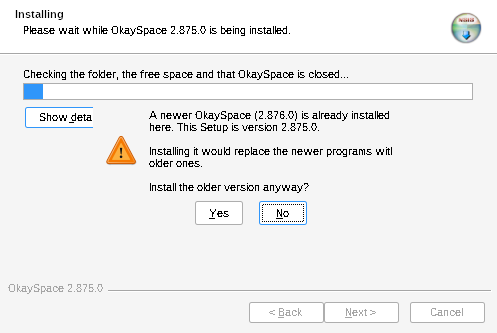
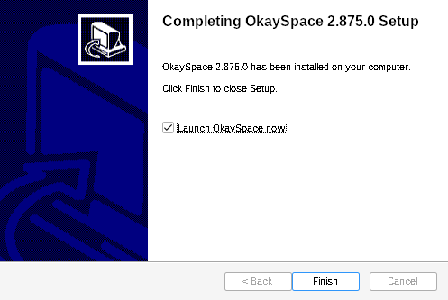
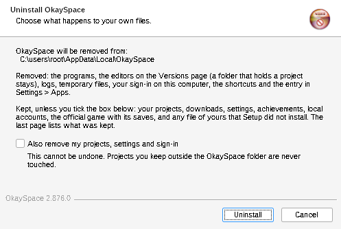
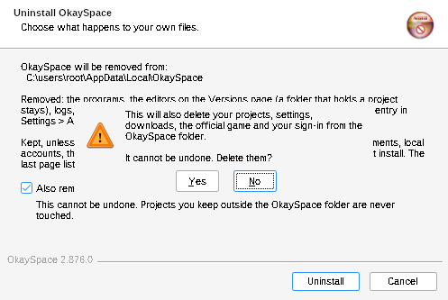
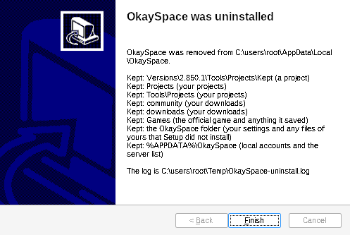

# The Windows installer: Setup and uninstall

`OkaySpace-Setup.exe` is made by `scripts/okayspace-installer.nsi` (NSIS, Modern UI 2) from the folder `scripts/build-windows-dist.sh`
writes. It installs for one person (`%LOCALAPPDATA%\OkaySpace`, no administrator rights). It also writes the uninstaller. This page says
what both do, in plain words. The audit this change comes from is [install_audit.md](install_audit.md) (findings 3, 4, 5, 7, 8 and 11, most of 13 and 14, and
the plan items 3, 4 and 10, Setup part). How to try it on Windows is section 7p of [try_it.md](try_it.md).

**What was and was not seen.** Everything below was run under wine 9.0 on Linux: Setup and the uninstaller in silent mode (`/S`) by the script test, and
the dialogs on a virtual screen (the pictures at the end are those headless wine renders, not Windows). The release builds a 32-bit installer and this
wine cannot run 32-bit programs, so the tests ran a 64-bit build of the same script (made with `makensis -XTarget amd64-unicode`); the 32-bit build is
compiled in every test run but was not run. **Nothing was run on real Windows.**
Unverified there: UAC and `Program Files`, antivirus or Explorer holding a file, the real look of the dialogs, the code-page check on a non-English
Windows, how Settings > Apps shows the entry and runs the quiet uninstall, signing and SmartScreen, and removing a junction.

## What Setup does

1. **Checks first, changes nothing.** The folder can be made and written (a probe file is written, renamed and deleted), there is enough free space
   (the size of the files plus 16 MB, on the drive of that folder), no program of the distribution is running, and this Setup is not older than what
   is installed. Warnings (not refusals): the folder is under `Program Files`, looks like OneDrive, has letters outside the Windows ANSI code page
   (the launcher starts programs with an ANSI call, audit finding 6), or is long (over 150 characters).
2. **Unpacks beside the old files** into `<folder>\.okayspace-setup-new`, then checks that every file is there with exactly the size in the list.
3. **Swaps.** Each old file is renamed to `<name>.old` and the new one moved in. Any error puts every old file back and removes the new ones
   (rollback). Each rename is tried a few times, because a virus scanner can hold a file for a moment.
4. **Commits.** The staging folder is removed first (a crash after that only leaves `.old` files), then the `.old` files.
5. **Only then** it writes the Start Menu folder, the Desktop shortcut (first install only), and the Settings > Apps entry.

A full disk therefore cannot leave a half-written folder: the pre-check refuses, and if the disk fills anyway during unpacking the old folder was
never touched. A Setup that was killed half way is repaired by the next Setup (the marker file `.swap-started` in the staging folder says a swap
was running; the `.old` files are put back first).

### What an update keeps and replaces

| | |
|---|---|
| Replaced | Every file in the installer's list: the programs, `SDL2.dll`, `README.txt`, `VERSION.txt`, `Tools\*`, `Assets\Textures\*`, `Assets\Fonts\*`, `examples\*`. This includes a shipped file the person edited (an example scene, `README.txt`). Keep your own work outside those folders. |
| Removed | A file an earlier Setup installed that this release no longer ships (`installed-files.txt` lists what the last Setup installed). It works from the second update on: an install made by the old Setup has no such list. |
| Kept | Projects, `Tools\Projects`, `Versions\`, `Games\`, `community`, `downloads`, settings, logs, sign-in, and any file Setup does not install. |
| Remembered | The Desktop shortcut is made on the first install only. A shortcut the person deleted does not come back (`HKCU\Software\OkaySpace\DesktopShortcut`). |

### Switches and exit codes

`OkaySpace-Setup.exe /S` installs silently. `/D=<folder>` chooses the folder for a **new** install (it must be last; with an install already there
that install is updated and the log says `/D=` was not used). `/FORCE` lets an older Setup replace a newer install in silent mode (in normal mode it
asks, default No).

From a command window use `start /wait "" OkaySpace-Setup.exe /S` and then `echo %errorlevel%`: Setup is a window program, so a plain command returns at
once.

| Code | Meaning |
|---|---|
| 0 | Done |
| 1 | The person cancelled |
| 10 | A program of OkaySpace is running (the log names it). In normal mode Setup asks to close it: Retry or Cancel |
| 11 | The folder cannot be made or written (a file in the way, a read-only disk, no permission) |
| 12 | Not enough free space |
| 13 | A newer version is installed (use `/FORCE`) |
| 14 | The files could not be unpacked or did not check out (disk full while unpacking). Nothing was changed |
| 15 | The new files could not be put in place. The old ones were put back |
| 16 | Another Setup or uninstall is running |
| 17 | (uninstaller only) `Uninstall.exe` was copied to a folder that is not an OkaySpace install, so it removes nothing |

Every run writes `%TEMP%\OkaySpace-setup.log` (fresh each time): what was checked, warnings, what failed, the exit code. It is UTF-16 with a byte
order mark, so Notepad opens it and any folder name is written right. It never contains a password or token.

## The uninstaller

Started from Settings > Apps > Installed apps, the Start Menu folder, or `Uninstall.exe`. It stops (Retry or Cancel; silent mode exits with 10)
if any program of ours is running: the programs of the distribution, and any `.exe` below `Versions\` or `Games\`. Then:

| What | Box off (the default) | Box ticked |
|---|---|---|
| The files Setup installed, `Uninstall.exe`, `installed-files.txt`, `.old` files | removed | removed |
| Editor versions in `Versions\` (and `.partial-*`, `.removing-*`) | removed, **except a folder that holds a project** (a `project.okayproj`, or an `Assets` folder) | removed, projects too |
| Logs, state, update leftovers (`okay_update.log`, `okay_selfupdate.state`, `*.exe.old`, `.new`, `.failed`, crash logs), temp files `%TEMP%\okayspace_*` | removed | removed |
| **Sign-in token** `%APPDATA%\OkaySpace\session.txt`, the game `ipc\` folder | removed | removed |
| `Projects\`, `Tools\Projects\`, `community\`, `downloads\`, `Games\` (the official game and anything it saved) | kept | removed |
| Settings (`launcher.cfg`, `okay_*.txt`, `imgui.ini`, ...), achievements, `account_*.txt` | kept | removed |
| `%APPDATA%\OkaySpace\accounts.db` (local accounts), `servers.cfg` | kept | removed |
| A file Setup did not install and the programs did not make (your own file in `examples\` or `Assets\`) | kept | kept |
| Shortcuts, Start Menu folder, both registry keys | removed | removed |
| The OkaySpace folder | removed when empty | removed when empty |

A link (junction or folder symbolic link) is never followed: what it points at is not touched, and a folder that is a link is only unlinked (on
Windows; not run there: wine cannot remove a folder link, so under wine the link stays and the log says so).
The last page lists `Kept: ...` for each place that still holds something, and the full list is in `%TEMP%\OkaySpace-uninstall.log`. In silent mode
`/REMOVEUSERDATA` is the box. `Uninstall.exe /S` returns at once (NSIS runs the real uninstaller from a temporary copy); to wait for it and get its exit
code use `Uninstall.exe /S _?=<folder>` (then `Uninstall.exe` itself stays, because a running program cannot delete itself).

## The list of files

`scripts/gen-installer-filelist.py` makes the list from the distribution folder every time `makensis` runs (so it matches signed programs too).
It refuses a distribution without `OkaySpace.exe`, `VERSION.txt`, `Tools\OkayEngine.exe` or `Tools\OkaySpacePlayer.exe`, an empty `.exe`, `.dll` or
`VERSION.txt`, a link, and a file name with a character an installer script would read as something else (`$`, `"`, non-ASCII letters, ...).
`build-windows-dist.sh` runs it with `--check` at the end, so a bad distribution fails there. Run it by hand:
`python3 scripts/gen-installer-filelist.py build-win-dist --check`. Building the installer needs `python3` on the PATH (the release job and `scripts/release-local.sh` have it): `makensis` runs the generator with the script's own
folder as the current folder, so give `-DDISTDIR` as an absolute path (a relative one is read from the `scripts` folder; the release job already passes an absolute one). `makensis -DFILELIST=<file>` uses a list made beforehand; `-DSPACE_MARGIN_KB=<n>`
changes the extra free space asked for (default 16384; the test lowers it).

## Defaults picked for the owner decisions (rule 1)

D2 uninstall keeps projects and settings unless the box is ticked. D6 an older Setup does not replace a newer install in silent mode, and asks in
normal mode. D7 the Desktop shortcut is made on the first install only. D8 per-user only. D11 no support link in Apps & features. Also picked: the sign-in
token is always removed; local accounts, the server list, achievements and the official game folder count as the person's (kept unless the box is ticked);
Settings > Apps gets size, a quoted uninstall command and a quiet uninstall command.

## Tests

`tests/scripts/test_installer_wine.sh` (ctest `installer_wine`; `bash tests/scripts/test_installer_wine.sh`). It builds the installer with `makensis`
(as a 64-bit installer through `-XTarget amd64-unicode`, because this wine cannot run 32-bit programs; the script itself is not changed) and runs
Setup and the uninstaller silently under wine, in 21 scenarios: the build the way the release job does it, the file-list generator, fresh install, update
with the person's own files and a dropped file, an older Setup, each of the five programs running, a folder below a file, a read-only disk and a folder
that is not a full path, a full disk (a small tmpfs, unmounted afterwards) before and during unpacking, a swap that fails half way, uninstall with the box
off and on against a tree made by hand from the audit's file map (the "after use" tree), uninstall while programs run, odd folder names, an update over an
install made by the older Setup, a tampered file list, a killed Setup, `/D=`, links, an `Uninstall.exe` in the wrong folder, a Setup run from an
unzipped copy, and a folder of your own choice. It skips (77) without `makensis`; without wine, MinGW or
`iconv` only the build and file-list checks run (the CI job `ticket-and-script-tests` runs those) and the result is still "skipped". The full disk and
read-only disk checks mount a tmpfs, which needs root (skipped otherwise, with a line saying so); a folder without permission can only be tested when
the test is not run as root (it is then, and root skips it).
`OKAY_INSTALLER_NSI=<old copy>` runs it against another script; `OKAY_INSTALLER_VERBOSE=1` prints each run's exit code and log; `OKAY_INSTALLER_ONLY="fresh update"`
runs some scenarios; `OKAY_INSTALLER_PREFIX=<dir>` reuses a wine prefix (about 700 MB; put `TMPDIR` on `/dev/shm` to keep it off the disk).

Against the Setup script this change replaced: **127 of 249 checks failed** (exit 0 with nothing installed, a mixed folder with the relay running, a
silent downgrade, a changed folder after a failed update, the token, `Versions\` and logs left, no log, a stray `Uninstall.exe` cleaning another folder).
Against the new script **all 249 checks pass**. Each safety rule was also checked by breaking it on purpose (a copy of the script with the check removed)
and seeing the test fail: links not followed, the file-list safety rules, projects kept in `Versions\`, `Tools\Projects\` protected, the wrong-folder guard.

## Pictures (headless wine renders on a virtual screen; the version number is only a test value)

| | |
|---|---|
|  |  |
| The welcome page says where projects are and what an update keeps | A warning (OneDrive); Yes or No, default No |
|  |  |
| Not enough free space: it stays on the folder page | The relay is running: Retry or Cancel |
|  |  |
| An older Setup over a newer install asks | Finished |
|  |  |
| The uninstall page: one box, default off | Ticking it asks once more |
|  | |
| The last page lists what was kept | |

## Not done

From the audit plan: items 5 (Versions verify and repair), 6 (downloads that resume), 7 (wide-character paths and the manifest), 8 (user data out of
the program folder), 9 (one logs folder, Open logs, Copy diagnostics: only the Setup log is done), 11 (file types), 12 (Versions on another drive).
The launcher writing `DisplayVersion` after a self-update is a separate small change in `launcher/main.cpp` and is **not** done here (so Settings >
Apps shows the install-time version after a self-update). Items 1 and 2 (kept editors, projects in Versions) are on the branch `claude/versions-safety`.
Also open: a second copy through Setup (`/D=` with an install present), the Desktop shortcut on a OneDrive Desktop (audit finding 21), the first update
from an install made by the old Setup cannot remove files an earlier release dropped, and `Games\Official` is kept as a whole when the box is off because
its saves cannot be told from its program files without reading the game's manifest.
