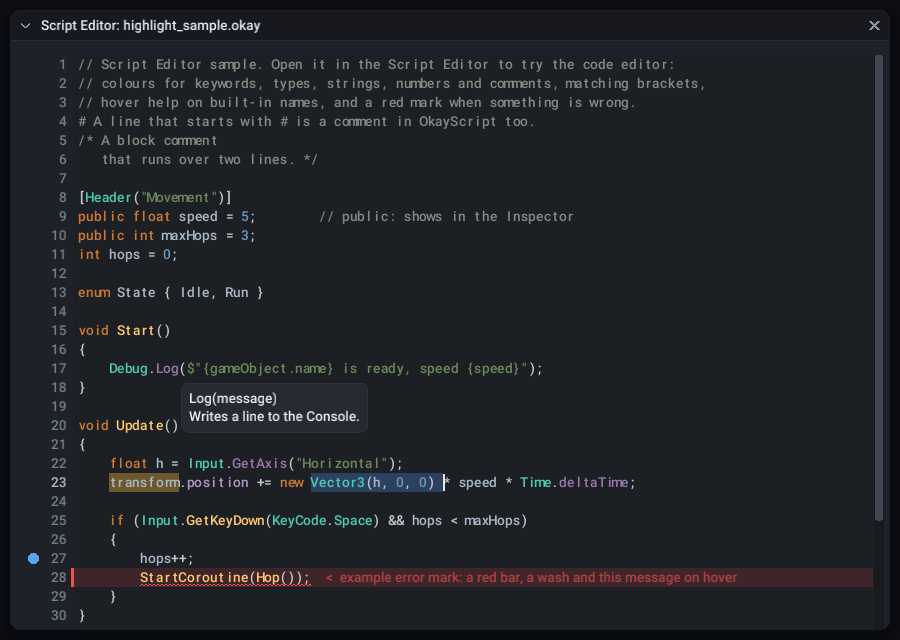
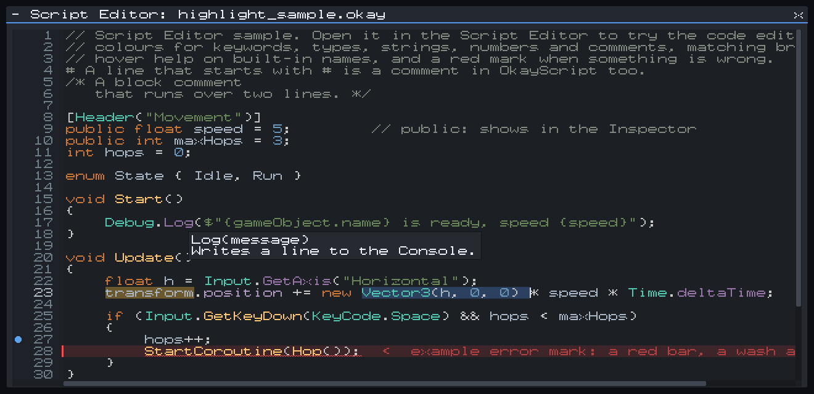

# Own code editor: the text data model (`okay::text::Buffer`) and the plan

Own code. Part of the "replace every third-party library" work (`docs/own_code_roadmap.md`, row ImGuiColorTextEdit). This page covers the data model underneath the widget and the port of the widget onto it; the widget itself is described in `docs/own_ui_code_editor.md`.

## Where things stand (read this first)

Three layers, and they are at different stages:

| Layer | What | State |
|---|---|---|
| Seam | `ScriptEditorWidget` (`editor/ScriptEditorWidget.hpp`) is the one type `editor/main.cpp` uses for its code view. It holds the vendored `TextEditor` (default) and `ScriptEditorCodeEdit` (adapter over our `OkayUI::CodeEdit`) and forwards every call to the active one. | Done before this slice (step 27 of `docs/own_ui_code_editor.md`). No new interface was added: a second one would only duplicate it. The calls it lists are the calls the script editor makes (see the feature list below). |
| Widget | `OkayUI::CodeEdit`: drawing, mouse, keys, scrolling, highlighting, markers. Since slice 2 it keeps no text model of its own: lines, edits, undo, search, brackets, tokens and line marks are `okay::text::Buffer`'s. Since slice 3 it has what the script editor was still missing from it (hover help for built-in names, a clipboard that is not 4 KB, safe drawing with a proportional font, the editor's zoom) and survives hostile input (see "Slice 3" and the parity table). | Built and tested headless, fuzzed under ASan and UBSan; never run in a real window; off unless the developer-only OkayUI backend is on. |
| Data model | `okay::text::Buffer` (`okayui/include/okay/Text/TextBuffer.hpp`, `okayui/src/TextBuffer.cpp`, library `okay_text`): a pure library with an edit log, several carets, hostile-input limits and the helpers the widget needs. | Built and tested headless (slice 1). **Slice 2: `CodeEdit` now runs on it** (same public API, its 407 checks and two fuzzers unchanged and green). |

So the honest state of "own code editor": the widget exists and is the replacement candidate, and it now sits on the tested data model. Nothing runs it in a real window yet (see "Next steps").

## What was written from what (rule 19a)

`Buffer` was written from general text-editor design, in our own structure: a line table of byte strings, a position type (line, byte column), an edit log of (position, removed text, inserted text) with groups, Knuth-Morris-Pratt for search, and the well-formed UTF-8 byte table from the Unicode standard (chapter 3, table of well-formed sequences). No code, comments, tests or shader text from ImGuiColorTextEdit or any other editor was read, copied or followed for it. `editor/vendor/TextEditor.h` was not opened for this slice; the feature list below comes from `docs/own_ui_code_editor.md`, which was produced from the script editor's own call sites.

## The model

- Text is a list of lines; a line never holds `\n`. A text with N newlines has N+1 lines. Line breaks are `\n` only: CRLF and lone CR are turned into `\n` on the way in.
- Everything stored is well-formed UTF-8. Invalid input is repaired on the way in (every bad byte, NUL, overlong form, surrogate, value above U+10FFFF becomes U+FFFD). No function ever meets a broken sequence.
- A position is `{line, byte column}`. Every position given to any function is clamped into the text and moved back to a character start, so huge numbers and the middle of a character are safe.
- Offsets (byte index in the whole text) convert both ways (`OffsetOf`, `PosOf`); display columns with tab stops convert both ways (`DisplayColumn`, `ByteForDisplayColumn`).
- Every change goes through the edit log. `BeginGroup` and `EndGroup` nest and make one undo step. Undo and redo restore the selections as well as the text. Caps: number of groups (default 1000) and bytes held (default 64 MiB); the oldest steps are dropped.
- The text may not grow past `Options::maxBytes` (default 256 MiB); a change that would is refused and changes nothing. All size arithmetic is overflow-safe (tested with a limit of `SIZE_MAX`).
- Several carets and selections at once: typing, Backspace, Delete and word delete apply to every caret as one undo step, and the carets are kept in step as other carets edit.
- Word movement (Ctrl+Left and Right), word under the caret, indent and outdent of line ranges, the text Enter should insert (keeps indent, one level deeper after an opening bracket), bracket matching with a caller predicate to skip strings and comments and a scan limit.
- Find (next, previous, wrap, whole word, ASCII case folding, needles that span lines), find all, replace all (one undo step, one linear edit whatever the number of matches). Search is KMP: linear time for any needle and text.
- Tokenizer hook: the caller gives one function (line, state in, tokens out, state out); `Buffer` caches the tokens per line and re-runs only from the first changed line. Out-of-range tokens from a careless tokenizer are clamped.
- Pure standard C++17: no `<mutex>`, no `<thread>`, no SDL, no Dear ImGui, no OkayUI. It also compiles with the MinGW cross compiler (syntax checked).

## What the script editor needs (the feature list)

The calls the script editor makes are listed in the HAVE and GAP table of `docs/own_ui_code_editor.md` (set and get text, lines, cursor, selection, undo, `InsertTextUndoable`, `Delete`, colouring with user types, error markers, breakpoints, geometry for the autocomplete popup, keyboard hand-over). Against that list, `Buffer` covers the model side of: text and lines, cursor and selection, undo and redo, insert and delete, find and replace, word and bracket helpers, indent, tokens. It does not do drawing, geometry (row height, caret screen position), the clipboard, error markers or breakpoints (those move with lines; `CodeEdit` does that today and would keep doing it, or be moved onto `Buffer` positions later).

## Tests

`okayui/tests/test_text_buffer.cpp` (ctest name `text_buffer`, about 83,000 checks in the default run):
- every feature on its own;
- hostile input: invalid and truncated UTF-8, NUL, a 1 MB paste with many lines (about 12 ms in this run, asserted under 2 s; budgets are multiplied by 20 under sanitizers), a 4 MB single line with 400 edits and a search, a needle built to make a naive search quadratic, 100,000 lines through replace all and indent plus undo, positions and offsets of `SIZE_MAX`, a size limit of 0 and of `SIZE_MAX`, the undo group cap and byte cap, junk bytes through every entry point with the invariants checked after each step;
- a randomised differential test against a `std::string` model: random insert, erase, replace, undo, redo, find (forward, backward, count) and replace all, text compared after every step, line count, offset round trip and undo depth compared too, then undo everything and redo everything. 6 seeds, `OKAY_TEXT_FUZZ_ITERS` steps each (default 4000), `OKAY_TEXT_FUZZ_SEED` changes the seed.

Run: default run clean (0 failures) with `-O1 -fsanitize=address,undefined`; 20,000 steps on five more seeds under the same flags: 0 failures (about 412,000 checks each); an `-O2` run without sanitizers: 0 failures. It also builds and passes through CMake (`ninja test_text_buffer`, `ctest -R text_buffer`). Only this test was run in this slice; the rest of the OkayUI tests and the editor were not rebuilt.

## Slice 2: `CodeEdit` ported onto `Buffer`

What moved into `Buffer` (and what `Buffer` gained for it):
- Storage, edits and undo. `CodeEdit` keeps only the rule for WHAT one undo step is (typing a word, a run of Backspaces, compound edits). `Buffer` gained `ReopenLastGroup` (the next edit joins the newest step) and `RecordSelectionsInLastGroup` (Redo puts the caret where it ended). The undo log is `Buffer`'s, capped at 2000 steps as before.
- Input repair, with options (`Options::badByte`, `dropControls`) so the widget keeps its old rule (bad bytes become `?`, control characters dropped) and the library keeps U+FFFD by default.
- Word movement, Prev and Next character, display column, Enter's indent text (`NewlineText`), find, find previous, count, replace all (`FindInLine` for the on-screen highlight), bracket matching with the token predicate (`MatchBracket` now also takes a line limit, and tells which bracket was next to the caret), the highlighter as the tokenizer hook (the model caches the end states and re-runs from the first changed line).
- Breakpoints and error markers as line marks (`NewMarkSet`, `SetMarks`, `Marks`): they move with every edit, undo and redo with the old rules (marks below move by the difference, marks on removed lines are dropped and do not come back). Tested in `test_text_buffer` (`TestEditorSupport`).
- Removed from `CodeEdit` (no duplicate left): the line vector, `applyRaw`, the undo structs, `shiftLines`, the sanitiser, `textIn`, `endOf`, `wordLeft`, `wordRight`, the per-line naive search, the bracket scan, the highlighter state cache.

Stayed in `CodeEdit` because it is widget behaviour, not model: caret and anchor, the desired column, word-at-point selection (it selects punctuation and blank runs too), Tab with a multi-line selection, the pixel and display code, the keys and the mouse.

Tests: `test_okayui_codeedit` (407 checks) and `test_okayui_codeedit_fuzz` (36 checks, 6 seeds) are unchanged and green; no check was edited. The tests that link `CodeEdit` (`okayui_script_adapter`, `okayui_host`, `okayui_compose`, `okayui_golden`, `okayui_render`, `okayui_render_bench`) are green too.

Small behaviour differences, said plainly (none is covered by a check, so none was caught by the unchanged tests):
- Find previous with an overlapping needle (`aa` in `aaaa`) now finds the last overlapping match before the caret; the old code walked non-overlapping matches from the line start.
- Replace all is one edit over the span from the first to the last match. If the replacement has newlines, markers and breakpoints on lines inside that span no longer move per match (marks below the span still move correctly). The caret still keeps its numeric position, as before.
- A bracket right at the caret that is inside a string or comment gives no pair (as before); the library now does this itself.
- The highlighter is run per line through the model's tokenizer hook; tokens that the callback gives out of range are clamped to the line.
- `Version()` counts model changes (a replace counts two); only equality was ever used.

## Slice 3: parity with what the script editor asks of its widget

The question this slice answers: against every call `editor/main.cpp` makes on its code widget, what does `OkayUI::CodeEdit` still lack? The answer is the parity table below (it was made by reading the call sites in `editor/main.cpp`; `editor/vendor/TextEditor.*` was not opened). The gaps that could be closed without a real window were closed, each with a test written first; the rest is listed honestly.

What changed:

1. **Hover help for built-in names, and known-word colours.** The script editor gives its widget every built-in name with a signature and a doc text (`OkayScriptLangDef()`, from `ScriptCompletions()`); the old widget coloured them and showed the text when the pointer rests on one. `CodeEdit` had neither. Now: `SetIdentifierDocs(map name -> text)` colours each name as a known word (a keyword or type of the language keeps its own colour) and shows the text as a tooltip while the pointer is on the name (`IdentifierAt(x, y)` finds the name under a point, `HoverTip()` is what the last frame showed). An error message on the same line comes first, then the doc. The tooltip is cut at a character boundary (the tooltip box holds 1023 bytes). `ScriptEditorWidget::SetLanguageDefinition` copies `mIdentifiers` into it. Setting the same docs, or the same user types, again does nothing: before, the editor's per-frame `SetUserTypes(...)` call rebuilt the highlighter and threw away the colouring of the whole text every frame.
2. **A proportional font no longer breaks the caret.** The editor's default look is the launcher look (Roboto, not monospaced). `CodeEdit` measures cells with the width of `0` and used to draw whole runs of text, so in Roboto the text drifted away from the caret and the selection. Now, when the font is not monospaced (`CellsAreGrid()`), every character is drawn in its own cell, centred. This is a stopgap that makes the text correct, not pretty (letters are spaced evenly, so it looks airy and a wide letter such as `m` is tight). The proper fix is a monospaced code font (JetBrains Mono is already in the repository for the ImGui editor): NOT DONE, see below.
3. **The clipboard is a growing buffer.** `OkayUI::SetClipboardText` kept 4095 bytes, so copying a long script lost the rest, and cutting more than that did nothing. Now the clipboard holds up to 16 MiB (`kClipboardStoreMax`); a text field still copies at most `kClipboardMax` (4096) from itself. Text longer than the limit is cut at a character boundary; `CodeEdit::Cut` still refuses a selection the clipboard cannot take (it never deletes what it could not copy). Three existing tests had checks that assumed the 4 KB limit (`test_okayui_codeedit.cpp`: a 5,000 byte selection is not cut; `test_okayui_values.cpp`: a 6,000 byte clipboard is cut; `test_okayui_codeedit_fuzz.cpp`: the cut limit in its model). They now check the same rules at the new limit; no other check of any existing test was edited.
4. **Hostile input.** Float-to-int casts in `CodeEdit` (the row under the pointer, the first visible line, the visible columns, the gutter click, the IME width) now go through one checked function: a NaN, an infinity or `1e30` from the pointer or a scroll offset gives a harmless number instead of undefined behaviour (the same fix the Grok report on PR #907 asked for in the old code; this branch rewrote those lines on `okay::text::Buffer`, so merging #907 into it conflicts in four hunks that are all resolved by keeping this branch's side). A line of 4 MB used to make a frame with a find highlight take 63 seconds (one walk from the line start for each of about 6,000 matches); now a long plain-ASCII line has its columns without a walk, the find highlight walks the line once, the draw loop starts at the first visible column and reads the tokens in place. Result for a 4 MB line: select all plus a frame 63 s to 6 ms, caret moves plus a frame 14.7 s to 6 ms.
5. **The editor's zoom works in the OkayUI editor.** `ScriptEditorWidget::SetZoom` (called by the script editor with its zoom) scales the OkayUI editor's text; the ImGui editor still gets its zoom through the code font the caller pushes.
6. **A click on the breakpoint column is reported, not applied.** The script editor owns its bookmarks and hands them back every frame with `SetBreakpoints`, so the widget's own toggle was undone one frame later (a dot that flashes). The adapter now queues the click (`TakeGutterClicks()`, 1-based lines) and the editor toggles its bookmark set (one line in `editor/main.cpp`).
7. **Error text next to the code.** The script editor shows the first error or warning of a line dimmed after the end of its text, drawn with ImGui over the widget, where the OkayUI editor would cover it. `CodeEdit::SetInlineMessages(true)` draws it inside the widget (`<  message`, one line, about 90 characters, the marker's colour; the adapter turns it on and colours warnings amber).
8. **Fixed on the way: the text scale crept.** The widget's zoom pushes a text scale before `OkayUI::Begin` and pops it after `End`, as the script editor does. `End()` did not forget the window's base scale, so the next `BeginFrame` took it for a window left open and kept the pushed scale: the scale was multiplied again every frame (invisible while the UI scale is exactly 1, which is why nobody saw it). One line in `End()`; found by the zoom test, which fails without it.
9. **A shipped sample to open** (`examples/script_editor/`, copied into the Windows release) and a status line check (below), so the owner can try it; and a small tool, `okayui_codeedit_shot`, that renders the editor headless to a PNG.

### What each new piece was written from (rule 19a)

All of it is our own code, written from our own call sites and general techniques, in our own words. Nothing was read, copied or followed from ImGuiColorTextEdit, Dear ImGui, or any other editor.
- Hover help: from the script editor's call sites (`mIdentifiers`, `ScriptCompletions`) and plain hit testing: pixel to row, pixel to display column, display column to byte, word extent by character class.
- Cell grid for proportional fonts: from the fact that the editor measures one cell width for every column (the widget's own contract); each glyph is placed in the middle of its cell.
- Long lines: from the definition of the display column (one per character, a tab to the next tab stop): a line without a tab or a byte above 127 has byte equal to column; a walk over increasing byte offsets keeps its position.
- Clipboard: a heap buffer; the UTF-8 character boundary rule is the well-formed byte table of the Unicode standard (chapter 3).
- `okayui_codeedit_shot`: OkayUI's public API and its software render backend.

## Parity table: what the script editor uses of its code widget

"Used where" is a line in `editor/main.cpp` (this branch); "status" is `done`, `partial` or `missing` for the OkayUI editor; "test" is where it is checked headless. Nothing in this table was checked in a real window.

| # | Feature | Used where | `OkayUI::CodeEdit` status | Test |
|---|---|---|---|---|
| 1 | Syntax colours: keywords, types, strings (`"..."`, `$"..."`, `@"..."`), characters, numbers, `//`, `#` and block comments, punctuation, calls, members after a dot | `OkayScriptLangDef()` ~14352, `SetLanguageDefinition` 14425 | done: hand-written scanner, no regular expressions (`OkayScriptLanguage()`), the same keyword and type lists | `test_okayui_codeedit` HighlightTests |
| 2 | Palette (24 entries) | `OkayScriptPalette()` ~14318, `SetPalette` 14426 | done: `DefaultCodePalette()` has the same colours | `test_okayui_codeedit_parity` PaletteTests (numbers copied from the table) |
| 3 | Built-in names coloured as known words, with signature and doc as hover tooltip | `mIdentifiers` from `ScriptCompletions()` 14388-14394 | **was missing, done in slice 3**: `SetIdentifierDocs`, `IdentifierAt`, `HoverTip`; adapter `SetIdentifierDocs`; widget copies `mIdentifiers` | parity DocsTests, HoverTests; adapter test |
| 4 | Classes and enums of the script as type names | `te.SetUserTypes` every frame, 15891 | done; no longer rebuilds the highlighter when the set did not change | parity DocsTests (`LanguageRevision`); adapter test |
| 5 | "Syntax" toolbar switch | `te.SetColorizerEnable` 15754 | done; docs and user types are kept when it is turned back on | adapter test |
| 6 | Text in and out, line count, line length, current line | `SetText` 15763, `GetText`, `GetTextLines` 16966, `GetCurrentLineText` 15952, `GetTotalLines`, `LineLength` | done (display columns, `GetText` ends with a newline) | adapter (68 checks); codeedit TextTests |
| 7 | Whole-text replace as one undoable edit (Format, Rename, Replace All) and line operations (delete, duplicate, move, comment) | `SelectAll` + `InsertTextUndoable` 15770, 16952-17078 | done | adapter; codeedit UndoTests |
| 8 | Caret, selection, word under the caret, selected text, delete | `Get/SetCursorPosition`, `SetSelection`, `SelStart`, `SelEnd`, `HasSelection`, `SelectWordUnderCursor`, `GetSelectedText`, `Delete` | done | adapter; codeedit SelectionTests, MoveTests |
| 9 | Typing, Enter keeps the indent, Tab, Shift+Tab; auto-pair and step-over done by the editor on top | `InsertTextUndoable`, `SetHandleKeyboardInputs(false)` while the autocomplete popup owns Tab and Enter | done | codeedit NewLineTests, TabTests, widget key tests |
| 10 | Undo and redo (Ctrl+Z, Ctrl+Y) | in the widget | done; the script editor's own Ctrl+Z is not blocked while the OkayUI editor has the keyboard (needs a real window) | codeedit UndoTests; `okayui_host` |
| 11 | Copy, cut, paste | in the widget | **partial before (4 KB), done in slice 3 (16 MiB)**; the mirror to the real system clipboard is unverified | parity ClipboardTests; codeedit ClipboardTests |
| 12 | Mouse: click, drag, double and triple click, wheel, scroll bars | in the widget | done (synthetic input) | codeedit WidgetTests |
| 13 | Error and warning markers with a message on hover | `SetErrorMarkers` 15890 | done: whole line (red bar, wash, wavy underline, message); the script editor gives lines, not columns | codeedit MarkerTests; parity HoverTests |
| 14 | Bookmarks drawn as breakpoint marks, toggled by hotkey | `SetBreakpoints` 15893, 17045 | done; a click on the column is now reported to the editor (1-based) | adapter gutter-click test |
| 15 | Geometry for popups and overlays (row height, cell width, first visible line, text start, content origin, caret position below, pixel to position) | 16250-16890 | done | adapter geometry test |
| 16 | Keep the caret visible, go to line / column | `SetCursorPosition` 15899-15911 | done | codeedit WidgetTests |
| 17 | Line spacing, tab size | `SetLineSpacing`, `SetTabSize` | done | adapter |
| 18 | Code font (JetBrains Mono) | `g_codeFont`, `PushFont` 16176 | **missing**: the OkayUI editor uses OkayUI's UI font; stopgap: proportional fonts are drawn on the cell grid | parity ProportionalFontTests (grid only) |
| 19 | Zoom (View > Zoom, Ctrl+wheel) | `s_zoom` 14941, 16207 | **done in slice 3** through the text scale | parity ZoomTests |
| 20 | Things the editor draws itself with ImGui over the widget: inline diagnostic text, a squiggle under the token a diagnostic names, the Ctrl+hover underline, the autocomplete popup and signature help | ~16275-16890 | **partial, and the largest open problem**: ImGui draws first and OkayUI last, on top, so anything the editor draws inside the code rectangle is hidden behind the OkayUI editor. Inline error text is now the widget's own (`SetInlineMessages`, slice 3). Still hidden: the autocomplete popup, signature help, the Ctrl+hover underline and the squiggle under a named token (the adapter does not get columns). They must be redrawn with OkayUI (or the draw order changed) before a flip. Not checkable without a real window | parity InlineMessageTests; adapter test (the rest: none) |
| 21 | Minimap, status bar, search bar | beside the widget | done by the editor from the geometry calls; unverified on screen | none |
| 22 | Show whitespace, left margin | `SetShowWhitespaces(false)`, `SetLeftMargin(22)` | not used (always off; the old widget's own margin): nothing to do | none |
| 23 | Find and replace | the editor's own bar over the text; matches are selected with `SetSelection` | not a widget feature; `CodeEdit` has find, find all and replace anyway (unused) | codeedit FindTests |
| 24 | Multiple carets | not used (the old widget has none) | not in the widget (`Buffer` has them) | text_buffer |
| 25 | Folding | not used | not done, not needed | none |
| 26 | IME and UTF-8 | committed text arrives as typed text | UTF-8 is repaired on every way in; preedit drawing exists in the widget but the host does not send a preedit yet (the old widget showed none either) | parity JunkTextTests; `okayui_compose` (preedit and commit) |
| 27 | Read-only | not used | done | codeedit |
| 28 | Cursor-position callbacks | not used: the editor polls `GetCursorPosition()` every frame | done by polling | adapter |
| 29 | Big and hostile text: 100,000 lines, 1,000,000 lines, one 4 MB line, invalid UTF-8, NaN and infinity from the pointer and scroll, extreme positions | not a feature, a limit | done, measured, sanitizer clean (below) | parity NanAndExtremeTests, JunkTextTests, LongLineTests, ManyLinesTests |

## Hostile input and speed (measured here, Release, this machine)

From `test_okayui_codeedit_parity`:

| Case | Result |
|---|---|
| 1,000,000 lines (7.7 MB): `SetText` | about 0.14 to 0.17 s |
| the same: first frame / jump to the last line / steady frame | about 9 to 18 ms / 0.12 to 0.14 s (the highlighter runs over all lines once) / 0.27 ms |
| the same: edit in the middle plus frame / insert three lines at the top (marks move) / delete all and undo | 10 to 17 ms / 3 to 8 ms / 0.12 to 0.14 s |
| one line of 4 MB: `SetText` / first frame / steady frame | 25 to 40 ms / 134 to 167 ms (tokenising 4 MB) / 0.01 ms |
| the same: typing a character at the end plus frame | 73 to 118 ms (the whole line is tokenised again) |
| the same, with a find highlight of about 6,000 matches: caret moves, select all plus frame | 6 to 16 ms each (before: 14.7 s and 63 s) |
| NaN, infinity, `1e30`, `FLT_MAX` and `-0` for scroll, pointer, wheel and widget size (121 combinations); `INT_MIN` to `INT_MAX` for lines and columns (100 combinations) | no crash, no undefined behaviour, the scroll and caret stay in range |
| every byte value alone, 4,000 junk bytes through `SetText`, `InsertText`, paste, typed text, IME commit and preedit | the text is always valid UTF-8 |

The test asserts generous limits (multiplied by 20 under a sanitizer). Sanitizer run done here (Linux, GCC): the okayui library and these tests built with `-fsanitize=address,undefined,float-cast-overflow`: `test_okayui_codeedit_parity` (1,098 checks), `test_okayui_codeedit`, `test_okayui_codeedit_fuzz`, `test_okayui_script_adapter`, `test_okayui_values`, `test_okayui_widgets`, `test_okayui_host` and `test_text_buffer` ran with 0 failures and no sanitizer report. Through the real CMake build (`ninja -j1`, then `ctest`, Release): the 25 okayui ctest tests (`okayui_render_gl` needs EGL and was not built), `text_buffer` and `script_editor_sample` passed, 27 of 27. To check that the test really catches the old bug, the checked float-to-int function was turned back into a bare cast for one run: UBSan reported `nan is outside the range of representable values of type 'int'` and the run failed, then the file was restored.

## Flip criteria and how close this is

The roadmap's five criteria (`docs/own_code_roadmap.md`, "How a library is removed", step 3) applied to this editor, with the state today. All must hold; there is no partial credit.

| # | Criterion | State |
|---|---|---|
| 1 | Real-use corpus: every script of the example projects and templates opens and edits through the adapter with the same text and the same edit results as the old editor | **Not met.** Only fixtures, one 38-line sample script and generated texts. |
| 2 | The script editor runs on the OkayUI backend in a real window on Windows and Linux and every row of the parity table is checked by eye, including: the autocomplete popup and signature help are visible, squiggles and the Ctrl+hover underline are drawn (row 20), the caret does not drift, copy and paste with the real clipboard, zoom, scrolling, the breakpoint column | **Not met.** Never run in a real window. Row 20 (the popup and signature help) is known to be broken by design today. |
| 3 | A code font (monospaced) in the OkayUI editor | **Not met** (stopgap grid only). |
| 4 | Fuzz and soak: model and widget fuzzers clean under ASan and UBSan; a long editing soak with no crash or hang | **Fuzz met on Linux here** (the six targets above; the CI sanitizer job does not run the okayui tests on main yet: PR #907 adds that). **Soak not met** (no long run). |
| 5 | No known bugs in our editor | **Not met**: the NOT DONE list below is the known list (row 20 above all). |
| 6 | Platform tests pass on Windows and Linux CI | **Not met** for this branch: no CI run, no Windows run. |
| 7 | Owner approval, written down in the PR | **Not asked.** |

How close, honestly: by what the script editor calls on its widget, about 85 percent exists and passes headless tests (24 of the 29 rows of the table are done or not needed, 4 are partial or unverified: rows 10, 20, 21 and 26, and 1 is missing: the code font, row 18; the biggest part of row 20 is the autocomplete popup). By the flip criteria it is about one quarter of the way (fuzz met; the rest not), because the part that decides everything, a real window with the editor's overlays and a code font, has not been started. **The default stays ImGuiColorTextEdit.** `OKAY_UI_BACKEND=okayui` is the only way in and stays off by default; this change flips nothing.

## How to try it

Everything the headless parts show is **run here** (the tests and the two pictures). Everything about the real editor window is **unverified**: no window or GPU exists on the build machine and nothing runs on Windows here. Tell us when a "you should see" line is wrong.

**The switch.** The script editor has no switch of its own: its code view follows the editor's UI backend. The own code editor (`OkayUI::CodeEdit`) is used exactly when the OkayUI backend is on; the default (Dear ImGui backend) uses ImGuiColorTextEdit. Two ways to turn it on:
1. Start the editor with the environment variable `OKAY_UI_BACKEND=okayui` (Windows: `set OKAY_UI_BACKEND=okayui` then run `Tools\OkayEngine.exe`; Linux: `OKAY_UI_BACKEND=okayui ./OkayEngine`). It is honoured without any other flag and it wins over the saved setting.
2. Or with the developer flag `OKAY_DEV=1` set, open View > Rendering & Performance > UI backend and pick "OkayUI (preview)". It applies at once and is saved in `okay_settings.txt`. Pick "Dear ImGui (default)" to go back.
Turning the backend on also draws the Console, Crash Log and Audio Mixer with OkayUI; that is expected.

**What to open.** The release carries a sample: `examples\script_editor\script_editor_sample.okayscene` (installer: `%LOCALAPPDATA%\OkaySpace\examples\script_editor\`; zip: the unzipped `examples\script_editor\`). In the editor use File > Open, type or browse to that path, click the object **Script sample** in the Hierarchy, and its script shows in the Script Editor window (or use "Open in Script Editor" in the Inspector). The same text is in `highlight_sample.okay` next to it. Press Play: the Console shows `Script sample is ready, speed 5` (checked headless: `tests/test_script_editor_sample.cpp` loads the scene, runs Start and three frames, and sees that line and no error).

**How to tell the own editor is on.**
- The Console's first lines say `Script editor: our own code editor (OkayUI backend, preview)` (the default says `Script editor: ImGuiColorTextEdit (default)`).
- Help > About OkaySpace shows the same `Script editor:` line.
- The stderr line printed at startup (`okay::ownstack`) shows `ui=okayui` (or `ui=imgui`).
- The look: a number gutter with a blue breakpoint column on the left, a current-line band, a red bar on error lines.

**What you should see in the own editor (unverified), in order.**
1. Keywords orange, types teal, strings green, numbers blue, comments grey, calls yellow, built-in names purple (like `Log` in `Debug.Log(...)`).
2. Rest the pointer on `Log` (or `GetAxis`, `deltaTime`): a tooltip with its signature and text appears.
3. Click inside a line, press Enter after `{`: the next line is indented one level deeper. Tab inserts spaces, Shift+Tab removes them. Ctrl+Z and Ctrl+Y undo and redo.
4. Click on a bracket or put the caret next to one: its partner is outlined.
5. Type `unknownName(` on a new line: after a moment the line gets a red bar, a wavy underline and the message in dimmed red after the code, and the message shows as a tooltip when the pointer is on the line.
6. Select a few lines, Ctrl+C, click elsewhere, Ctrl+V. Select the whole script (Ctrl+A), Ctrl+C, and paste into Notepad: all of it arrives (before this change only the first 4 KB did).
7. View > Zoom In (or Ctrl+wheel) makes the code bigger and the caret stays on the letters.
8. Known to be wrong or missing: no code font (letters are evenly spaced, it looks airy); the autocomplete popup, signature help, the squiggle under a name and the Ctrl+hover underline are drawn with Dear ImGui and are probably hidden behind the code rectangle (parity row 20). If they are, that confirms the open problem; it is not a new bug.

**A headless picture, without the editor.** `okayui_codeedit_shot examples/script_editor/highlight_sample.okay out.png [launcher|classic]` (built with the okayui tests; `ninja okayui_codeedit_shot`) draws the own editor on the sample with the same code the editor uses, into a PNG, with no window. These pictures are **headless renders**, not screenshots of the running script editor: `docs/images/own_code_editor/launcher.png` (the editor's default look) and `docs/images/own_code_editor/classic.png`. They show colours, the gutter, a breakpoint dot (line 27), an error line with its message after the code (28), find matches (`transform`), a selection, a matching bracket (line 17) and a hover tooltip on `Log`.

**If it is wrong,** switch back with `OKAY_UI_BACKEND=imgui` (or the menu) and report what you saw; the text, caret and selection are copied across when the backend changes while a script is open.

## NOT DONE

- **A code font.** The OkayUI editor draws in OkayUI's UI font. With the launcher look (Roboto) the text is now correct but evenly spaced. A real monospaced font needs OkayUI to take a font per widget (family 23 in `docs/own_ui_toolkit.md`); JetBrains Mono is in `shared/`.
- **The editor's overlays inside the code rectangle** (parity row 20): autocomplete popup, signature help, squiggle under a named token (needs columns), Ctrl+hover underline. Hidden behind the OkayUI editor until redrawn with OkayUI or the draw order is changed. Inline error text is done (slice 3). Needs a real window.
- **Preedit from the host.** The widget draws and positions a preedit; `InputCollector` does not send SDL text-editing events yet.
- **Multiple carets in the widget:** `Buffer` supports them, `CodeEdit` has one caret and one anchor. The old widget had none, so this is not a parity gap.
- `Buffer` has no folding, word wrap, column (block) selection, grapheme clusters (a combining mark is its own character, wide characters count as one column), Unicode case folding (ASCII only), or regular-expression search. A find text with a newline matches nothing in the widget (the model can).
- Typing into a very long line tokenises the whole line again (about 0.1 s for 4 MB). Fine for scripts; not incremental.
- Replace all collapses a caret inside the replaced span to the end of the replacement (one edit). Undo drops the oldest steps once the caps are reached; one paste bigger than the byte cap empties the log.
- No real-use corpus, no run on Windows, no GitHub CI run for this branch, no long soak, no libFuzzer harness. Only the tests above.
- Compile of the editor: `editor/main.cpp` and `editor/ScriptEditorWidget.hpp` were checked with `g++ -fsyntax-only` against the pinned Dear ImGui and SDL2 headers (no errors); the editor was not linked or run, and the Windows cross compile was not run. The library, the adapter, the tests and the tool were compiled and run on Linux.
- Owner approval: none asked for, nothing flipped.

## Next steps

1. A monospaced code font in OkayUI, then drop the cell-grid stopgap (or keep it as the fallback for proportional fonts).
2. Redraw the editor's overlays (row 20) with OkayUI, or change the draw order; this needs the real window.
3. Run the script editor on the OkayUI backend in a real window (Linux, then Windows) and walk through the parity table by eye.
4. Real-use corpus: open and edit every script of the example projects through the adapter and compare with the old editor's text.
5. A long soak; the CI sanitizer job running the okayui tests (PR #907).
6. Owner approval, flip the default for one release, delete `editor/vendor/` one release later.
