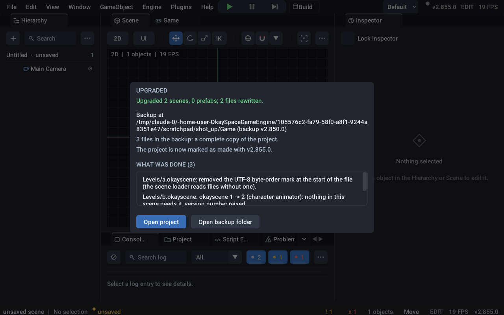
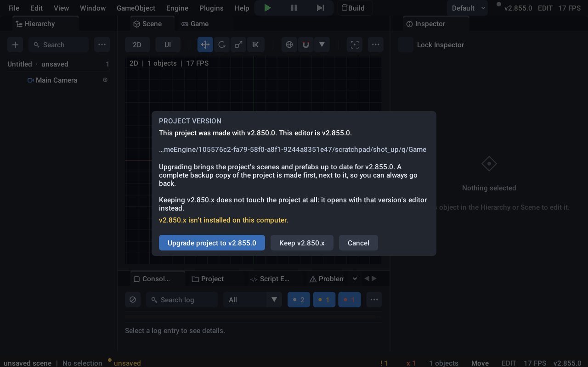
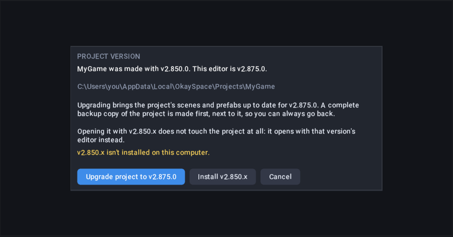
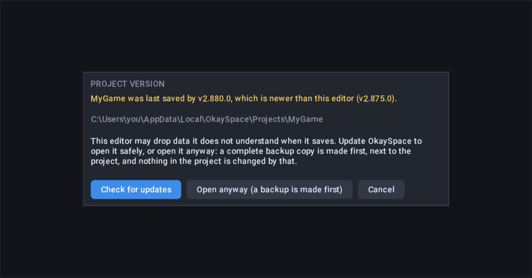
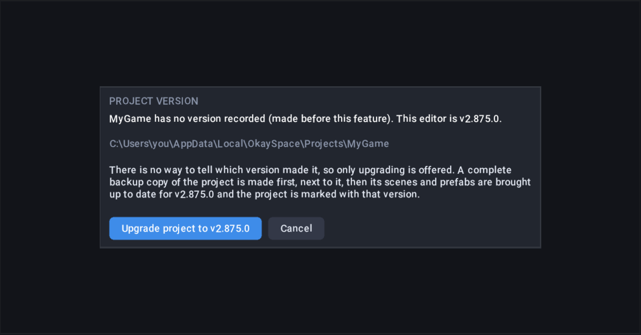

# Project versions and upgrading a project

A project remembers which version of OkaySpace last saved it. When you open it with an editor of another version, you are asked
before anything is touched: upgrade the project (after a full backup), keep its version, or leave it alone. A plain **Open** in the
launcher asks **in the launcher, before any editor window appears** (see "The question before Open"); the editor asks the same
question for every other way a project reaches it. The rules live in
`shared/ProjectVersion.hpp` (no editor, ImGui or engine code, so the launcher uses the same ones) and `editor/ProjectUpgrade.hpp`
(the backup, the upgrade and the question, no ImGui); the windows are `editor/ProjectUpgradeUI.cpp`.

This is about the **engine version** (`2.855.0`). Scene files have their own format version (`okayscene 3`, with migrations: see
[scene_serializer.md](scene_serializer.md) and [scene_diff_merge.md](scene_diff_merge.md)); an upgrade uses those migrations on every scene
and prefab, but the two numbers are not the same thing.

## The stamp

`<project>/project.okayproj` has one line, `engine_version=2.855.0`: the version of the editor that last saved the project.

- A new project has it from its first moment. Save Scene, Save Project and the automatic saving of Project Settings and Build Settings
  write the running editor's version (only that one line changes when a scene is saved).
- An editor that does not know the key skips the line like any unknown line, so a stamped project still opens in an older editor.
- Saving `project.okayproj` keeps every line the editor does not know (a newer editor's settings, a note you typed), and the stamp is
  written first. Writes are the usual whole-or-nothing ones (`WriteTextAtomic`: a read-only file is refused, the old file stays whole).
- A development build (version `dev`) never asks and never writes a stamp, but keeps the one that is there.
- The stamp is the last writer's, whatever it was before: open a project with an older editor, save, and it says that older version.

## Release lines and patches

A release is `2.<build>.<patch>`. The first two numbers are the **line** (`2.850`); a long-term line only gets fixes, as patch releases
of the same build number (`2.850.1`, `2.850.2`). A patch never changes a file format, so a project stamped `2.850.0` opens in `2.850.1`
(and the reverse) **with no question**: the next save writes the running version. `LineOf("2.850.1")` is `"2.850"`, `SameLine(a, b)`,
`LineLabel("2.850.1")` is `"v2.850.x"` (what the dialogs call a line).

## What happens when a project is opened

`okayver::Decide(projectVersion, runningVersion)` gives one of:

| Decision | The project was last saved by | The editor does |
|---|---|---|
| `Same` | this version | opens it |
| `SamePatchLine` | another patch of this line | opens it; the next save stamps this version |
| `DevBuild` | (the running editor is a development build) | opens it, never asks |
| `Older` | an older line | asks: **Upgrade project to v2.855.0**, **Keep v2.850.x**, **Cancel** |
| `Unknown` | nothing recorded (made before this feature) | asks: **Upgrade project to v2.855.0** or **Cancel** (the old version can't be known, so Keep is not offered) |
| `Newer` | a newer line | asks: **Cancel**, **Open anyway (a backup is made first)**, **Update OkaySpace** |

The editor asks the question for every way of opening a project: the startup chooser, File > Open Project Folder, File > Open Recent and
File > Open, a scene opened from the Project panel or dropped on the Hierarchy or Scene view, a scene given on the command line, and a
project handed over by the launcher (`--open`). The one difference: when the launcher has already asked (a plain Open on a project card),
it passes the answer on (`--project-answer`, see "The question before Open") and the editor does **not** ask a second time. Without that
flag the editor asks, exactly as before: it is the safety net for every way in that did not come through the launcher's question.
It is asked **before anything of the project is read for writing or written**: no stamp, no autosave, no settings file, not even the
look at `project.okayproj` the loading screen takes. The old shared `project.okayproj` is only copied into a project once the question is answered.
As a safety net, `EditorState::Load` itself refuses a scene of a project nobody has answered for (`EditorState::beforeLoad`), so a future
way of opening scenes that forgot the question cannot skip it.

One question at a time, also across the editor's other startup questions: the version question goes first, and **Save changes?**,
the project chooser, an old `<scene>.autosave` and **Restore recovered work?** wait until it is answered (`editor/StartupModals.hpp`,
issue #888; before that fix the version question and the recovery question closed each other every frame and the editor froze).

A request to open another project while a window is on screen (the launcher handing over a project while the
question for the first one is open) is **held**, not dropped: once the window closes (answered, cancelled, upgraded) the held project is
opened, with its own question if it needs one. A newer request replaces a held one. When the answer closes this editor (**Keep** starts
another version), the held request is dropped with the editor. Before the review of issue #888 the second request was thrown away with no
message and the hand-off file was already deleted, so clicking Open on project B in the launcher did nothing.
**Cancel** changes nothing and the editor stays where it was (or shows the project chooser, when nothing was open).
Answering is remembered for the session: once a project is upgraded, opened anyway, or made in this session, it is not asked about again.

### Which folder is the project

`okayup::ProjectRootForScene` finds the project a scene belongs to. It is the one rule for everything: the version question and its
safety net (`ProjectGate::Open`, `MayLoad`), File > Open and the launcher's `--open` (where the Project panel is rooted:
`EditorState::projectRootOf`), the settings the loading screen reads at startup, and File > Project Upgrade (the folder the window shows is
the folder its Upgrade button upgrades and its Restore button restores: `UpgradeRootFor`). From the scene's folder upwards, the nearest
folder that is clearly a project wins:

1. A folder that holds the scene through a folder called `Assets` (`<project>/Assets/.../scene`). On Windows any spelling counts
   (`assets`, `ASSETS`), because Windows folder names ignore case; elsewhere it must be `Assets` exactly. The case rule is a parameter
   (`RootRules::assetsAnyCase`), so both answers are tested on Linux; on Windows itself it is unverified.
2. A folder that holds a `project.okayproj` with an `engine_version` stamp (every project made or saved since versions were recorded has
   one). So a scene in `Levels/` or `Scenes/World1/` belongs to its project, and a stamped project inside another project's folder is its
   own project (the nearer one wins).
3. Only when no folder up the path is clearly a project: the scene's own folder, when it holds a `project.okayproj` (stamped or not) or an
   `Assets` folder (the old flat layout).
4. Nothing found: the scene is a loose file. No question is asked and File > Project Upgrade does nothing for it.

What is **not** evidence of a project:

- A `project.okayproj` **without a stamp** in a folder above the scene. That is the old shared settings file, or a copy of it: editors before
  issue #888 copied it into the folder of any scene they opened (see "Settings files" below), so Documents, Desktop, a Projects folder or a
  repository root could hold one. Before this rule such a folder became a "project": the "no version recorded" question came up, and
  Upgrade would have copied the whole folder.
- An `Assets` folder **beside** a folder above the scene. The release folder holds `Assets/` (starter textures) next to `examples/`, so that
  rule would make the release folder the project of every example scene.
- A `.okay` folder alone: the editor leaves one (autosave, the build list) next to any scene it opened, project or not.
- A drive root (`C:\`, `/`, `\\server\share`) and the home folder: never a project, whatever they hold.
- The editor's **working folder**, for rules 2 and 3. While no project is open the editor keeps its settings in a `project.okayproj` there
  (the shared file), and a release editor stamps that file too. The working folder is compared as a folder on disk (`SameFolder`: a link,
  a `..`, another case on Windows, an 8.3 name or a `\\?\` spelling are the same folder), not as text. Rule 1 still applies there: a project
  that is the working folder is found through its `Assets` folder.

**The limit we accepted.** A real project that is itself the editor's working folder, opened through a scene **outside** its `Assets`
folder, is not found (it is treated as a loose file: no question, no upgrade). Such a folder can't be told apart from the release folder
when the editor is started there: both hold `Assets/` and a stamped `project.okayproj`. Scenes in its `Assets` folder are found as usual.

**A very big folder.** As a last guard, the upgrade counts what it would copy while it looks through the folder. Past 50,000 files or 8 GB
it stops before anything is made and asks: "\"<Name>\" is very big for a backup copy", with the counts so far, **Copy it anyway and
upgrade** (or **Copy it anyway, then open** for a newer project) and **Cancel**. Cancel changes nothing.

Before issue #888 only rule 1 and the old form of rule 3 existed: a project's scene outside `Assets/` was treated as a loose file (no version
question, the safety net let it load, File > Project Upgrade silently did nothing). The first fix added "the nearest folder above with any
`project.okayproj`", which made the shared file's copies into projects; the review of that fix gave the rules above.

### Settings files: no more copies in scene folders

`LoadProjectSettingsFrom` (`editor/main.cpp`) reads a project's settings. For a project with no `project.okayproj` of its own it starts from the
shared file and writes the project its own copy. It used to do that for **any** folder it was given: the folder of a loose scene, or
`Game/Levels` for `Game/Levels/a.okayscene` (the loading screen picked the scene's folder). Now the folder is first checked with
`okayup::SettingsFolderFor`: only a project folder (it has `project.okayproj` or an `Assets` folder) gets its own file; any other folder uses the
shared file and gets nothing. The loading screen uses `ProjectRootForScene` to pick the folder. Copies made by older editors are still on disk:
an unstamped one above a scene is ignored (see above); a stamped one (a release editor stamped them) still makes its folder a project, and is
safe to delete.

**How to try it (scene outside Assets).** Make a project folder `Game` with a `project.okayproj` that says `engine_version=2.850.0` and a scene in
`Game/Levels/a.okayscene` (no `Assets` folder). Open `a.okayscene` in the editor (File > Open, or `--open`). You now see the "Upgrade project
to v..." question for **Game**; before the fix it opened with no question. Choose Upgrade: the backup `Game (backup v2.850.0)` appears next
to `Game`, and `Game/project.okayproj` now has the editor's version. The Project panel shows **Game**, and File > Project Upgrade... shows
**Game** too (before the review fix File > Open left the Project panel where it was, so the window showed another folder than the one its
button upgraded). No `Game/Levels/project.okayproj` is written.

**How to try it (loose scene folder).** Open `examples/vehicle/vehicle_test.okayscene` (File > Open), close the editor, and open it again.
It opens straight away with no version question, also the second time when `examples/vehicle/.okay` exists, and also when the editor's
working folder (or any folder above `examples`) has the shared `project.okayproj`. File > Project Upgrade... is greyed out, or (when the Project panel
is rooted at the scene's folder) shows "The open scene is not part of a project" with the Upgrade button greyed out; no `vehicle (backup ...)`
folder appears. No `project.okayproj` is written into
`examples/vehicle` any more. If one is there from an older editor and it has an `engine_version` line, delete it first (a stamped file there
makes the folder a project).

**How to try it (a folder above that is not a project).** Put any scene in `Documents\Test\t.okayscene`, and a `project.okayproj` with just
`company=Me` in `Documents`. Open the scene: no version question (before the review fix: "This project has no version recorded", and
Upgrade would have copied all of Documents).

### Older: upgrade or keep

- **Upgrade project to v2.855.0** makes the backup, checks and rewrites, stamps, and shows the result (see below).
- **Keep v2.850.x** does not touch the project. If an editor of that line is installed (see "The launcher's Versions folder") this editor
  starts it on the project and closes; the newest installed editor of the line is used (a `2.850.0` project keeps `2.850.1` when that
  is installed). Otherwise: "v2.850.x is not installed. Open the OkaySpace launcher > Versions to install it." with **Back** and **Cancel**.
  The editor that is started gets `--keep-version`, and shows `v2.850.1 (kept)` in the status bar. This editor closes first (without asking
  about unsaved changes again: that was asked before the project was left) and the other one is started after it has exited, through the
  helper process the self-updater uses, so the two never fight over the single-instance lock.

### Newer: open anyway or update

An older editor may drop data it does not understand when it saves. **Update OkaySpace** opens the same window as Help > Check for
Updates (Download & Install; the editor reopens afterwards with the arguments it was started with). **Open anyway** first makes the same complete backup
copy as an upgrade (`<Name> (backup v2.860.0)`), changes nothing in the project, and then opens it. Why before opening rather than "before
the first save": the editor writes into the project in many places (new scripts, materials, settings, autosave), not only on Save, so
the only point that covers all of them is before the project is opened.

## The upgrade

All of it is stepped a little each frame (about 8 ms), so the window stays alive and shows files done / total, with a Cancel button
until the first file is rewritten.

1. **Look through the project** and list what it holds.
2. **Check every scene and prefab** (`.okayscene`, `.okayprefab`) through the engine: `SceneMigration::MigrateThroughEngine` (the
   registered `N -> N+1` steps, and the loader's own upgrades for old files), then a load of the result into a scratch scene. A file
   that is damaged, newer than this editor reads, or can't be loaded stops everything here, and so does a read-only file that would
   have to change. Nothing has been made or changed at this point.
3. **Check the free space** for the copy (the project's size plus 16 MB) and that the backup place can be written.
4. **Make the backup**: a full copy into the sibling folder `<Name> (backup v2.850.0)` (`(backup before v2.855.0)` when the old version is
   unknown; `... (2)`, `(3)` when the name is taken). It is built as `<name>.partial` and renamed only when it is whole, so a backup is
   either complete or not there. The copy is **verified**: every file's size, the number of items, and the content of the files that
   will be rewritten; a file that changes while it is being copied stops the upgrade.
5. **Rewrite only what changes**: a scene or prefab that is already current is not touched (not even its date); one that needs it is
   written back as canonical text, one file at a time, each whole-or-nothing. A file may not have changed since step 2.
   A file that starts with a UTF-8 byte-order mark (the bytes EF BB BF, which some text editors such as Notepad add when they save) is
   checked without the mark and written back without it, even when it is otherwise current: the engine's scene loader does not read a
   file with the mark (see "Byte-order marks" below). The log says "removed the UTF-8 byte-order mark"; the backup keeps the original.
   A UTF-16 file with its mark (FF FE or FE FF; Windows PowerShell's `>` and Notepad's "Unicode" write those) is converted to UTF-8 the
   same way ("converted from UTF-16 to UTF-8"). UTF-16 that is not whole (an odd number of bytes, half a surrogate pair) is a damaged
   file and stops the upgrade, naming it.
6. **Stamp** `engine_version` last.

**It stops at the first failure and puts everything back.** The files rewritten so far are restored from the backup (their content is
checked against what was backed up), a project.okayproj the stamp had to create is removed, and the window says what failed and what was
done about it. The backup is kept. Because the stamp is written last, a crash or power loss in the middle leaves a project that still asks
next time, and running the upgrade again finishes the job (a second run finds nothing to rewrite).

### What the backup holds and leaves out

Everything in the project folder, byte for byte, dates kept, empty folders too. Left out: `.okay/backups` (the restore copies), build
output (a top-level `build` folder and the output folders named in Build Settings and its profiles, when they are inside the project),
and version control folders (`.git`, `.svn`, `.hg`). Links are copied as links, never followed. The upgrade only ever writes scenes, prefabs
and `project.okayproj`, so what the backup leaves out is never at risk. `<backup>/.okay/upgrade_backup.txt` records the version, the date, the
counts and the files the upgrade rewrote (with their size and a checksum); that is what Restore uses.

The backup goes next to the project, so it needs the free space of a copy and a writable parent folder. Choosing another place is not offered
yet (the sibling place is also the only one the Restore list can find).

### The result

"Upgraded 14 scenes, 3 prefabs; 2 files rewritten. Backup at ...", with **Open project** and **Open backup folder**. Under it,
**WHAT WAS DONE (n)** lists the upgrade's log, one line per file it changed or noticed (`Assets/Old.okayscene: removed the UTF-8 byte-order
mark ...`, a migration step, records this version doesn't know).





(Headless screenshots on Linux, `OKAY_DEV=1 OKAY_FAKE_VERSION=2.855.0`, with `OKAY_UI_UPGRADE_ANSWER=upgrade` for the first: a development-build
switch that answers the question with Upgrade once, for screenshots.) A failure shows the
reason (in plain words, with the file) and the restore result ("Every file that had been rewritten was put back from the backup: the
project is exactly as it was", or the files that could not be put back, whose originals are in the backup).

## File > Project Upgrade...

Shows the project's version and this editor's, and the backups next to the project.

- **Upgrade project to v...** runs the same upgrade again on the open project (after the usual Save / Don't Save question, and the scene is
  reopened afterwards). Running it twice changes nothing the second time.
- **Restore...** (per backup) puts back the files that upgrade rewrote (scenes, prefabs, `project.okayproj`) from that backup and removes a
  `project.okayproj` the upgrade had made. Every file it replaces is first copied to `<project>/.okay/backups/restore-N/`, so work done after
  the upgrade is not lost; files you made since are left alone; it is whole-or-nothing too. The editor then restarts on the project so the
  version question is asked afresh (nothing in memory can be written over the restored files). A backup made by Open anyway has nothing to
  restore. Folders that are not ours are listed with "open the folder to copy files by hand".

## The launcher's side: the Versions folder and `--keep-version`

This is the contract the launcher builds on (all of it in `shared/ProjectVersion.hpp`):

**Layout.** A release is `<launcher dir>/OkaySpace.exe` and `<launcher dir>/Tools/OkayEngine.exe` (with its own `SDL2.dll`). The launcher
keeps other versions as complete copies of `Tools`:

```
<launcher dir>/Versions/<version>/Tools/OkayEngine.exe      <version> = NormalizeVersion, e.g. 2.850.1
```

`InstalledEditorPath(launcherDir, version)`, `IsInstalled`, `InstalledVersions(launcherDir)` (newest first), `LauncherDirOf(editorExeDir)`
(works from `Tools` and from a kept copy). The editor looks in `LauncherDirOf(its own folder)/Versions`; started by hand from a build folder
there is no such folder, nothing is installed, and the project can still be upgraded or cancelled.

**Which editor opens a project.** `ReadProjectVersion(projectDir)` gives the stamp (`""` for a project made before this feature). To open it
with its own version: `ResolveKeepTarget(projectVersion, InstalledVersions(launcherDir))` is the newest installed editor of the project's line
(`""` when none is installed: offer to download it). Start `InstalledEditorPath(launcherDir, thatVersion)` with

```
--launcher <pid> --open "<scene>" --keep-version
```

(`KeepVersionArgs(scene)` plus the launcher's own `--launcher <pid>`). The editor that gets `--keep-version` skips the question for that project
for the session when the project is older or unversioned, and shows `v2.850.1 (kept)` in the status bar. A project that is *newer* than the
editor is still asked about (it is the data-loss question). `--keep-version=<version>` is honored only when that is the editor's own version.
An editor from before this feature ignores the flag and opens the project as it always did. `Decide` and `CompareVersions` replace the
launcher's own copy of the comparison (done: the launcher calls `okayver::CompareVersions`).

**One editor at a time.** The editor's single-instance lock and hand-off file are shared by all versions. An editor started while another
runs does not open: it writes its request (`open`, and `keep-version` with its own version) for the running one and exits. The running editor
honors `keep-version` only if it is that version; otherwise it asks its normal question. So to open a project with an older version while a
newer editor is open, close that editor first (the launcher's save-and-close request does this); the editor's own **Keep** closes itself first
and starts the other one after it has exited (the same helper process the self-updater uses).

**What the editor writes.** `engine_version` in `project.okayproj` as above; `<Name> (backup ...)` folders next to a project; under a project
`.okay/backups/restore-N/`. Nothing in `Versions/`.

**The launcher's half is built** ([launcher_versions.md](launcher_versions.md)): the Versions page installs, removes and prunes those folders
(whole or not at all, every download checked against `versions.json`), keeps the editor an update replaces, and offers the Latest / LTS
channel. Project cards show the project's version and an **older: v2.850.x** / **newer** badge; **Open with** starts
`InstalledEditorPath(...)` with `--launcher <pid> --open "<scene>" --keep-version`. A plain **Open** asks the question above **in the
launcher first** (next section), then starts the current editor; a project with no version goes to the launcher's default editor, if one is
set, with no question. When the open
editor is another version, the launcher uses its save-and-close request first (one editor at a time). The "not installed" window has an
**Open launcher** button: it starts `OkaySpace --versions <version>` (through the same helper process), which shows the Versions page with
that version highlighted; a launcher that is already running is brought forward instead of a second one.

### The question before Open

Before this change a plain **Open** on a project card started the editor, and only then did a window inside the editor ask "This project
was made with v2.850.0 ...". Now the launcher asks first, in its own window, before any editor window exists. Every way of opening an existing
project in the launcher goes through one function, `OpenProjectChecked` (`launcher/main.cpp`), so none can skip the question: a card's **Open**,
**Open in editor** in its menu, **Open with** `<version>`, and **Open Project** (a folder from anywhere). Making a new project is not opening one and
is unchanged.

| The project was last saved by | The launcher asks | Buttons (the first is the default) |
|---|---|---|
| this version, another patch of this line, or the editor is a development build, or the scene is not part of a project | nothing | the editor starts as before |
| an older line | "MyGame was made with v2.850.0. This editor is v2.875.0." | **Upgrade project to v2.875.0**, **Open with v2.850.x** (only when an editor of that line is installed; the newest one is used) or **Install v2.850.x** (when none is: opens the Versions page with it highlighted), **Cancel** |
| nothing recorded | "MyGame has no version recorded (made before this feature). This editor is v2.875.0." | **Upgrade project to v2.875.0**, **Cancel** (a default editor set on the Versions page takes such a project with no question, as before) |
| a newer line | "MyGame was last saved by v2.880.0, which is newer than this editor (v2.875.0)." (the data-loss question, in amber) | **Check for updates** (the launcher's own update check), **Open anyway (a backup is made first)**, **Cancel** |

The sentences and button labels are the editor's own: both windows build them from `shared/ProjectQuestion.hpp`, so they read the same.
**Open with** (an editor picked on purpose) never gets the upgrade question: an older or unversioned project opens in it as before; a project newer than
that editor gets the newer question, naming that editor.








(Headless pictures made by `tools/launcher_open_shot.cpp`: the launcher's real drawing code, `launcher/OpenProjectUI.cpp`, in its Slate look and
Roboto font, on SDL's software renderer. The rest of the launcher is not drawn: the window is what the launcher shows. Not a Windows screenshot.)

**What each answer does.**

- **Upgrade project** starts this launcher's own editor with `--launcher <pid> --open "<scene>" --project-answer=upgrade`. The editor skips its question and
  runs the upgrade at once: the same backup, progress window and result window as always (they are the editor's, not the launcher's).
- **Open anyway** starts the editor with `--project-answer=open-anyway`: the editor skips its newer question and makes the same complete backup copy first,
  then opens the project (nothing in the project is changed). With **Open with** it also keeps `--keep-version` and starts that editor.
- **Open with v2.850.x** starts `Versions/<newest 2.850.x>/Tools/OkayEngine` with `--launcher <pid> --open "<scene>" --keep-version`, as the card menu always did.
- **Install v2.850.x** opens the Versions page with that version highlighted (the same page the editor's "not installed" window opens). **Check for
  updates** starts the launcher's update check. Neither starts the editor; press **Open** again afterwards. **Cancel** (or Escape) does nothing.

Then the usual rule applies: if an editor of another version is already open, the launcher asks it to save and close first ("One editor at a time" above),
and starts the project's editor after that. An editor of the same version that is already open is handed the project (the single-instance hand-off) and the
answer goes with it.

**How the editor knows not to ask again: `--project-answer=upgrade|open-anyway`.** It is honoured only when all of this holds (`okayver::ParsePreAnswer`,
`shared/ProjectAnswer.hpp`; each point is a test in `project_answer`):

- the editor was started by a live launcher: `--launcher <pid>` is on the command line and that process is running (the hand-shake the editor needs to start at all);
- the flag is for the project of the `--open` scene, and for that project only (the gate keeps it per project folder);
- the name is spelled exactly (`upgrade`, `open-anyway`), in the one-token form `--project-answer=<name>`.

Anything else is ignored and the editor asks its own question. The gate (`ProjectGate::NotePreAnswer`) uses the answer **once**, and only while the project is
still what the launcher saw: "upgrade" never applies to a project from a newer version, "open anyway" never to an older one, and a project that was
upgraded in between just opens. A held open that is replaced takes its answer with it. The very-big-folder question (above) is still the editor's own and can
still appear. The flag is not remembered when the editor restarts itself (after a restore or an update): the restarted editor asks again. An editor from before this
change ignores the flag and asks its own question (so a kept older editor opened with **Open anyway** may ask once more).

**Which folder is the project.** The launcher finds it with the same rule as the editor: `okayroot::ProjectRootForScene` (`shared/ProjectRoot.hpp`; it used to be
in `editor/ProjectUpgrade.cpp` and moved unchanged, the editor still calls it as `okayup::ProjectRootForScene`). So a scene in `Levels/` belongs to its stamped project, a
loose scene or one under an unstamped copy of the shared settings file is no project, and the project card's version label uses the same rule.

**Known limits.** The launcher cannot see what the running editor has already answered this session (a project opened anyway in the open editor is asked
about again if you press Open on it in the launcher); a development launcher compares with `OKAY_FAKE_VERSION` when `OKAY_DEV` is set (the editor reads the same
variable); on Windows nothing of this has been run (see `docs/try_it.md`, 7m).

## Command line and environment

| | |
|---|---|
| `--keep-version` / `--keep-version=<ver>` | the version was chosen on purpose for the `--open` project (see above) |
| `--project-answer=upgrade` / `=open-anyway` | the launcher already asked the version question and the person answered; honoured only for a live `--launcher <pid>` and the `--open` project (see "The question before Open") |
| `OKAY_DEV=1` with `OKAY_FAKE_VERSION=2.855.0` | development builds only: the editor reports and stamps that version, so a project stamped `2.850.0` can be opened by "another" editor and the question tried. The launcher reads the same two variables, so its question compares with that version too |
| `OKAY_DEV=1` with `OKAY_UI_UPGRADE_ANSWER=upgrade` | development builds only (screenshots): the version question is answered with Upgrade once |

## Failure cases

| What | What happens |
|---|---|
| A scene or prefab is damaged, can't be loaded, or is newer than the editor reads | the upgrade stops before the backup is started; the file is named; nothing changed |
| A scene or prefab starts with a UTF-8 byte-order mark | not a failure: the mark is taken off and the file is written back without it (the backup has the original) |
| A scene or prefab is UTF-16 with its mark | not a failure: converted to UTF-8 (the backup has the original); broken UTF-16 stops the upgrade before the backup |
| The folder holds more than 50,000 files or 8 GB | stops while looking through it, before anything is made, and asks: copy it anyway, or Cancel |
| A file that has to change (or `project.okayproj`) is read-only | stops before the backup, says which file; nothing changed |
| Not enough free space, or the backup place is read-only or missing | stops before the copy; says how much is needed and free |
| The disk fails while copying | the unfinished backup is removed; the project was never touched |
| The disk fails, or a file changes under us, while rewriting | files rewritten so far are restored from the backup; the result window says so; the backup stays |
| Putting a file back fails too | the window lists the file; its original is in the backup |
| Cancel while working | same as a failure before the first rewrite: backup removed, nothing changed |
| The editor is a development build | no question; File > Project Upgrade shows it has no version to upgrade to |
| The editor crashes or loses power mid-upgrade | the stamp is written last, so the project asks again; the upgrade can be run again; the complete backup (if past its copy step) is there |

### Byte-order marks

Before issue #888 one scene or prefab that started with a byte-order mark stopped the whole upgrade with `"Assets/X.okayscene" can't be
upgraded: not a scene: missing 'okayscene' header`, so no project with such a file could be upgraded. Now the mark is taken off (step 5).
A file that is still not a scene after the mark is taken off is damaged, and stops the upgrade as before: the upgrade checks every file
first and is all or nothing by design, so one damaged file is not skipped.

The engine's own loader (`SceneSerializer::LoadFromFile`) still refuses a file with the mark ("missing 'okayscene' header", from the header
check in `ParseStep` in `engine/src/Scene/SceneSerializer.cpp`). That is not changed here; `tests/test_scene_bom_bug.cpp`
(`scene_bom_bug_load_from_file`, only with `-DOKAY_RUN_KNOWN_BUG_TESTS=ON`) shows it. Until the loader is fixed, File > Open of such a scene
fails; running the upgrade on its project removes the mark and the scene then opens.

**How to try it.** In a project made with an older version (or File > Project Upgrade... on any project), open one of its scenes in a text
editor and save it as "UTF-8 with BOM" (Notepad: Save as, Encoding "UTF-8 with BOM"; or put the three bytes EF BB BF at the start). Run the
upgrade. It finishes; the result window's **WHAT WAS DONE** list names the file with "removed the UTF-8 byte-order mark", and the file now
starts with `okayscene 3`. Before the fix the upgrade stopped with "missing 'okayscene' header" and changed nothing. For UTF-16: in Windows
PowerShell 5, `Get-Content Assets\Main.okayscene | Out-File -Encoding Unicode Assets\Main2.okayscene` (or `type Assets\Main.okayscene >
Assets\Main2.okayscene` in Windows PowerShell); the upgrade lists "converted from UTF-16 to UTF-8" for `Main2.okayscene`.

## Design choices

- **Backup before open for a newer project**, not before the first save: see above.
- **Check first, then back up.** Loading every scene before the copy means a damaged scene costs nothing (no copy, no cleanup).
- **Only upgrade and restore what changes.** The upgrade writes scenes, prefabs and the project file; it never moves or renames anything.
- **Restore restarts the editor.** It is the only way to be sure nothing in memory is written over the restored files, and it reuses the
  question and the gate rather than duplicating them.
- **A development build never writes a stamp.** `dev` is not a version, and a project stamped `dev` would be unreadable to a release.
- **A stamp is the last writer's.** After "Open anyway" and a save in an older editor the project says the older version, which is true.
- **Keep ignores `--keep-version` for a newer project**, because that flag means "I chose this version for an older project"; the data-loss
  question stays.

## Tests

`project_version` (parse and compare matrix, Decide table, the stamp line in text and in files, CRLF, BOM, read-only, release lines, the
keep target, the Versions layout; links nothing), `project_upgrade` (the upgrade end to end, backup completeness, space refusal, the disk
failing at every step in turn (with a byte-order-mark scene among the rewritten files), damaged and read-only files, restore, the whole gate
state machine with held opens, which folder is the project: a scene outside `Assets/`, the nearest stamped `project.okayproj`, unstamped copies
and `Assets` beside an ancestor are no evidence, the release folder layout, the working folder by any spelling, the home folder, both case rules,
a bare `.okay` folder is no project, scenes and prefabs with a UTF-8 or UTF-16 byte-order mark: upgraded, backed up and restored byte for byte,
the very-big-folder limit; the loose-file checks stop their search at the test's own temp folder, so a project.okayproj above it can't change
them) `editor_hooks` (`EditorState::Load` under the gate, and File > Open rooting the project where the gate finds it) and
`startup_modals` (the version question and a waiting recovery copy at startup, stepped frame by frame: exactly one question asks at a time,
the scene opens after the answer, then the recovery question asks).
`open_project_gate` (the launcher's question: every combination of project version, editor version, installed versions, default editor, "Open with" and
"is it a project", the options in order, what each answer starts with its exact arguments and quoting, the answer flag never produced without a hand-shake, and,
on temp folders, that a scene outside a project never asks; the editor's sentences are kept as literal text), `project_answer` (the `--project-answer` flag: honoured
only for a live launcher and the `--open` project, the same through the hand-off, never remembered for a restart) and, in `project_upgrade`, the gate applying the
answer (upgrade, open anyway, once, only for that project, not for a project that does not fit, held opens).
`scene_bom_bug_load_from_file` (`tests/test_scene_bom_bug.cpp`) is the loader's byte-order-mark check; it only runs with
`-DOKAY_RUN_KNOWN_BUG_TESTS=ON`. The issue #888 known-bug file `tests/test_upgrade_bugs.cpp` is gone: every check in it is fixed and lives in
`project_upgrade` (and `startup_modals` for the two startup windows).

## What changed

New: `shared/ProjectVersion.hpp`, `editor/ProjectUpgrade.hpp/.cpp`, `editor/ProjectUpgradeUI.hpp/.cpp`. Edited: `editor/main.cpp` (hook calls),
`editor/EditorState.hpp/.cpp` (`beforeLoad`), `editor/CMakeLists.txt`. The editor's own copy of `CompareVersions` now calls the shared one.

Startup freeze fix (issue #888): new `editor/StartupModals.hpp` (which startup question may ask; which recovery copies an answer deletes;
where the recovery folder is), used by `DrawGatePrompt` (`editor/ProjectUpgradeUI.cpp`) and by the two recovery questions in
`editor/main.cpp`; the recovery folder moved from the working folder to the user data folder. Test: `tests/test_startup_modals.cpp`.

Launcher side (see [launcher_versions.md](launcher_versions.md)): the launcher's own `CompareVersions` now calls the shared one too; the
"v2.850.x is not installed" window gained **Open launcher** (`editor/ProjectUpgradeUI.cpp`).

The launcher asks first (this change): new `launcher/OpenProjectGate.hpp` (the decision), `launcher/OpenProjectUI.cpp/.hpp` (the window),
`shared/ProjectQuestion.hpp` (the sentences, shared with the editor), `shared/ProjectAnswer.hpp` (`--project-answer`), `shared/ProjectRoot.hpp` (which folder
is the project, moved from `editor/ProjectUpgrade.cpp`), `tools/launcher_open_shot.cpp` (the headless pictures), `tests/test_open_project_gate.cpp`,
`tests/test_project_answer.cpp`. Edited: `launcher/main.cpp` (`OpenProjectChecked` and the three open paths, the window, the plan after "Close the editor first"),
`editor/ProjectUpgrade.hpp/.cpp` (`NotePreAnswer`), `editor/ProjectUpgradeUI.cpp/.hpp` (reads the flag; uses the shared sentences), `editor/main.cpp` (the
hand-off carries the answer), `shared/AppRestart.hpp` (a restart forgets the answer), `tests/test_project_upgrade.cpp`.
