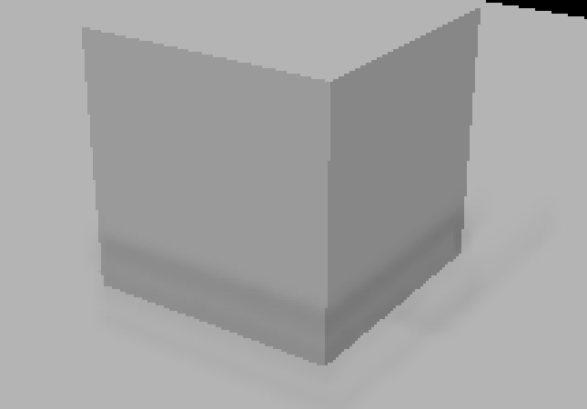
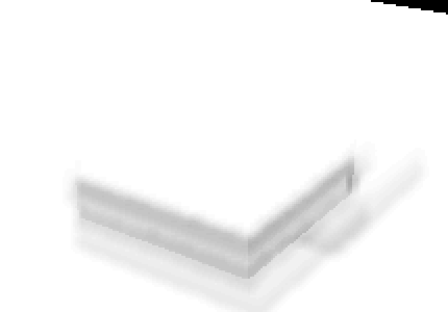
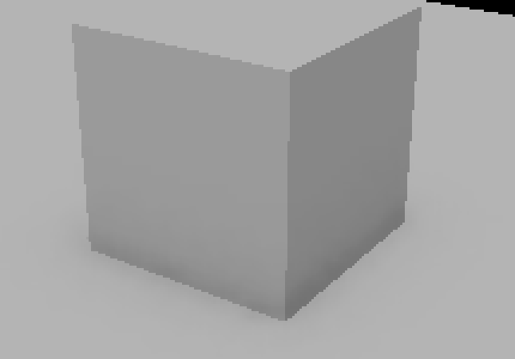
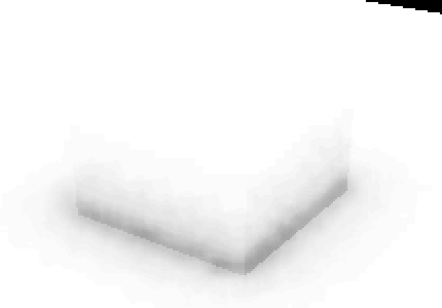
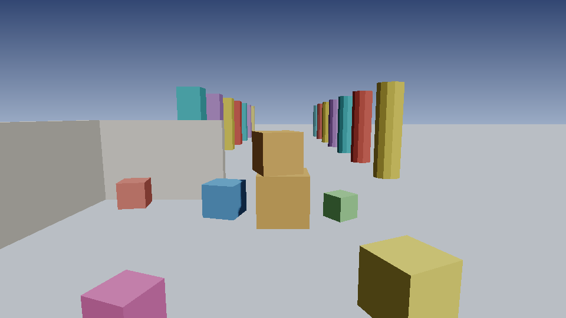
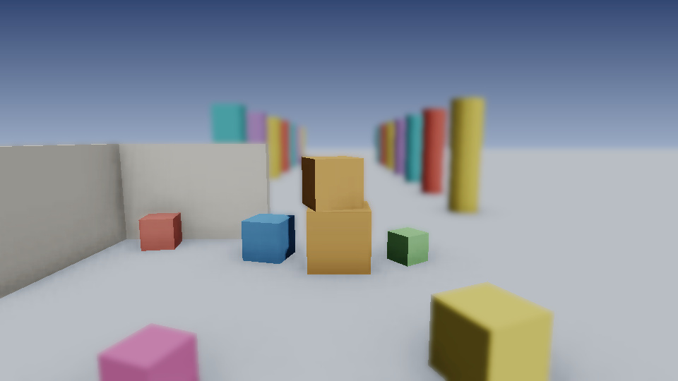
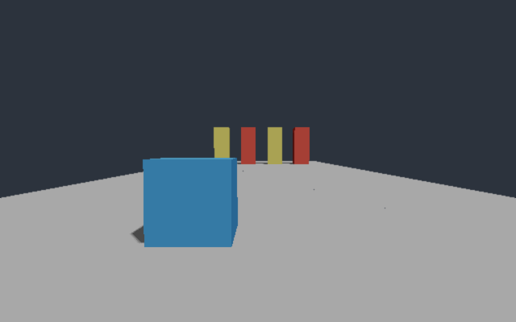
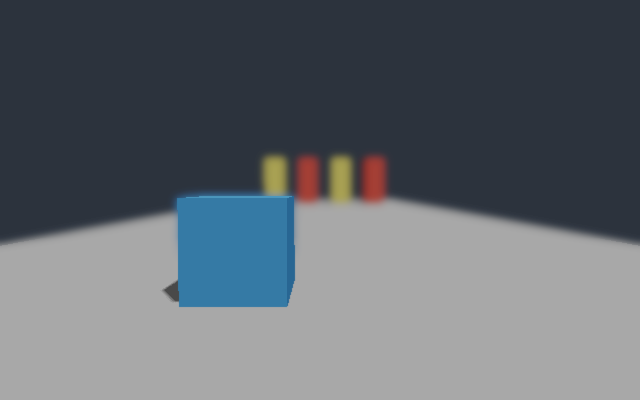
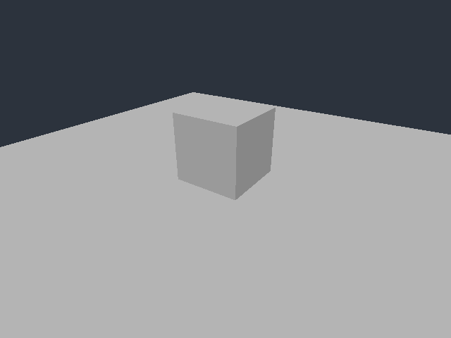
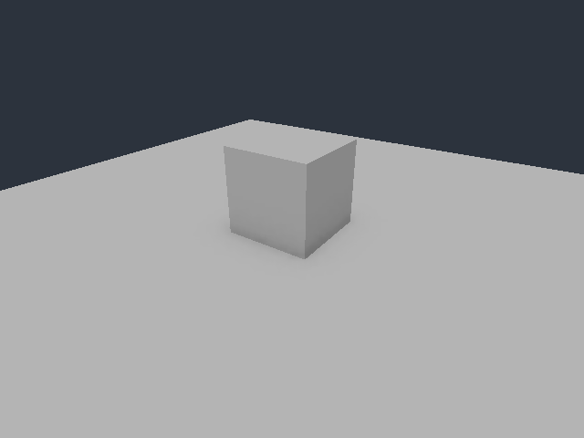

# Render status: our own renderers, honestly

This page says what each of our four renderers really draws today. It was read off the code, not guessed. Each row names the file and the function that proves it.

The four renderers:

- **Software** is `engine/include/okay/Render/SoftwareRenderer.hpp`. It runs on the CPU. It is the reference, and the only one we can test headless on Linux.
- **OpenGL** is `engine/src/Render/GLRenderer.cpp`. It is the most complete GPU renderer.
- **Direct3D 11** is `engine/src/Render/D3D11Renderer.cpp`. It is the default on Windows.
- **Direct3D 12** is `engine/src/Render/D3D12Renderer.cpp`. It is a preview: opt in only.

How to read the table:

- **Done**: it is in the code and the backend draws it.
- **Partial**: some of it is drawn, or only under a condition (the note says which).
- **Missing**: the code is not there.

"Done" does not mean "run on a GPU". We have no GPU and no Windows machine in this environment. Only the software renderer is run by tests here. The GPU files are compile-checked (Direct3D with the MinGW cross compiler in CI) and read, nothing more. Rows that rest on unrun GPU code say UNVERIFIED in the notes below.

The machine-readable version of the "ignored switch" part is `engine/include/okay/Render/RendererFeatures.hpp`. The editor reads it to show grey notes under switches a backend ignores.

## The table

| Feature | Software | OpenGL | Direct3D 11 | Direct3D 12 | Proof (file: function) |
|---|---|---|---|---|---|
| Lit materials (lights, texture, normal, gloss, AO maps) | Partial | Done | Done | Done | Software: per-pixel when Per-pixel lighting is on, or while a shadow map exists (`ShadowsUsePerPixel`), else per vertex; `Raster::TrianglePhong`; GL: `kFrag`; D3D11: `PSMain` in `kHLSL`; D3D12: same HLSL copy (`kHLSL12`) |
| Sun shadows | Done | Done | Done | Done | Software: `RenderShadowMap` + `ShadowFactor`, drawn by default (the per-pixel path is chosen automatically while a shadow map exists); GL/D3D11: `PlanShadows` (`ShadowSetup.hpp`); D3D12: `ComputeDirectionalShadowVP` |
| Sun shadow cascades | Done | Done | Done | Missing | Software: `ShadowCascades()`; GL/D3D11: `PlanShadows`; D3D12 draws one map and reads only `ShadowDistance` |
| Spot, point and area light shadows | Done | Done | Done | Missing | Software: `RenderLocalShadowMaps` + `LocalShadowFactor` (same automatic per-pixel path); GL: `localShadow` in `kFrag`; D3D11: `localShadow` in `kHLSL`; D3D12: `lsh = 1.0` for every non-sun light |
| Ambient occlusion (SSAO) | Partial | Done | Partial | Missing | Software: `ApplySSAO`, the process switch and the scene's switch with its radius, intensity and power (test `software_scene_ssao`); lit meshes only (they are drawn per pixel while it is on), a hemisphere pattern turned per pixel (test `software_ssao_quality`), not the GPU's algorithm; GL: `kSsaoFrag`, `computeAo`; D3D11: `PSAo` pass added in this change (UNVERIFIED); D3D12: no code |
| Tonemap and exposure | Done | Done | Done | Missing | Software: `ApplyScenePost` (scene exposure, curve and tonemap switch, plus the process switch); GL: `kUberFrag`; D3D11: `PSUber`; D3D12: none |
| Bloom | Done | Done | Done | Missing | Software: `ApplyBloom`, run when the scene's Bloom or the process switch is on (the scene's threshold is clamped to 0.95: no HDR); GL: `kBrightFrag` + `kBlurFrag`; D3D11: `PSDown` + `PSBlur`; D3D12: none |
| Vignette | Done | Done | Done | Partial | GL/D3D11: in the uber pass, with smoothness. Software: `ApplyScenePost`, same maths and smoothness, sets `PostVignetteHandled` so the host skips its overlay. D3D12: the host paints the amount; smoothness is ignored |
| Colour grading | Done | Done | Done | Missing | Software: `ApplyScenePost` (temperature, tint, saturation, contrast, lift/gamma/gain) and `ApplyColorGrade` (process switch); GL: `kUberFrag`; D3D11: `PSUber`; D3D12: none |
| Depth of field | Done | Done | Partial | Missing | GL: `kDofFrag`; D3D11: `PSDof` (shared maths in `DofMath.hpp`, compile-checked, UNVERIFIED on a GPU); software: `ApplyDof` (same `DofMath.hpp` circle of confusion and mix, a fixed-width half-resolution blur with premultiplied alpha; test `software_dof`); D3D12: no code |
| Anti-aliasing (FXAA) | Done | Done | Done | Missing | Software: `ApplyFXAA` (scene's FXAA switch or the process switch; a different, cheaper algorithm); GL: `kFxaaFrag`; D3D11: `PSFxaa`; D3D12: none |
| MSAA | Missing | Done | Done | Done | GL: `EnsureTargets(samples)`; D3D11: `EnsureTargets` clamps to what the device supports; D3D12: `Impl::msaa` picks up to 4x. Software has no MSAA |
| Fog | Done | Done | Done | Done | Software: `FogFactor` in `RenderMeshes`; GL and D3D11/D3D12 HLSL: same maths in the mesh shader |
| Sky | Partial | Done | Done | Partial | GL: `kSkyFrag`; D3D11: `PSSky`; Software and D3D12: a plain gradient from `EffectiveSkyColors` (no disc, halo, clouds, stars) |
| Reflections (sky gradient) | Partial | Done | Done | Done | Software: `EnvSky()` in `TrianglePhong` (per-pixel path); GL/D3D11/D3D12: `uSky` in the mesh shader. Not real reflection probes anywhere |
| GPU skinning | Missing | Done | Done | Missing | GL/D3D11: `SupportsGpuSkinning`; D3D12 and software skin on the CPU (`player/main.cpp`: `if (d3d12Ready) gpuSkin = false`) |
| Particles, lines, trails | Partial | Partial | Partial | Partial | All four: the host draws them as a CPU overlay after the frame. Only software frames give them depth occlusion (the GPU renderers do not read depth back) |
| Presentation | Done | Partial | Partial | Partial | Software draws straight into the CPU frame. The three GPU renderers all read the frame back to the CPU (`RenderToPixels`). D3D11 can render into the editor's own texture on Windows (`RenderToTexture`, UNVERIFIED). No swap-chain presentation anywhere |

## Notes that matter

- **Software shadows now work by default.** Shadows are only sampled on the per-pixel lighting path, and `PerPixelLighting()` is still off by default. So a new switch, `ShadowsUsePerPixel()` (default **on**), makes a mesh that receives shadows take the per-pixel path while the frame has a shadow map (a sun or a spot/point light that casts, with Shadows on). With no shadow-casting light, nothing changes and the cheap path stays. To go back: set `ShadowsUsePerPixel()` to false (the per-vertex frame, no shadows) or turn Shadows off. I picked this over drawing shadows on the vertex path because vertex shading cannot show a shadow edge smaller than a triangle (a big floor would be wrong), and the per-pixel code is already tested. Cost, measured here (4 core CPU shared with other jobs, 640x360, 41 meshes, one sun shadow, `tests/test_software_default_shadows.cpp`): about 38 to 42 ms per frame against 31 ms per vertex without shadows (1.2 to 1.3 times). Not measured: a big imported model, or a weak CPU.
- **Software now reads the scene's Post-processing section** for the parts that are cheap on a CPU: exposure, the tonemap curve (None, ACES, Filmic) and the scene's Tonemap switch, colour grading (temperature, tint, saturation, contrast, lift, gamma, gain), the vignette with its smoothness, Bloom and FXAA (`PlanScenePost`, `ApplyScenePost`), and now the scene's Ambient Occlusion and Depth of field (next section). Fog was already read. The frame is 8-bit and shaded in display space, so these curves act on 0..1 values and will not match the GPU pixel for pixel (no HDR, no linear lighting). Nothing in the section is ignored by software any more, except Bloom Softness.
- **The GPU ambient occlusion has no normals** (OpenGL and the new Direct3D 11 pass): it compares depths only, so a floor seen at a slant darkens a little by itself. The software one has a normal per pixel and does not do that. The unit test measures about 0.72 on open floor against 0.69 in a box crease. Radius and Intensity control how strong it looks.
- **Direct3D 11 is now level with OpenGL on ambient occlusion, on paper.** The pass was added in this change. It compiles under MinGW. It has never run on a GPU. Treat it as UNVERIFIED until someone with Windows looks at a frame. It runs only when the post chain runs and an Ambient Occlusion switch is on (the scene's post.ssao, or the Build Settings switch).
- **Direct3D 12 is a preview.** No post-processing, one sun shadow map, no spot or point shadows, CPU skinning. Build Settings now says so.
- **Depth of field** is OpenGL, plus a new Direct3D 11 pass (`DofMath.hpp`) that compiles under MinGW and has never run on a GPU. It reuses the ambient occlusion depth image, so turning it on without ambient occlusion still runs the half-resolution depth pass. The software renderer has its own depth of field pass on the CPU (next section).
- **Every GPU frame is read back** to the CPU. That is a cost per frame. The profiler's "GPU ms" is CPU wall time.

## Software depth of field and scene ambient occlusion

The software renderer did not draw these two scene effects. It does now. This is the one place that says what they do, which renderer you get on Windows, how to try them and how they were measured.

**Which renderer you get on Windows.** Direct3D 11, the GPU renderer. The software renderer is used only when no GPU can be started, in the web player, and when you ask for it. Direct3D 11 has its own ambient occlusion and depth of field passes, but they have never run on a GPU (UNVERIFIED, see the rows above), so on a default Windows install you are looking at code nobody has seen work. The software passes below are the ones the tests check. To look at them on Windows: View > Rendering & Performance > Use the software renderer (CPU) in the editor (the line above it then reads `Renderer: software`), or start the editor or the player with the environment variable `OKAY_SOFTWARE_RENDER=1` (the player's window title then ends in `[software renderer]`). The steps, with a sample scene, are in [try_it.md](try_it.md) item 18. Where the settings are: View > Panels > Lighting > Post-processing, **Ambient Occlusion (SSAO)** with Radius, Intensity and Power, and **Depth of Field** with Focus Distance and Focus Range (each has a tooltip). They are saved with the scene and off by default.

**Ambient occlusion** (`ApplySSAO`). The switch is the scene's own (above) or the editor's process-wide one under Rendering; when both are on, the process-wide settings win. For every second pixel in each direction it looks from the surface at 12 points in the half-sphere above it, finds which of them lie behind nearer surface, counts the hidden ones by how far behind they are (nothing past the radius) and darkens the pixel by the result. The scene switch uses the shared formula `postq::ApplyPowered` with Intensity capped at 1, like the GPU (test `software_scene_ssao`, strength 1.5); the process-wide switch keeps its original formula `1 - strength x occlusion`, not capped, so the editor's AO strength slider above 1 still darkens more. The pass needs the world position and normal of every pixel, which only meshes drawn per pixel provide, so **while ambient occlusion is on, every lit mesh is drawn per pixel** (with Shadows on, which is the default, the meshes that receive shadows already were; with Shadows and Per-pixel lighting both off, for example on the Low quality preset, the switch used to do nothing at all: test `software_scene_ssao`, last block). Unlit, matcap and see-through meshes are not in that picture: they are not darkened and they hide nothing. It is not the GPU's algorithm (that one compares depths only and has no normals), so the two look alike, not the same. Written from the general idea of a hemisphere kernel; no other renderer's code was used.

**The banding and the halo, found and fixed.** The first headless pictures of the scene switch showed stripes across the wall of a box just above the floor, and a flat grey shelf on the floor beside it that ended in a hard edge. The cause was the sample pattern: every pixel looked at a crease from the same 8 points in the same directions, so the darkness near a crease was a staircase of 8 steps, not a fade. It was not a flat-wall problem: a flat wall well above the crease, and open floor, measured exactly 1 (untouched) before and after. The fix (`ApplySSAO`): 12 points laid out by the golden angle and the golden ratio, the pattern turned around the normal by one of 16 angles taken from a 4x4 tile of half-resolution pixels, and a 4x4 box blur (exactly one tile, so the 16 turns average out) instead of the 3x3 one. Measured by `tests/test_software_ssao_quality.cpp` (a box on a floor, 640x480, radius 0.5, intensity 0.8, ratio of the lit pixel with ambient occlusion on to off, averaged in bins by world position so 8-bit rounding does not matter):

| Measured | Before the fix (8 fixed points, 3x3 blur) | After the fix (12 points turned per pixel, 4x4 blur) |
|---|---|---|
| Wall of the box, at heights 0.01 / 0.09 / 0.17 / 0.25 / 0.33 / 0.41 / 0.49 above the floor | 0.914 / 0.933 / 0.907 / 0.987 / 1.000 / 1.000 / 1.000 (up, down, up: the stripes) | 0.877 / 0.925 / 0.961 / 0.978 / 0.989 / 0.994 / 0.999 (only up) |
| Wall ripple (sum of the places it gets darker again, over the whole rise; a smooth fade is 0; the test allows 0.10) | **0.327** | **0.000** |
| Floor beside the box, at 0.01 / 0.09 / 0.17 / 0.25 / 0.33 / 0.41 / 0.49 from it | 0.944 / 0.968 / 0.967 / 0.993 / 1.000 / 1.000 / 1.000 (a shelf near 0.97 that even dips, then a drop) | 0.915 / 0.952 / 0.976 / 0.985 / 0.994 / 0.998 / 1.000 |
| Floor ripple (the test allows 0.06) | **0.113** | **0.000** |
| Biggest single step, as a share of the whole fade (wall / floor) | 0.329 / 0.171 | 0.129 / 0.132 |
| Flat wall above the crease (heights 0.65 to 0.95): biggest distance from 1, and the variance of the 15 bin means (the "per-row variance") | 0.0000, 0 | 0.0000, 0 |
| Open floor far from the box (0.7 to 1.7 away): the same | 0.0000, 0 | 0.0000, 0 |
| The test | 13 checks, 2 failures | 13 checks, 0 failures |

Full profiles (25 bins of 0.02) are printed by the test. The numbers do not depend on the machine (the pass is deterministic). The stripes were on the crease, not on the flat part of the wall.

Pictures, rendered by the software renderer in that test (`OKAY_SHOT_DIR=<folder>`, `OKAY_SHOT_TAG=<name>`), the base of the box at 3 times size; left the frame, right the occlusion alone (black = 0.6, white = 1): before the fix   after  

**Depth of field** (`ApplyDof`, after ambient occlusion and before bloom): the scene's Depth of Field switch with Focus Distance and Focus Range. Distance comes from the W-buffer (an empty pixel counts as sky, 4 x far, like the GPU), a half-resolution copy of the frame is blurred twice with a 9-tap binomial kernel (C(8,k)/256, horizontal then vertical), colours are blurred premultiplied by their alpha so the transparent background does not darken edges, then `DofMath.hpp`'s circle of confusion mixes the sharp and the blurred picture. The blur width is **fixed** (about 8 half-resolution pixels): the circle of confusion sets how much of the blurred copy is mixed in, not how wide the blur is. It runs on the raster being drawn, which is the supersampled one when anti-aliasing is on, so the blur is narrower on screen than the GPU's, and the kernel is not the GL one: the two will not match pixel for pixel. Every pass is split over the threads, the work buffers are kept between frames, and with nothing out of focus it costs one scan of the depth buffer. Each camera of a camera stack draws into its own raster and gets the pass, like the other software post effects (test `software_dof`).

**Cost, measured here** (Linux container, 4 hardware threads shared with other builds, Release build, so only a rough guide):

| What | Measured here | Notes |
|---|---|---|
| Depth of field, 1920 x 1080, half of it out of focus | 24.9 ms a frame (the last run), 26.4 ms (another run) | Claude 2 measured 15.2 ms on an idle machine and about 30 ms while builds ran on the same cores |
| Depth of field, 1920 x 1080, nothing out of focus (one scan of the depth buffer) | 3.2 ms, 2.3 ms | Claude 2: 3.9 ms idle, 2.6 to 3.0 ms loaded |
| Ambient occlusion pass alone (`ApplySSAO`), 640 x 480, best of 40 runs | old pattern 4.4 to 6.8 ms, new pattern 7.8 to 9.6 ms | three runs each, machine load average about 5 on 4 cores, so only a guide |
| The same at 1280 x 720 | old 13.3 to 19.9 ms, new 30.9 to 32.6 ms | the new pass costs about 1.5 to 2 times the old one: 12 points instead of 8 and a 4x4 blur instead of 3x3 |

The depth of field time is the whole `ApplyDof` call (both blur rounds, every pass split over the 4 hardware threads); the tests print the numbers and check nothing about them. Not measured: a big imported model, a weak CPU.

**Pictures of the sample scene** (`examples/render_effects`, headless software renders from the test `render_effects_example`, not screenshots of a window; the same four are in [try_it.md](try_it.md) item 18):     And the two small ones from the first change:     (the ambient occlusion picture was re-rendered after the banding fix).

**Not verified.** Nothing here ran in a real window or on Windows: the editor menu item, the tooltips, the `OKAY_SOFTWARE_RENDER` switch of the editor and the player were checked by a syntax-only compile and by reading, not by clicking. Direct3D 11's and OpenGL's versions of both effects were not run. The software versions were not compared with the GPU's pixel for pixel (they are different algorithms on an 8-bit frame with no HDR). Not measured: a big imported model, a weak CPU, a camera stack with several cameras, ambient occlusion on a scene whose meshes are mostly Unlit.

## Who is behind on what

- Software is behind OpenGL on: MSAA, GPU skinning, the sky disc and clouds, Bloom Softness, and ambient occlusion on Unlit and matcap meshes. It is ahead on one thing: it is the only one with automated pixel tests (and, with this change, a switch you can flip on Windows to look at it).
- OpenGL is the reference for the GPU side. It misses nothing in the table except real swap-chain presentation.
- Direct3D 11 is level with OpenGL on paper (its new ambient occlusion and depth of field passes are unrun).
- Direct3D 12 is behind on almost everything after the mesh pass. Do not ship a game on it expecting the D3D11 look.

## What was done in this change, and how it was checked

| Change | Checked how | Not checked |
|---|---|---|
| Software spot, point and area light shadows (`RenderLocalShadowMaps`, `LocalShadowFactor`) | `tests/test_software_local_shadows.cpp`: pixel probes and a rendered frame, run on Linux | Visual quality on a big scene, speed on a big scene |
| Shared view maths for local shadows (`LocalShadowMath.hpp`) used by the software renderer and the GPU planner | `tests/test_light_shadows.cpp` (the GPU planner tests) still pass | The GPU backends were not run |
| Shared SSAO maths (`SsaoMath.hpp`): constants, CPU reference, and the HLSL text | `tests/test_ssao_math.cpp`: CPU maths, a frame from the software renderer, and a text check that GL, D3D11 and the header agree | The HLSL has never been compiled by the real HLSL compiler (`D3DCompile`) |
| Shared depth of field maths (`DofMath.hpp`): constants, CPU reference, HLSL text | `tests/test_dof_math.cpp`: CPU maths, and a text check that GL, D3D11 and the header agree | The HLSL has never been compiled by `D3DCompile` |
| Direct3D 11 depth of field pass (`PSDof`) | Compile-checked with `x86_64-w64-mingw32-g++ -fsyntax-only`; not run. UNVERIFIED | Blur quality and focus on a real frame |
| Bloom Softness and Ambient Occlusion Power (`PostQualityMath.hpp`, `post.bloomSoftness`, `post.ssaoPower`, saved as a `postq` line, `post_set` names, inspector sliders) | `tests/test_post_quality_math.cpp` (CPU maths: softness 0 and power 1 equal today's output exactly; knee is continuous; text check that GL and D3D11 paste the same code), `tests/test_post_sky.cpp` (save round-trip, clamps, defaults write nothing); D3D11 compile-checked | GLSL never compiled here; HLSL never run through `D3DCompile`; unrun on a GPU. UNVERIFIED |
| Direct3D 11 ambient occlusion pass | Compile-checked with `x86_64-w64-mingw32-g++ -fsyntax-only` | Not run. No Windows, no GPU. UNVERIFIED |
| Direct3D 12 honest labels (Build Settings, `RendererFeatures.hpp`, header comment) | `tests/test_renderer_features.cpp` | n/a |

## Why these two quality settings

I picked Bloom Softness and Ambient Occlusion Power from the candidate list because both are pure maths on a number the shader already has (a pixel's brightness, the occlusion value). That means the whole formula can be unit tested on the CPU, and with the default (softness 0, power 1) the output is mathematically the same as before, so no saved scene changes. Auto-exposure needs a GPU brightness read-back, shadow cascade blending changes the shadow sampling loop on both backends, and contact shadows need a new depth march and a light-direction input: all bigger, and harder to test without a GPU. They are still open (see below).

## What was done in the second render change

| Change | Checked how | Not checked |
|---|---|---|
| Software shadows on by default (`ShadowsUsePerPixel`) | `tests/test_software_default_shadows.cpp`: a default frame has the shadow, the switch gives back the old frame bit for bit, a mesh that does not receive shadows keeps the cheap path, a timing line | Big scenes, slow CPUs |
| Software reads the scene post (`ApplyScenePost`) | `tests/test_software_scene_post.cpp`: neutral scene equals the old tonemap pixel for pixel; exposure, curves, grading, vignette coverage, bloom and FXAA switches through `RenderMeshes` | Visual match to the GPU frame |
| Post-chain HLSL moved to `D3DPostHLSL.hpp` (text identical to what D3D11 had; D3D11 now includes it) | The literals were compared by script before and after; `tests/test_d3d_post_hlsl.cpp`; MinGW `-fsyntax-only` on D3D11 and D3D12 | Not compiled by `D3DCompile`, not run: UNVERIFIED |

## What was done in the third render change (software depth of field and scene ambient occlusion)

| Change | Checked how | Not checked |
|---|---|---|
| Software depth of field (`ApplyDof`, from Claude 2's branch `claude2/software-dof`, merged) | `tests/test_software_dof.cpp`: a synthetic frame (in focus stays bit for bit, out of focus blurs, transparent background does not darken edges, scene switch gates it, early outs touch nothing), a timing line | Pixel match to the GPU, a real scene on a real window, a weak CPU |
| Software scene ambient occlusion (`rs.post.ssao` with radius, intensity, power; from `claude2/software-scene-ssao`, merged) | `tests/test_software_scene_ssao.cpp`: off equals before, scene switch equals the process switch with the same settings, intensity 0 does nothing, power darkens, the process switch is not capped at 1 | Pixel match to the GPU |
| Ambient occlusion banding and halo fix (12-point golden pattern, 4x4 rotation tile, 4x4 blur) | `tests/test_software_ssao_quality.cpp`, numbers above; the test failed on the old pattern | Other scenes than a box on a floor, speed on a big frame |
| Lit meshes are drawn per pixel while ambient occlusion is on | `tests/test_software_scene_ssao.cpp`, last block: with Per-pixel lighting off, the frame with the switch on differs from the frame with it off (before: identical) | Cost on a big scene |
| Sample scene `examples/render_effects`, shipped by `scripts/build-windows-dist.sh` (`EXAMPLE_DIRS`) | `tests/test_render_effects_example.cpp` (the file loads, equals the scene the test builds, both effects show); `tests/check_example_dirs.cmake` (every shipped folder exists, the sample is in the list) | The Windows zip and installer (the full release job was not run) |
| Editor: View > Rendering & Performance > Use the software renderer (CPU), `OKAY_SOFTWARE_RENDER=1` for the editor and the player (title gets `[software renderer]`); tooltips on the Ambient Occlusion and Depth of Field rows | A syntax-only compile of `editor/main.cpp` and `player/main.cpp`, and reading | Clicking it in a real editor, the player on Windows |

## Direct3D 12 post chain: the plan (not started)

D3D12 draws the mesh pass only. To give it the D3D11 post look, in order:

1. **Shared shader text (done in this change).** `engine/include/okay/Render/D3DPostHLSL.hpp` holds `PSDown`, `PSBlur`, `PSUber` and `PSFxaa` as the macro `OKAY_POST_HLSL`. D3D11 uses it today. `SsaoMath.hpp` (`OKAY_SSAO_HLSL`) is already shared the same way. The vertex shader `VSQuad`, the `PSQuad` struct, `aces()`, the sampler and the constants are still in `kHLSL` in `D3D11Renderer.cpp`; `PSSky` (sky pass) is there too.
2. **Move the rest of the full-screen shader text** (`PSQuad`, `VSQuad`, the post constants and `aces`) into the same header, so D3D12 does not need a copy. Verify with a text test like `test_d3d_post_hlsl.cpp`.
3. **Root signature.** D3D12 needs a root signature for the quad passes: one descriptor table of three SRVs (t0 frame, t1 bloom A, t2 bloom C), one static clamp sampler, and a root constant buffer holding the same `uP0..uP2`, `uLiftAspect`, `uGainRadius`, `uGammaThresh`, `uTexelDir` layout as D3D11's constant buffer. Compile with shader model 5.1 (`ps_5_1`, as `kHLSL12` does). A register space is not needed.
4. **Targets.** A resolved single-sample HDR colour target (D3D12 already resolves MSAA), two half-resolution bloom targets and a quarter pair, a ping-pong pair, and an output RGBA8 target. These mirror `EnsurePostTargets` in D3D11. Transition barriers between every pass are the new work compared with D3D11.
5. **Frame wiring.** Call the chain only when `PostActive(rs)` is true, copy `Impl` pass order from `D3D11Renderer.cpp` (bright pass, blur x2, quarter, blur x2, uber, FXAA), set `PostVignetteHandled()`, and read back the output target.
6. **Then** `RendererFeatures.hpp` rows for D3D12 can change to Yes, with the test and this page updated. That must wait for a real Windows GPU run: until a frame is looked at, the rows stay No.

What cannot be done here: compile the HLSL (`D3DCompile` is Windows only), run D3D12, or check barriers. Only `x86_64-w64-mingw32-g++ -fsyntax-only` is possible.

## Next three renderer items

1. Put the new D3D11 ambient occlusion and depth of field in front of a real Windows GPU and fix what the first frame shows.
2. Direct3D 12 post chain: steps 2 to 6 of the plan above, or park D3D12 for good and say so.
3. Software ambient occlusion for Unlit, matcap and see-through meshes (they need to write the position and normal picture too), a blur that grows with the circle of confusion for software depth of field, and a look at both on a real Windows window.
4. Still open on GL and D3D11, in order of value: shadow cascade blending (visible seam between cascades), auto-exposure, screen-space contact shadows. The software renderer ignores Bloom Softness; Direct3D 12 ignores Bloom Softness and AO Power.
